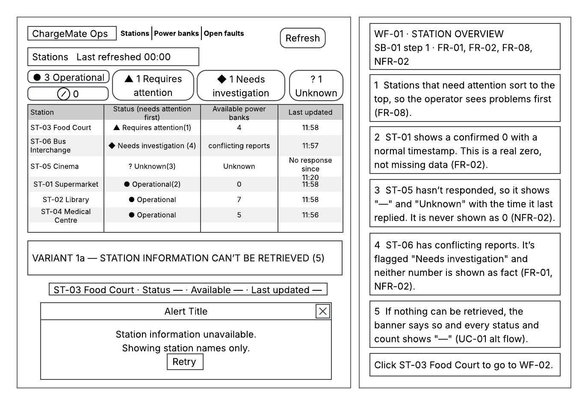
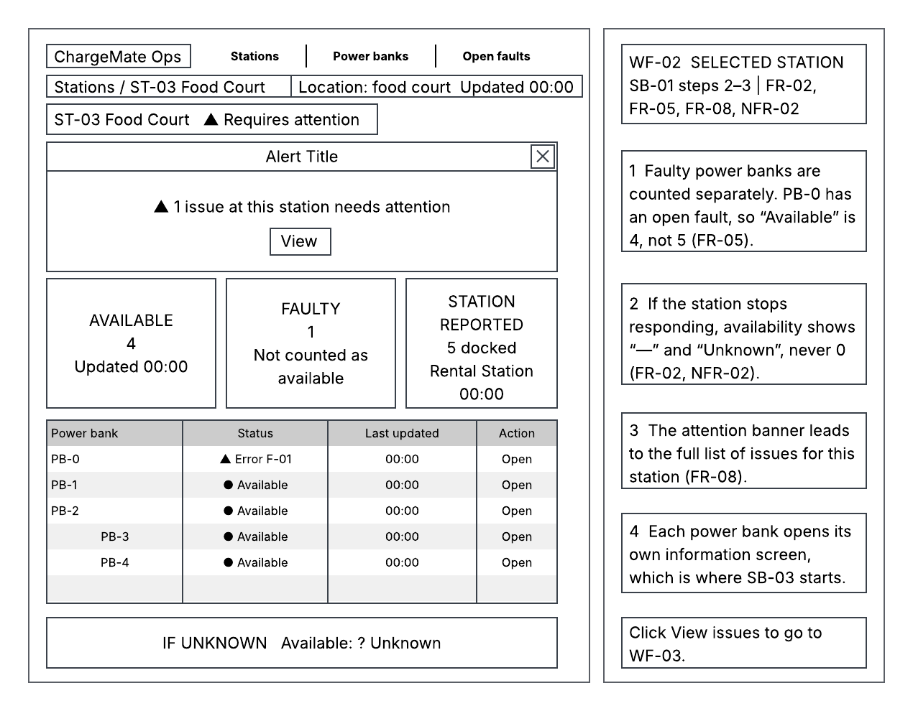
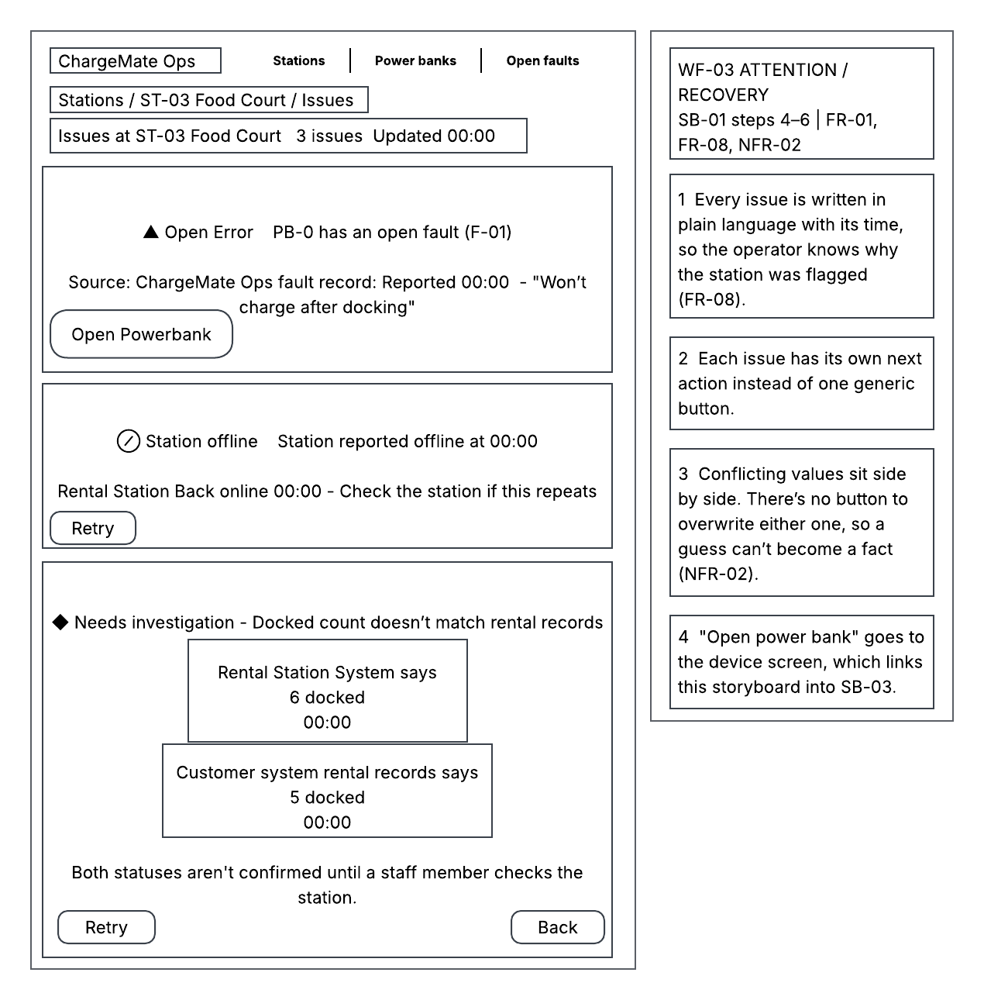
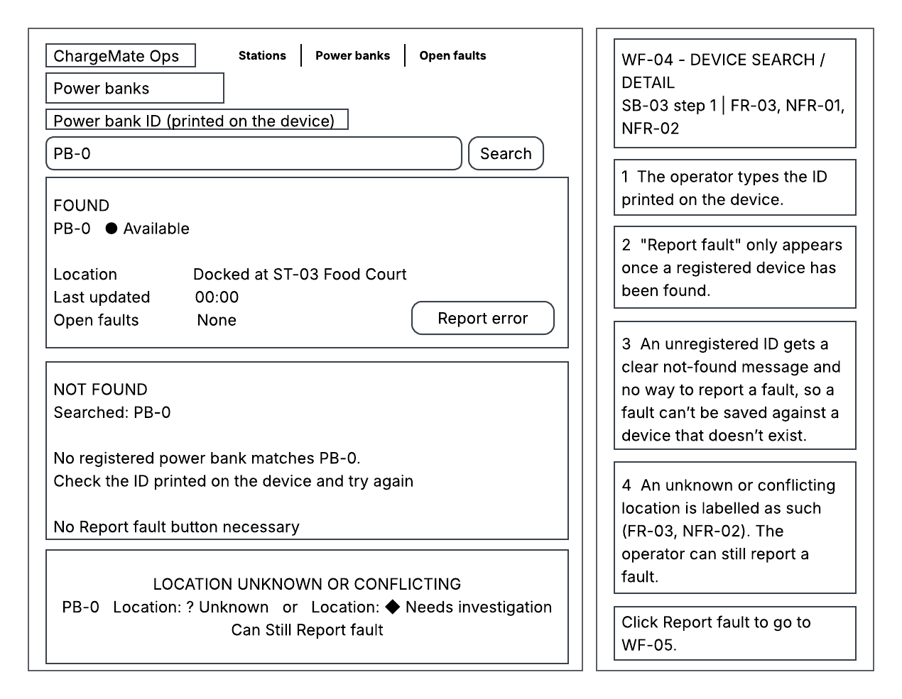
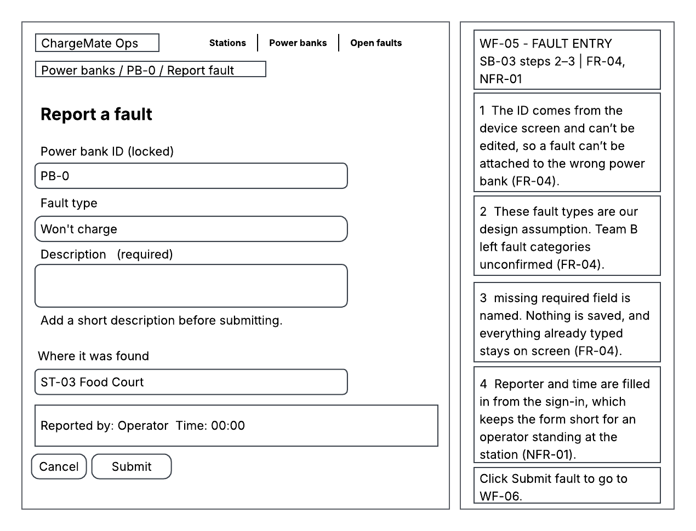
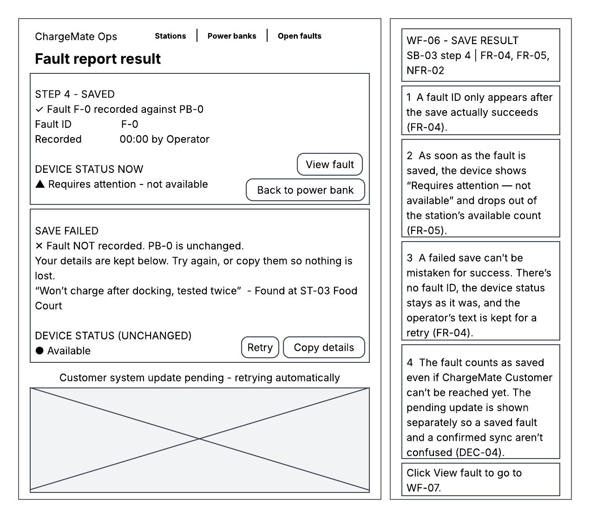
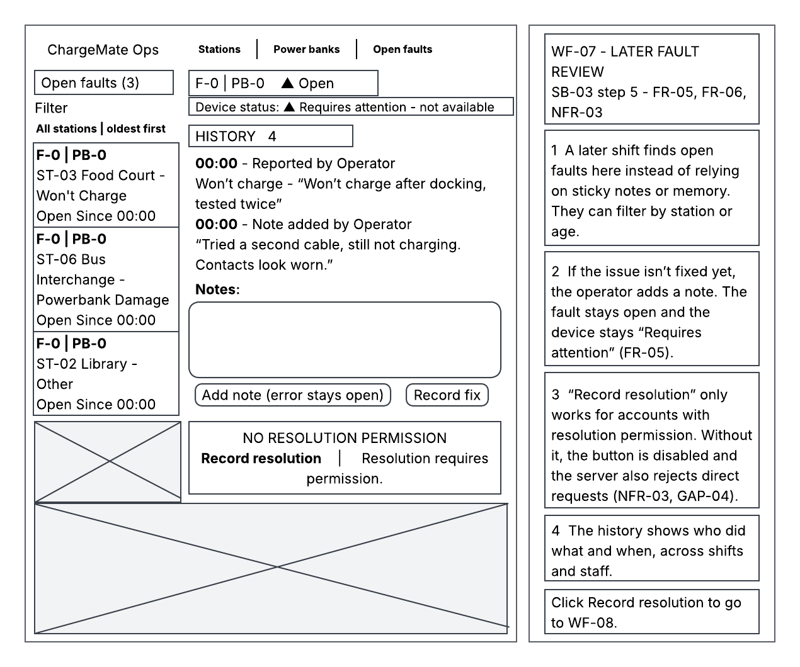
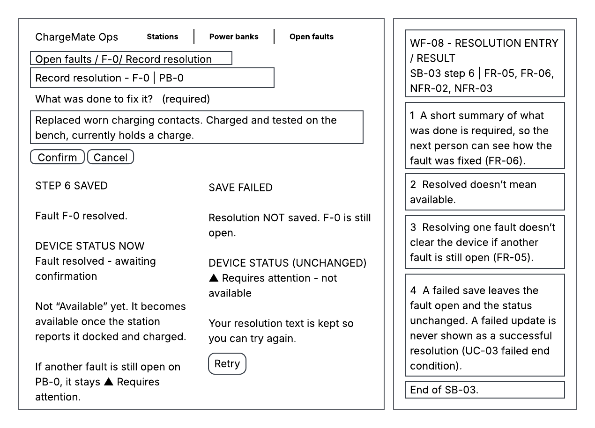
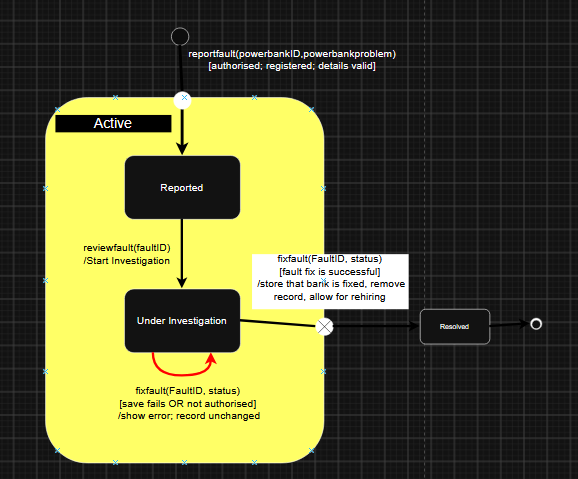

# ChargeMate Ops
## System Design Document (SDD) — COMP2050 Assignment 2

**Design team:** Group 3 — Team A  
**Requirements supplied by:** Group 3 — Team B    
**Date: 01/11/2026**   
**Document status:** Draft - Pending Review

| Team member | Student ID |
|---|---|
| Yousef | 48603090 |
| Harrison | [FILL] |
| Cooper  | 49067281 |
| Isaac  | [FILL] |

---

# Team working guide — remove before final PDF export

This is a ready-to-fill structure, not a completed submission. Replace every `[FILL]`, `[INSERT ...]` and other bracketed instruction. Remove author/reviewer prompts after review. Keep the completed academic content, genuine records, references and final figures.

**A2 project:** Team A is now designing **ChargeMate Ops**, using Team B's SRS. ChargeMate Customer is an external collaborating system.

**Suggested allocation:** Yousef and Harrison lead the technical decisions and final quality checks. Cooper and Isaac own complete, substantive deliverables, with review from the technical leads. These assignments are proposals, not evidence of a past team decision.

| Person | Primary sections | Concrete deliverables | Reviewer |
|---|---|---|---|
| Yousef | 1, 3, 4, 9.1–9.3, 10, 11, 13.1; coordinate 15 | Requirements/interface decisions; architecture and data strategy; trade-offs/concurrency; all 11 RTM rows; SRS reflection; overall document consistency | Harrison |
| Harrison | 6, 7, 8, 12; validate 13.3 and co-review 15 | Three state diagrams and guards; detailed test specifications and plan; check requirement/state/failure coverage; validate sprint analysis against real records | Yousef |
| Cooper | 2, 5 | Original vision; two actor descriptions; complete wireframes and numbered storyboards for UC-01 and UC-03, including failure/recovery screens; revise after review | Yousef checks requirements/UI behaviour; Harrison checks state/test consistency |
| Isaac | 9.4, 13.2–13.3, 14, Appendix; PDF assembly support | Maintenance/deployment strategy; actual A1/A2 tools comparison; collect and caption genuine sprint charts/snapshots; organise interaction records, references and formatting | Yousef reviews maintenance; Harrison reviews evidence and staff-report accuracy |
| Everyone | 13–15 and Appendix | Supply actual contributions, A1/A2 tool experience, sprint records, meeting/discussion evidence and review feedback | Whole team |

## Hand-offs and final checks

- **Yousef → everyone:** Agree the scope, component names, interface responsibilities and provisional assumptions first. Cooper and Isaac can draft in parallel while open decisions are clearly marked.
- **Harrison ↔ Yousef:** Cross-check architecture/data rules against state transitions, tests and the RTM. Resolve conflicting expectations together before final assembly.
- **Cooper → Yousef and Harrison:** Deliver the actual screen figures, actor descriptions and numbered storyboards. Include unknown/unavailable information, denied actions and failed saves. Cooper owns making the revisions identified in review.
- **Isaac → Yousef and Harrison:** Deliver a complete maintenance section and an organised evidence package with dates, captions and source links. Isaac drafts the tools/sprint narrative from actual records; Harrison checks that the interpretation matches those records.
- **Everyone → staff report:** Provide real examples of difficulties, decisions and changes in working method. Yousef writes the coherent SRS reflection from those inputs.
- **Final check:** Yousef checks scope, architecture, RTM and narrative consistency. Harrison checks state logic, test coverage and evidence accuracy. Cooper checks screen readability and storyboard completeness. Isaac checks references, captions, appendix organisation and PDF layout.

The staff report is worth 25 marks and the appendix 10, so the evidence and reflection need substantive review alongside the technical design. Record who actually authored, revised and reviewed each part; do not present the proposed allocation as completed work.

**Working rules**

- Work in the team's existing `a2docs` folder. Suggested main filename: `SDD.md`.
- Use real task/issue/commit/PR links when they exist. Keep review feedback with its actual date.
- Agree component IDs before writing other sections. Reuse the same names in every diagram, RTM row and test.
- Distinguish inherited requirements, provisional assumptions and agreed design decisions.
- A fault must exclude normal availability. Unknown availability is not confirmed zero. Failed saves must not appear successful. Physical movement needs confirmation before its new location is recorded. Fault resolution alone does not establish rental eligibility.
- Record genuine activity. Do not invent historical meetings, attendance, sprint progress, GitHub links, approvals or test results.
- This assessment asks for test **specifications and a plan**. Do not claim tests ran if they did not.
- Final deliverable: one professional PDF, **maximum 50 A4 pages including the appendix**. Aim for 48 pages. Each person also completes the individual contribution evaluation.

## Shared progress board

Fill this with the current position; blank fields are not evidence that work is complete.

| Deliverable | Owner | Current status | Actual draft/task link | Reviewer feedback link | Review date |
|---|---|---|---|---|---|
| Baseline, assumptions, architecture | Yousef | Reviewed | [Sections 1, 3 and 4](#1-project-scope-and-requirements-baseline) | [Review record](reviews/YOUSEF_SECTIONS_REVIEW.md) | 1 November 2026 |
| Vision and two storyboard/wireframe sets | Cooper | [FILL] | [FILL] | [FILL] | [FILL] |
| Three state diagrams | Harrison | [FILL] | [FILL] | [FILL] | [FILL] |
| Persistence, caching and data access | Yousef | Sections 9.1–9.3 reviewed; integration pending | [Sections 9.1–9.3](#91-persistent-data-strategy) | [Review record](reviews/YOUSEF_SECTIONS_REVIEW.md) | 1 November 2026 |
| Trade-offs and concurrent processes | Yousef | Reviewed; final test-ID links pending | [Section 10](#10-trade-offs-and-concurrent-processes) | [Review record](reviews/YOUSEF_SECTIONS_REVIEW.md) | 1 November 2026 |
| Maintenance and deployment | Isaac; Yousef reviews | [FILL] | [FILL] | [FILL] | [FILL] |
| RTM | Yousef | Mapping reviewed; actual test-ID links pending | [Section 11](#11-requirements-traceability-matrix) | [Review record](reviews/YOUSEF_SECTIONS_REVIEW.md) | 1 November 2026 |
| Test specifications and plan | Harrison | [FILL] | [FILL] | [FILL] | [FILL] |
| SRS reflection | Yousef; everyone supplies examples | Source/evidence reviewed; final team input pending | [Section 13.1](#131-reflection-on-using-the-received-srs) | [Review record](reviews/YOUSEF_SECTIONS_REVIEW.md) | 1 November 2026 |
| Tools comparison and sprint evidence | Isaac drafts/collects; Harrison validates | [FILL] | [FILL] | [FILL] | [FILL] |
| References and interaction appendix | Isaac coordinates; everyone supplies records; Harrison checks evidence | [FILL] | [FILL] | [FILL] | [FILL] |
| Final PDF and consistency review | Yousef + Harrison lead; Cooper + Isaac complete presentation checks | [FILL] | [FILL] | [FILL] | [FILL] |

**Yousef review record:** “Reviewed” identifies the assistant source/consistency check recorded on 1 November 2026 in [the review log](reviews/YOUSEF_SECTIONS_REVIEW.md). Assigned human reviewers remain listed separately. Open stakeholder questions, final test-ID links and cross-team integration are not closed by this status.

**Suggested page budget:** cover/contents 2; scope, vision and assumptions 3; remaining system design 13; RTM 4; tests 12; staff report/references 7; appendix 7. Total 48. Adjust to fit the actual material legibly.

---

# Contents

- [1. Project scope and requirements baseline](#1-project-scope-and-requirements-baseline)
  - [1.1 Purpose and intended audience](#11-purpose-and-intended-audience)
  - [1.2 System scope and boundary](#12-system-scope-and-boundary)
  - [1.3 Received baseline and source documents](#13-received-baseline-and-source-documents)
  - [1.4 Requirement reference list](#14-requirement-reference-list)
  - [1.5 Use-case baseline](#15-use-case-baseline)
- [2. Project vision](#2-project-vision)
- [3. Assumptions, clarification gaps and design decisions](#3-assumptions-clarification-gaps-and-design-decisions)
  - [3.1 Open clarification register](#31-open-clarification-register)
  - [3.2 Design assumptions](#32-design-assumptions)
  - [3.3 Proposed design decisions](#33-proposed-design-decisions)
- [4. System architecture and rationale](#4-system-architecture-and-rationale)
  - [4.1 Architecture overview](#41-architecture-overview)
  - [4.2 Component catalogue](#42-component-catalogue)
  - [4.3 Requirement-driven architecture rationale](#43-requirement-driven-architecture-rationale)
  - [4.4 External interface responsibilities](#44-external-interface-responsibilities)
  - [4.5 Example: recording a power bank fault](#45-example-recording-a-power-bank-fault)
- [5. User experience: two wireframe/storyboard sets](#5-user-experience-two-wireframestoryboard-sets)
  - [5.1 Storyboard SB-01 — UC-01 View Station Status](#51-storyboard-sb-01--uc-01-view-station-status)
  - [5.2 Storyboard SB-03 — UC-03 Report and Manage a Faulty Power Bank](#52-storyboard-sb-03--uc-03-report-and-manage-a-faulty-power-bank)
- [6. State diagram 1 — FaultRecord](#6-state-diagram-1--faultrecord)
- [7. State diagram 2 — TrackPowerBank](#7-state-diagram-2--trackpowerbank)
- [8. State diagram 3 — ViewStationStatus](#8-state-diagram-3--viewstationstatus)
- [9. Persistent data, caching and maintenance](#9-persistent-data-caching-and-maintenance)
  - [9.1 Persistent data strategy](#91-persistent-data-strategy)
  - [9.2 Caching and component data access](#92-caching-and-component-data-access)
  - [9.3 Backup, recovery and retention](#93-backup-recovery-and-retention)
  - [9.4 Maintenance, updates and deployment](#94-maintenance-updates-and-deployment)
- [10. Trade-offs and concurrent processes](#10-trade-offs-and-concurrent-processes)
  - [10.1 Important trade-offs](#101-important-trade-offs)
  - [10.2 Concurrent activities and race conditions](#102-concurrent-activities-and-race-conditions)
- [11. Requirements Traceability Matrix](#11-requirements-traceability-matrix)
- [12. Test specifications and test plan](#12-test-specifications-and-test-plan)
  - [12.1 Test approach and fixtures](#121-test-approach-and-fixtures)
  - [12.2 Test inventory](#122-test-inventory)
  - [12.3 Detailed test-case specifications](#123-detailed-test-case-specifications)
  - [12.4 Test plan](#124-test-plan)
- [13. Report to COMP2050 staff](#13-report-to-comp2050-staff)
  - [13.1 Reflection on using the received SRS](#131-reflection-on-using-the-received-srs)
  - [13.2 Tools, communication and changes from A1 to A2](#132-tools-communication-and-changes-from-a1-to-a2)
  - [13.3 Sprint allocations and GitHub burn-up evidence](#133-sprint-allocations-and-github-burn-up-evidence)
- [14. References and resources](#14-references-and-resources)
- [15. Final integration and submission checklist](#15-final-integration-and-submission-checklist)
- [Appendix A. Team interaction log and full records](#appendix-a-team-interaction-log-and-full-records)
  - [A.1 Interaction index](#a1-interaction-index)
  - [A.2 Full record template — duplicate for each actual interaction](#a2-full-record-template--duplicate-for-each-actual-interaction)
- [Appendix B. Evidence index and contributions](#appendix-b-evidence-index-and-contributions)
  - [B.1 Evidence index](#b1-evidence-index)
  - [B.2 Individual contributions supported by evidence](#b2-individual-contributions-supported-by-evidence)

**List of figures:** [ADD FINAL FIGURE NUMBERS, TITLES AND PAGE NUMBERS]  
**List of tables:** [ADD IF USEFUL]

---

# 1. Project scope and requirements baseline

**Owner: Yousef | Assigned peer reviewer: Harrison | Status: Reviewed**

## 1.1 Purpose and intended audience

This System Design Document describes how ChargeMate Ops can be implemented to support the power bank network at Harbour North Plaza. It translates the paired Team B's requirements into component responsibilities, information flows, data rules and verification links. Its intended readers are a development team planning implementation and project managers allocating and reviewing that work. The accompanying test specifications describe how the proposed behaviour would be verified; they do not report an existing implementation.

For Assignment 2, Group 3 Team A designs the operator-facing project specified by Team B. The earlier ChargeMate Customer SRS supplies external interface context. It does not replace the Ops requirements baseline. [SRC-01, Section 4; SRC-04]

## 1.2 System scope and boundary

ChargeMate Ops helps authorised staff inspect stations, find registered devices, record and resolve faults, identify recorded operational issues and record confirmed redistribution. Different demand patterns around the plaza make a shared operational view useful, but the system does not assume that every external observation is current or correct. Unknown, unavailable and conflicting information remain visible rather than being replaced with plausible values. [SRC-01, Sections 5–6; SRC-05]

| Inside ChargeMate Ops | External responsibility or boundary |
|---|---|
| Station status, available power bank information and recorded attention indicators | The Rental Station System supplies physical observations; a displayed status does not independently prove hardware health |
| Registered device lookup and available recorded location/status | No GPS or guaranteed continuous physical tracking is assumed |
| Fault recording, unresolved-fault exclusion and valid resolution | Physical inspection/repair is staff work; clearing a fault does not itself certify rental eligibility |
| Recording suitable devices' confirmed movement between registered stations | A planned destination is not a completed physical transfer; staff provide confirmation |
| Receiving and reconciling relevant operational/rental/return information | Exact Customer/station contracts remain subject to the clarification register |
| Protected staff operations | Customer registration, payment processing, prices, late-fee calculation and the customer kiosk journey remain outside Ops |

The primary actor is the **ChargeMate Operator**. The **Rental Station System** and **Customer-Facing ChargeMate System** are external collaborators. Other staff may investigate or repair a device, but the source does not establish a separate maintenance-system role. Authorisation is therefore expressed through permissions until a staff permission matrix is confirmed. [SRC-01, pp.5–6,14–15]

Rental release and return-confirmation ownership requires an explicit decision. Customer's SRS expects Ops-side confirmations and device release, while Ops' numbered FRs mainly describe operational records and views. This design provides an adapter boundary for those exchanges without silently allocating payment processing or hardware release control to Ops. [SRC-03, pp.7–12,15,23–24]

## 1.3 Received baseline and source documents

| Source ID | Source and version | Precise locator | Use in this design |
|---|---|---|---|
| SRC-01 | Team B, *ChargeMate Ops Software Requirements Specification*, supplied as `SRS (1).pdf`; cover v1.2, 12 September 2026 | Requirements/fit criteria pp.7–9; use cases pp.12–19; recorded open questions pp.30–37 | Primary behaviour and acceptance baseline |
| SRC-02 | Team B handover, `Untitled design (3).mp4`, duration approximately 8:01; recording date not established | Approximately 4:23–6:07: information quality, physical confirmation and unanswered questions; 6:23–7:49: more specific workflow claims | Explanation and discrepancy identification |
| SRC-03 | Group 3 Team A, *ChargeMate Customer SRS*, `Group3_TeamA_COMP2050.pdf`; change log through v1.5 dated 13 September 2026 | Dependencies and requirements pp.7–12; Customer–Ops Q&A pp.23–24; return/problem flows pp.17–19 | External expectations and allocation conflicts |
| SRC-04 | Supplied COMP2050 Assignment 2 instructions | System Design, RTM, Test Specifications and Staff Report headings | Deliverable structure and project swap |
| SRC-05 | Released Project B brief, repository copy | [Project B — ChargeMate Ops](https://github.com/comp2050-2026/Group-3---Team-A/blob/main/project-briefs/PROJECT_B_CHARGEMATE_OPS.md), Sections 2–4 | Plaza context and operator/customer boundary |

The supplied ChargeMate Ops SRS is the requirements baseline for this design. Additional or conflicting details in the handover video are recorded as clarification questions or clearly labelled design assumptions.

## 1.4 Requirement reference list

The baseline contains eight functional and three non-functional requirements. The following summaries preserve their design implications; the full requirement sentences and fit criteria remain in SRC-01, pp.7–9.

| ID | Requirement title | Acceptance consequence for the design |
|---|---|---|
| FR-01 | View Rental Station Status | Match latest available station information and identify unreliable information |
| FR-02 | View Power Bank Availability | Match available records; unknown is not a confirmed count; unresolved faults exclude normal availability |
| FR-03 | Track Individual Power Bank | Match a unique registered ID; not-found, unknown location and conflicting data have distinct outcomes |
| FR-04 | Record Power Bank Fault | Validate and save against the correct device; report missing details and failed saves |
| FR-05 | Identify Faulty Power Banks | Any unresolved fault keeps the device visibly requiring attention and excluded from normal availability |
| FR-06 | Resolve Power Bank Fault | Store a valid resolution and update the associated fault/device view |
| FR-07 | Support Power Bank Redistribution | Record suitable devices' confirmed movement and new station; exclude faulty/unavailable candidates |
| FR-08 | Identify Operational Issues | Distinguish recorded attention conditions from normal operation |
| NFR-01 | Usability | Ordinary staff tasks use visible controls without database/command-line intervention |
| NFR-02 | Operational Data Reliability | Do not display assumed values as confirmed; expose unavailable, unknown and conflicting information |
| NFR-03 | Security and Access Control | Deny unauthorised operational access; allow only permitted actions |

`FR-xx` refers to Ops throughout this document. A Customer requirement is prefixed `Customer.FR-xx` to prevent collisions between the two SRS numbering schemes.

## 1.5 Use-case baseline

| Source use case | Design interpretation | Source |
|---|---|---|
| UC-01 — View Station Status | Open monitoring, inspect available station information, select a station and recognise unavailable/conflicting/attention conditions | SRC-01 pp.12–13; Figure 3 p.16 |
| UC-02 — Track a Power Bank | Search a unique ID and inspect available status/location; distinguish missing ID from unknown location and conflicting observations | SRC-01 pp.13–14; Figure 4 p.17 |
| UC-03 — Report and Manage a Faulty Power Bank | Identify device, validate/save a fault, preserve exclusion and later record a permitted resolution; failed updates do not count as success | SRC-01 pp.14–19; Figure 5 p.18 |
| Supporting redistribution scenario | Select candidate/source/destination, revalidate suitability, confirm physical movement and commit the new recorded location | FR-07; overall model p.11 and historical UC-04 discussion pp.36–38 |
| Supporting issue-view scenario | Inspect the attention indicators generated by recorded faults, unavailable stations and inconsistent information | FR-08 and UC-01/02/03 failure/alternative branches |

Redistribution is required despite not having a fourth complete detailed use case in the final SRS. The supporting scenarios above are design elaborations. A successful return, a fault resolution and a rental-ready device are treated as different facts.

# 2. Project vision

**Owner: Cooper | Reviewer: Yousef | Status: Review Pending**

ChargeMate Ops gives the staff running the Harbour North Plaza pilot program one place they can trust to see the state of every rental station and power bank, and to act on whatever needs attention or change. With ChargeMate Ops, an operator can see which stations are running normally, which need attention, and where the system doesn’t have reliable information. They can also follow and track a single power bank from the moment an issue is reported, all the way through to a resolution is recorded, even across different shifts and staff. Our design treats data transparency as a core feature. The system will never present a guess as a fact, never present a failed save as a success, and never show a faulty power bank as available for rental or redistribution. The outcome we are designing for is a pilot in which issues are found by staff before customers find them, and staff members record problems that can be reviewed between shifts. 

[FILL: Write one original paragraph describing the value, intended staff users and operational outcome of your proposed ChargeMate Ops implementation. Do not copy Team B's vision statement.]

# 3. Assumptions, clarification gaps and design decisions

**Owner: Yousef | Assigned peer reviewer: Harrison | Input: everyone | Status: Reviewed; clarification gaps remain open**

This section distinguishes missing information from proposed implementation choices. A **clarification gap** is an unanswered question in the supplied material. A **design assumption** is a provisional condition used to continue planning. A **design decision** selects an approach and explains why it fits the requirements. Neither assumptions nor proposed decisions represent stakeholder approval.

## 3.1 Open clarification register

The SRS explicitly leaves several operational and integration details open. The following register identifies their effect on this design and the proposed handling while clarification is pending. Source labels refer to the documents listed in Section 1.3. No additional stakeholder response is recorded in this draft.

| Gap ID | Unanswered question and source | Affected requirements | Provisional handling | Status |
|---|---|---|---|---|
| GAP-01 | Which fields are exchanged between Ops, stations and Customer, which system owns them, and how quickly must updates arrive? [SRC-01, pp.5,30,33,37] | FR-01, FR-02, FR-03, NFR-02 | Define explicit interface fields and ownership; retain source/time information and show unavailable or conflicting values. Do not promise a numerical refresh interval. | Open — interface and update expectations need agreement |
| GAP-02 | Who authorises rentals, controls device release and confirms returns? Customer expects Ops-side actions that are not fully specified by Ops' numbered requirements. [SRC-03, pp.7–12,15,23–24; SRC-01, pp.7–9] | Cross-system allocation; FR-02, FR-03 | Keep an integration boundary for the exchanges. Do not silently add payment processing or an unconfirmed release controller to Ops. | Open — responsibilities must be allocated explicitly |
| GAP-03 | What makes a device sufficiently charged and available, and how are exact counts and return capacity determined? [SRC-01, pp.7–8,30–31,37; SRC-03, pp.8,23] | FR-02, FR-05, FR-07 | Keep charge, physical presence, rental occupancy and unresolved faults as separate facts. Missing eligibility information is not treated as confirmed suitability or a confirmed zero count. | Open — eligibility and capacity definitions needed |
| GAP-04 | What exact station/device statuses and fault fields are required, and who may resolve faults? [SRC-01, pp.31,37] | FR-01, FR-03, FR-04, FR-06, NFR-03 | Use the provisional fault fields in ASSUMP-03 and check permission for each protected action. Do not invent a separate staff role or fixed category/priority list. | Open — data dictionary and permission rules needed |
| GAP-05 | What happens if a movement's destination becomes unavailable, another operator changes the device, or physical movement occurs but recording fails? [SRC-01, pp.8,32] | FR-07, NFR-02 | Recheck suitability when recording completion. Require physical confirmation; preserve contradictory movement evidence for investigation instead of presenting an uncertain location as confirmed. | Open — capacity and reconciliation rules needed |
| GAP-06 | Which conditions generate automatic alerts, with what priorities and resolution process? [SRC-01, p.32] | FR-08 | Display recorded issues and attention indicators. Add automatic thresholds, notifications or recommendations only when their rules are established. | Open — automatic alert scope not confirmed |
| GAP-07 | How should the video's real-time telemetry, automatic dock blocking and restored-availability claims be reconciled with the written SRS? [SRC-02, approximately 6:23–7:49; SRC-01, pp.18–19,33] | FR-01, FR-03, FR-05, FR-06, NFR-02 | Use latest-available information. Keep faulty devices excluded locally; external blocking requires an agreed contract. Resolving a fault alone does not establish charge, physical presence or rental eligibility. | Open — conflicting handover details need clarification |
| GAP-08 | What performance, availability, backup, retention and recovery targets must the implementation meet? The numbered SRS gives qualitative fit criteria without these numerical targets. [SRC-01, pp.7–9] | NFR-01, NFR-02, NFR-03; operational planning | Specify failure/recovery mechanisms and testable qualitative behaviour. Record proposed numerical targets separately for agreement rather than presenting them as inherited requirements. | Open — operational targets needed |

These gaps do not remove confirmed behaviour. For example, FR-07 already requires confirmed physical movement and excludes faulty/unavailable candidates; only the additional capacity and exception rules remain unresolved. Similarly, FR-08 requires visibility of recorded issues even though automatic alert rules are open.

## 3.2 Design assumptions

The following assumptions make the proposal concrete while exposing what would need to change if they are incorrect. They are provisional planning assumptions, not extra requirements attributed to Team B.

| Assumption ID | Provisional assumption | Reason for using it | Risk if incorrect / required change | Affected area and validation status |
|---|---|---|---|---|
| ASSUMP-01 | Authorised staff can access a supported browser and network connection for normal operational tasks. | Provides a common staff interface without assuming a separate installed mobile or desktop application. | If tasks must work without connectivity or on restricted devices, the interface/deployment approach must be revised. | NFR-01, NFR-03; device/connectivity context unconfirmed |
| ASSUMP-02 | Registered station/device identities and authorised staff identities are supplied through an agreed setup process. | The SRS assumes registered unique identities and authorised access, but does not specify registration/account-administration screens. [SRC-01, p.6] | Agree a provisioning/import process before implementation; do not assume missing registration features already exist. | FR-01–FR-07, NFR-03; provisioning mechanism open |
| ASSUMP-03 | Fault creation requires the registered device ID and a non-empty fault description. Resolution requires a resolution note and an operator permitted to resolve that fault. | Gives concrete provisional validation rules for the SRS's requirement to save valid fault information against the correct device. | Stakeholders may require different/additional fields; update forms, validation and tests together. | FR-04, FR-06, NFR-03; fields and permission assignments open |
| ASSUMP-04 | A device may have multiple independent fault records. It remains excluded from normal availability while any fault is unresolved. | Prevents resolving one issue from hiding another unresolved issue. | If only one active fault record is permitted, revise the workflow/schema while preserving unresolved-fault exclusion. | FR-04–FR-06; multiple-fault policy unconfirmed |
| ASSUMP-05 | External sources can supply stable event identifiers and ordering information, such as a source revision, where automated deduplication/ordering is needed. | Allows repeated or late updates to be recognised without relying only on arrival time. | If ordering cannot be established, retain conflicting evidence for investigation rather than automatically treating the last arrival as correct. | FR-01–FR-03, NFR-02; external contract open |

No numerical charge threshold, refresh deadline, low-stock trigger or recovery target is assumed. Unique device IDs also do not imply GPS tracking: the design uses available recorded location information, including an explicit unknown/investigation outcome where required.

## 3.3 Proposed design decisions

The following choices were drafted on **1 November 2026** and have received the source/consistency review recorded in the working review log. They remain provisional where clarification or stakeholder confirmation is open. This date does not represent a previous meeting or stakeholder agreement. Section 4 shows their architectural effect; Sections 9–11 carry the data and traceability implications. Detailed tests and the final state diagrams must remain consistent with them.

| Decision ID | Proposed choice and alternative | Rationale | Requirement / gap link | Status |
|---|---|---|---|---|
| DEC-01 | Use a staff web interface, a modular backend and a PostgreSQL relational database. Alternative: separately deployed services for each business feature. | Fault, device and movement updates are closely related. A shared transaction boundary simplifies consistent updates while named modules keep responsibilities clear. | FR-04–FR-07, NFR-01; ASSUMP-01 | Proposed — reviewed for internal consistency; deployment choice remains a design proposal |
| DEC-02 | Store fault state, physical location, charge/occupancy facts and information quality separately. Alternative: one combined device-status flag. | A device can be at a known station while faulty or insufficiently charged. One cleared fault must not imply every other eligibility condition is satisfied. | FR-02, FR-03, FR-05, FR-06, NFR-02; GAP-03/04 | Proposed — detailed state dictionary pending |
| DEC-03 | Check permissions on the backend for every protected request, and recheck the relevant device/record version when a change is saved. Alternative: trusting a visible UI control and previously loaded data. | Prevents unauthorised direct requests and changes based on outdated suitability information. | NFR-03, FR-05, FR-07; GAP-04/05 | Proposed — permission assignments pending |
| DEC-04 | Save a pending outgoing-update record with the local business change, then deliver/retry it separately. Alternative: require an external response before recognising local save success. | A saved fault should remain durable when Customer is unreachable. Local success and confirmed external synchronisation must be distinguishable. | FR-04–FR-06, NFR-02; GAP-01/07 | Proposed — outgoing contract pending |
| DEC-05 | Use database-backed operational views without a separate business-data cache or offline browser write queue initially. Alternative: additional cached copies and queued offline changes. | Reduces inconsistent copies and stale management commands for the pilot. The UI can refresh, while the backend remains responsible for validating changes. | NFR-02, FR-05, FR-07; ASSUMP-01 | Proposed — revisit if measured workload or offline needs justify it |
| DEC-06 | Implement recorded-issue visibility first; introduce automatic alerts/recommendations only with defined rules. Alternative: invent alert thresholds or predictive features. | Meets the confirmed operator need without expanding an unspecified rule set. | FR-08; GAP-06; SRC-05, Section 3 | Proposed — automatic alert rules remain open |

Changes to a decision must update the affected diagrams, data rules, RTM and tests together. Once a question is answered or a decision reviewed, record the actual response/review evidence and date; an open item should not be marked agreed solely because a plausible design has been written.

# 4. System architecture and rationale

**Owner: Yousef | Assigned peer reviewer: Harrison | Status: Reviewed**

## 4.1 Architecture overview

The proposed system has three layers: an operator web interface, a modular application backend and a PostgreSQL operational database. Staff use the browser interface to monitor stations, search devices, manage faults and confirm redistribution. The backend checks permissions and applies the operational rules before reading or changing stored information. The database holds the persistent records used by these functions. This implements DEC-01 and the browser-access assumption in Section 3.

The backend separates responsibilities into named modules, but they form one application rather than independently deployed business services. This allows related fault, device and movement changes to be recorded in one database transaction. A transaction commits its related changes together or leaves them unsaved if it fails. External exchanges use a dedicated integration module and delivery worker so that station/Customer communication does not bypass the same operational rules.

**Figure ARCH-01.** The operator, Rental Station System and Customer-Facing ChargeMate System are outside the Ops software boundary. C-UI and C-AUTH lead into four domain modules: C-MON, C-DEV, C-FAULT and C-MOVE. Domain modules use C-DB for persistent information. C-INT validates incoming external information, routes it through domain rules and delivers recorded outgoing updates. Solid arrows show logical requests/data relationships; the dashed Customer connection identifies an exchange whose detailed contract remains provisional. The diagram does not allocate customer payments or imply automatic hardware control. The editable source is [ARCH-01.drawio](diagrams/ARCH-01.drawio), for [diagrams.net (draw.io)](https://app.diagrams.net/). PNG and SVG exports are included for report assembly.

The plaza pilot does not establish a need for separate deployment of each business function. A modular backend provides clear responsibilities while keeping device/fault/movement consistency within one transaction boundary. The trade-off is a shared application release and database dependency. Keeping module boundaries explicit supports later change without requiring distributed business services at this stage.

## 4.2 Component catalogue

`C-` identifies a component in this design. The component names and grouping are proposed design choices derived from Team B's required functions. Reuse these IDs when referring to components in the RTM, test specifications and diagrams. State diagrams model objects managed by the components and can use object names rather than component labels.

| Component | Responsibility | Main exchanges | Requirements supported |
|---|---|---|---|
| C-UI — Operator Web Interface | Presents station/device views, fault/resolution forms, movement confirmation and clear attention/recovery messages. Distinguishes unknown, unavailable and confirmed information. | Operator actions → backend requests; results and quality information → screens | FR-01–FR-08, NFR-01, NFR-02 |
| C-AUTH — Staff Access Control | Establishes staff identity and checks whether each requested action/resource is permitted. Access is denied when permission cannot be established. | Staff identity, requested action and target → allow/deny decision | NFR-03; all protected operational functions |
| C-MON — Station Monitoring | Combines accepted station observations with device/fault information to present station status, availability and recorded attention conditions. | Station query → summary/detail; uses C-DEV and C-FAULT information | FR-01, FR-02, FR-08, NFR-02 |
| C-DEV — Device Registry | Looks up registered device IDs and maintains available recorded location, operational facts and record versions. | Device ID → device details, not-found or investigation outcome | FR-03; identification/location support for FR-02, FR-04–FR-08 |
| C-FAULT — Fault Management | Validates and saves faults/resolutions. Preserves exclusion while any recorded fault remains unresolved. | Device-linked fault/resolution → saved record or explicit rejection/failure; exclusion information → other modules | FR-04, FR-05, FR-06, FR-08 |
| C-MOVE — Redistribution Management | Identifies suitable candidates, checks registered source/destination and records confirmed physical movement. Rechecks suitability/current record before completion. | Device, stations and physical confirmation → recorded movement/new location or conflict/failure | FR-07; affects FR-02, FR-03, FR-05 |
| C-INT — Integration and Reconciliation | Checks external source identity and message structure, recognises duplicates/ordering where supported, and preserves conflicting information for investigation. Delivers pending outgoing updates. | Station/Customer records → domain modules; committed outgoing records → agreed external recipient | FR-01–FR-03, FR-08, NFR-02; agreed fault/status exchange |
| C-DB — Operational Store | Persists registered stations/devices, faults, movements, observations, versions and integration processing records with integrity constraints. | Protected backend queries/transactions → committed data or rolled-back result | Persistent support for FR-01–FR-08 and NFR-02 |

C-MON obtains device and unresolved-fault information through domain query functions. C-MOVE uses C-DEV and C-FAULT checks before recording movement. C-FAULT and C-MOVE coordinate changes through the same device record/version. Sharing a database does not allow one module to ignore another module's business rules.

External systems do not access C-DB directly. C-INT authenticates/authorises external exchanges under the agreed service policy and sends accepted changes through domain operations. Its worker may read pending outgoing records and record delivery outcomes, but it cannot independently declare a faulty device eligible. Detailed storage, locking and retry rules are addressed in Sections 9–10.

## 4.3 Requirement-driven architecture rationale

| Requirement / concern | Design response | Reason and limitation |
|---|---|---|
| NFR-01 — Usability | C-UI follows monitoring, device lookup and fault-management tasks with visible controls and clear results. | Staff should not need direct database access or command-line tools for ordinary tasks. The actual screens and representative-user checks must still demonstrate this. |
| NFR-02 — Operational Data Reliability | C-INT preserves source/time information; C-MON/C-DEV expose unknown, unavailable and conflicting facts. | Missing information is not converted into zero or normal operation. A timestamp does not establish an unsupported freshness guarantee. |
| NFR-03 — Security and Access Control | C-AUTH checks protected requests on the backend; C-INT restricts service exchanges. | Hiding a button is insufficient protection. Permission assignments remain provisional, but denied requests must not change operational records. |
| FR-04–FR-06 — Fault lifecycle | C-FAULT and C-DEV use a shared transaction boundary and derive exclusion from unresolved faults. | A failed save cannot count as a successful resolution or leave a partially updated device view. Resolving one fault does not clear another. |
| FR-07 — Confirmed redistribution | C-MOVE checks suitability, expected device version and physical confirmation at completion. | Selecting a destination does not itself establish a new physical location. Conflicting reports require investigation. |
| GAP-01/02/07 — External boundary | C-INT isolates field mapping and communication from the core modules. | The design can describe provisional exchanges without treating unconfirmed rental-control or dock-blocking behaviour as an inherited requirement. |

The access-control approach follows the principles of least privilege, denial by default and permission checks on every request described in the [OWASP Authorization Cheat Sheet](https://cheatsheetseries.owasp.org/cheatsheets/Authorization_Cheat_Sheet.html). The ability to coordinate short record-changing transactions using row locks is documented in [PostgreSQL 18: Explicit Locking](https://www.postgresql.org/docs/18/explicit-locking.html). These sources support implementation choices; they do not supply ChargeMate business requirements.

## 4.4 External interface responsibilities

The following exchanges are proposed for implementation planning under the assumptions in Section 3. They describe intended responsibilities and minimum information, rather than an existing deployed API. Exact field formats, source ownership and timing remain identified gaps; the proposed approach allows the design to proceed without claiming external approval.

| Exchange | Direction and proposed information | Processing / failure behaviour | Responsibility and assumption |
|---|---|---|---|
| Station observations | Rental Station System → C-INT: station/device identifiers, observation time, available status/location/availability facts, event ID and source revision where supplied | Validate source and registration; preserve missing fields; record conflicts rather than overwrite contradictory facts blindly | Stations supply physical observations. Charge/capacity semantics and ordering support remain GAP-01/03 and ASSUMP-05. |
| Rental/return facts | Customer → C-INT: event ID, device ID, station ID where applicable, event type/time and source revision where available | Route accepted facts through C-DEV/domain rules; repeated or late input cannot silently erase newer or conflicting evidence | Customer supplies its recorded rental/return information. This exchange does not itself define who authorises release or confirms physical docking. |
| Operational changes | C-INT → agreed Customer/station recipient: entity ID, changed operational facts, local revision and event ID | Save the pending outgoing update with the business change; retry delivery separately and distinguish pending from acknowledged delivery | Ops owns its recorded fault/movement changes. Remote exclusion/blocking requires the recipient's agreed handling; local success alone does not prove it happened. |
| Operational information requests | Agreed external caller → C-INT: permitted station/device query; response includes accepted values and quality/source/time information | Apply service access checks; return unknown/unavailable/conflicting information explicitly | Share only the fields needed by the agreed interface. Exact-count/return-capacity ownership remains GAP-01/03. |

For this proposal, physical docking/release hardware remains part of the external Rental Station System, and customer accounts, prices and payment processing remain with the customer-facing system. Ops manages its operational records and views. The software route for rental authorisation/release commands and return acknowledgements remains GAP-02; it is not silently implemented by the fault or redistribution modules. No payment credentials or customer card data are needed in the proposed operational exchanges.

### Consistent command results

Protected record-changing requests carry the target identifier, expected record version and a unique operation ID. The backend returns a consistent outcome: **committed**, **validation rejected**, **not found**, **access denied**, **version conflict** or **save failed**. A committed result includes the saved record ID and new version. For a command that committed, an authorised repeat with the same requesting identity, operation ID and input returns its saved committed result without another change; conflicting reuse of an existing ID is rejected. Rejected or rolled-back requests are not stored as successes. These are proposed interface conventions for aligning screens, state diagrams and tests.

## 4.5 Example: recording a power bank fault

1. The operator finds a device through C-UI. C-AUTH checks access, and C-DEV returns the registered device information.
2. The operator submits fault details for that selected device. C-AUTH checks permission to record the fault.
3. C-FAULT validates the details and coordinates with C-DEV/C-DB to save the fault, update the device version and record any pending outgoing update together.
4. C-UI shows success only after the save commits. C-DEV/C-MON/C-MOVE use the unresolved-fault rule so the device is visibly requiring attention and is not normally available or a suitable movement candidate.
5. C-INT delivers the outgoing status update under the proposed contract. If delivery fails temporarily, the saved fault remains active and external synchronisation remains pending.

This example shows why the interface, permissions, business modules, database and integration worker have separate responsibilities while preserving one consistent operational result.

# 5. User experience: two wireframe/storyboard sets

**Owner: Cooper | Reviewers: Yousef for requirements/UI behaviour; Harrison for state/test consistency | Status: Review Pending **

## 5.1 Storyboard SB-01 — UC-01 View Station Status

**Actor:** ChargeMate Operator. An authorised staff member on shift who looks after the day-to-day running of the power bank network at Harbour North Plaza. They know the centre and where each station is, but they aren't technical and shouldn't need database access or commandm line tools (NFR-01). A usual time they use this is at the start of a shift, or just before a busy period like the food court lunch rush, when they want to quickly see which stations are free of faults, which need someone to check them, and where the system doesn't have reliable information. They could be at a desk or walking around the centre, so the screens are designed to work on a desktop or tablet (ASSUMP-01).

**Preconditions:** The operator is signed in and authorised to view station information (NFR-03). The stations are registered in ChargeMate Ops (SRC-01 A01).

**Requirements:** FR-01, FR-02, FR-05, FR-08, NFR-01, NFR-02, NFR-03

### SB-01 Wireframes

*Figure 5.1.2 — WF-01 Station overview.*

*Figure 5.1.3 — WF-02 Selected station.*

*Figure 5.1.4 — WF-03 Attention / recovery view.*

## 5.2 Storyboard SB-03 — UC-03 Report and Manage a Faulty Power Bank

**Actor:** ChargeMate Operator, the same staff member described in SB-01. They've either found a power bank that won't charge or is damaged, or been told about one through the customer reporting system. They're usually standing at the station holding the device, so the fault form needs to be short and quick to fill in. Finding a resolution for the fault usually happens later, often in a different shift and by a different staff member, once the device has been looked at. Team B's SRS says resolution is done by "an operator authorised for the action" but doesn't confirm a separate role (SRC-01 §7.3.3), so we treat resolving a fault as a permission that can be given to any operator account rather than a separate actor (GAP-04, ASSUMP-03).

**Preconditions:** The operator is signed in and has permission to record faults (NFR-03). The power bank is registered with a unique ID (SRC-01 A02).

**Requirements:** FR-03, FR-04, FR-05, FR-06, FR-08, NFR-01, NFR-02, NFR-03

### SB-03 Wireframes

*Figure 5.2.1 — WF-04 Device search / detail.*

*Figure 5.2.2 — WF-05 Fault entry.*

*Figure 5.2.3 — WF-06 Save result.*

*Figure 5.2.4 — WF-07 Delayed error review.*

*Figure 5.2.5 — WF-08 Resolution entry / result.*

# 6. State diagram 1 — FaultRecord

**Owner: Harrison | Reviewer: Yousef | Cooper checks the related screen behaviour | Status: [FILL]**

The object choice is proposed. If replaced, choose another object with meaningful states and update the contents and links.

**Object and purpose:** FaultRecord Represents a reported fault against a submitted power bank. It tracks when the faulty record was submitted, and what is wrong with it.
**Requirements/use cases:** UC-03 – Report and Manage a Faulty Power Ban, FR-04, FR-05, FR-06, FR-07, FR-08
**Figure SD-01:** 

| Current state | Event | Guard / condition | Action | Next state | Related test |
|---|---|---|---|---|---|
| Initial | reportfault(powerbankID, powerbankproblem) | Power bank is registered, details are valid | Create record for the power bank, mark it as faulty | Active -> reported | [FILL] |
| Reported | reviewfault(FaultID) | fault exists | record that the fault is under investigation | Reviewing | [FILL] |
| Under-Investigation | fixfault(FaultID, status) | fault fix is successful | store that bank is fixed, remove record, allow for rehiring | Resolved | [FILL] |
| Under-Investigation | fixfault() | save fails | show error, leave record unchanged | Under-Investigation | [FILL] |
| Under-Investigation | fixfault() | reviewer has improper access | show error, leave record unchanged | Under-Investigation | [FILL] |
| Resolved | None | None | None | FinalState | n/a |

**Valid Creation**: Only an authorised person can report that a fault has been created/fixed. it is then flagged as needing repairs, and that the repair is active.
**Unresolved Investigation**: The record stays active when an error occurs, leaving the data untouched so it can be successfully resolved
**Successfull Resolution**: The authorised user submits the fixed fault, and the save succeeds. the records are resolved and the device status is updated to reflect this.
**Failed Save**: If the save fails, the record of the fault remains active, and no further data is saved. The failure isnt treated as a resolution to the fault.
**Unauthorised Resolution**: the resolution is denied, and the record remains active.

# 7. State diagram 2 — TrackPowerBank

**Owner: Harrison | Reviewer: Yousef | Coordinate the movement/data rules with section 9 | Status: [FILL]**

**Object and purpose:** Powerbank tracking status. represents the data that ChargeMate Ops can see about the location of a power bank, seperating known location, and information that needs to be investigated.
**Requirements/use cases:** [FILL]  
**Figure SD-02:** [INSERT UML STATE DIAGRAM]

| Current state | Event | Guard / condition | Action | Next state | Related test |
|---|---|---|---|---|---|
| [FILL] | [FILL] | [FILL] | [FILL] | [FILL] | [FILL] |
| [FILL] | [FILL] | [FILL] | [FILL] | [FILL] | [FILL] |

[FILL: Distinguish selecting/planning a movement from confirming physical movement and successfully recording completion. Handle faulty/unavailable devices, competing updates and failed recording after a physical move. Mark capacity/in-transit policies as assumptions where not agreed.]

# 8. State diagram 3 — ViewStationStatus

**Owner: Harrison | Reviewer: Yousef | Cooper checks the related screen behaviour | Status: [FILL]**

**Object and purpose:** [FILL]  
**Requirements/use cases:** [FILL]  
**Figure SD-03:** [INSERT UML STATE DIAGRAM]

| Current state | Event | Guard / condition | Action | Next state | Related test |
|---|---|---|---|---|---|
| [FILL] | [FILL] | [FILL] | [FILL] | [FILL] | [FILL] |
| [FILL] | [FILL] | [FILL] | [FILL] | [FILL] | [FILL] |

[FILL: Distinguish reliable available information, unknown, unavailable and inconsistent information. Keep information quality separate from physical device/station health. Do not invent a freshness deadline.]

# 9. Persistent data, caching and maintenance

**Owners: Yousef for 9.1–9.3; Isaac for 9.4 | Reviewers: Harrison for data strategy; Yousef for maintenance | Status: Sections 9.1–9.3 reviewed; 9.4 pending**

## 9.1 Persistent data strategy

C-DB is the proposed server-side PostgreSQL database for Ops' durable operational records. These records must remain available between staff sessions rather than exist only in a browser screen. A relational database fits the linked station, device, fault and movement records and the need to save related changes together. This follows DEC-01–DEC-04; PostgreSQL is a design choice, not a technology required by the SRS.

The backend accesses C-DB after the relevant access and validation checks. C-UI and external systems have no direct database access. C-INT submits incoming operational facts through the domain modules; its delivery worker accesses integration processing records without bypassing fault or movement rules. Registered station/device IDs and staff identity references depend on the agreed setup process in ASSUMP-02; this does not add unrequested registration screens.

The following is a proposed logical data model. Field names describe the intended information, rather than a completed database schema. All records listed are stored in C-DB.

| Entity / record | Main information and relationships | Responsible component / access | Integrity rule |
|---|---|---|---|
| Station | Unique station ID, location description, record version; linked station observations | C-MON reads; agreed setup process supplies registration; C-INT routes observations | Only registered stations are referenced by completed movements. Missing status, capacity or availability is not stored as a confirmed normal or zero value. |
| PowerBank | Unique device ID, record version, last confirmed station where known; links to separate location, charge and occupancy facts | C-DEV coordinates changes; other domain modules request its information | Preserve the difference between last recorded location and reliable current location. An unknown station is not replaced with an invented location. |
| FaultRecord | Fault ID, device ID, description, unresolved/resolved condition, investigation progress where used, reporting actor/time, resolution note and resolving actor/time, version | C-FAULT writes; C-MON/C-DEV/C-MOVE use its fault information | Each fault references a registered device. Apply ASSUMP-03 validation; any remaining unresolved fault continues to exclude normal rental availability and redistribution suitability. |
| RedistributionJob | Movement ID, device and source/destination station IDs, lifecycle state, expected device version, physical confirmation and actor/time | C-MOVE writes; C-DEV/C-MON read committed effects | A plan is not completed movement. Completion and the recorded destination change must be saved together. Movement completion follows the transaction rules below and concurrency guards in Section 10.2. |
| Observation / information quality | Entity and field, supplied value, source identity, event ID/revision where available, observation time, received time, quality and conflicting evidence | C-INT validates/routes; C-DEV/C-MON accept and present operational facts | Keep source evidence separate from accepted values. Arrival time alone does not establish which conflicting report is correct. Field-level quality and presentation follow Section 9.2. |
| Incoming processing record | Source identity plus event ID, input fingerprint, processing result and related record/version | C-INT coordinates with the responsible domain module | Recognise a repeated event within its source. Conflicting reuse is rejected; automatic deduplication/ordering depends on ASSUMP-05. |
| Command receipt | Requesting identity, operation ID, input fingerprint, committed result and resulting record/version | Responsible domain module records the result; C-AUTH checks access | Save the successful receipt with its business change. Repeating the same authorised operation must not create another fault or movement. A failed save must not leave a success receipt. |
| Pending outgoing update | Event ID, entity/version, agreed operational payload, intended recipient, delivery state and attempt/acknowledgement information | Domain transaction creates; C-INT delivers and records outcomes | Save with the local business change under DEC-04. Local commit and acknowledged external delivery are distinct outcomes; an acknowledgement does not itself prove physical hardware action. |

Unique keys protect record identities; foreign keys link faults and movements to registered devices/stations. Required-field and allowed-value constraints reject structurally invalid records. Cross-record business rules, such as checking all unresolved faults before confirming suitability, remain the responsibility of the backend transaction rather than a single device-status field. PostgreSQL documents these identity and relationship mechanisms in its [constraints guidance](https://www.postgresql.org/docs/18/ddl-constraints.html).

### Separate operational facts from information quality

Fault state, location, charge, rental occupancy and information quality are stored separately under DEC-02. A device can have a known station, an unresolved fault and unknown charge information at the same time. Resolving its fault changes that fault record; it does not prove sufficient charge, physical presence or rental availability. Missing or conflicting eligibility information must not produce a confirmed suitable candidate. Likewise, a partial device list must not be presented as a confirmed exact station total. These rules support FR-02, FR-03, FR-05–FR-07 and NFR-02. [SRC-01, pp.7–9; GAP-03/04]

Reporting and investigation progress both remain unresolved for exclusion purposes until a valid resolution is successfully stored. This classification supports the fault lifecycle without requiring its progress-state names to match a single device-status flag.

Observation time and received time remain separate so delayed input can be recognised. A previous observation may be useful as labelled last-known information, but its timestamp alone does not establish current reliability. No freshness deadline or charge threshold is invented here.

### Changes that must be saved together

- **Record a fault:** save the validated fault, increment the coordinated device version, and save the command receipt and any required outgoing update in one transaction.
- **Resolve a fault:** save the resolution and related version/receipt/outgoing changes together. Recheck remaining unresolved faults before deriving the device's exclusion result.
- **Complete redistribution:** recheck permission, suitability, expected device version and physical confirmation; save movement completion and the destination/version change together with the receipt and any outgoing update.
- **Accept an external event:** save its processing result with any accepted domain changes. Repeated input must not apply the same change again; contradictory evidence is retained for investigation rather than silently replacing a reliable value.

Success is returned only after commit. If the transaction fails, its related database changes are rolled back together, consistent with PostgreSQL's [transaction model](https://www.postgresql.org/docs/18/tutorial-transactions.html). A database rollback cannot undo a physical movement: recording failure after an actual move requires the investigation/reconciliation handling in Sections 10.2 and 9.3. External delivery occurs after the local commit and is retried separately. Detailed concurrency controls follow in Section 10; backup and recovery are addressed in Section 9.3. These are proposed behaviours and test obligations, not claims that an implementation or recovery test has already run.

## 9.2 Caching and component data access

### Cache scope and refresh rules

Under DEC-05, the initial design uses C-DB directly for operational reads and does not add a separate backend business-data cache. This avoids maintaining another copy of fault exclusion, device location and movement information during the pilot. The trade-off is that operational requests depend on the backend/database being available. Stored station observations remain external evidence with source/time information; reading them from the database does not establish that the station is currently connected or that its physical state is unchanged.

C-UI keeps only the currently displayed operational results temporarily in screen memory. The proposed interface does not persist these results as an offline operational database or queue record-changing commands for automatic submission later. Static interface assets may be cached separately, but must not contain staff operational records. Protected operational responses are configured to avoid persistent browser/shared caching.

The screen copy is replaced by a fresh backend response when the operator opens or manually refreshes a view. After a successful fault or movement change, C-UI invalidates the affected device, fault and station results and retrieves them again. It also re-fetches after a version conflict or reconnection; signing out clears displayed operational data. If retrieval fails temporarily, any retained previous values are labelled last-known and the failure is visible. Denied access or an expired session clears protected results and requires authorisation before loading them again. Manual refresh is part of the proposed interface; an automatic polling/push mechanism and numerical refresh interval remain GAP-01 rather than an assumed real-time guarantee.

### Component requests and consistency

| Request / activity | Component route | Data and checks |
|---|---|---|
| Station status, availability and recorded issues | C-UI → C-AUTH → C-MON; C-MON uses C-DEV/C-FAULT query functions | Combine accepted station observations with device records and unresolved faults. Return relevant quality, source/time and record-version information with values. |
| Individual device lookup | C-UI → C-AUTH → C-DEV; C-DEV uses C-FAULT information | Check access and registration; distinguish not-found from a registered device whose location or other facts are unknown/unavailable. |
| Fault creation/resolution or movement completion | C-UI → C-AUTH → C-FAULT/C-MOVE, coordinating with C-DEV and C-DB | Recheck permission, input, expected versions and current business rules; use the transaction boundaries in Section 9.1 and command outcomes in Section 4.4. |
| External observations and outgoing delivery | External system ↔ C-INT; accepted changes pass through domain modules | Validate the source and agreed fields, recognise duplicate input where supported, and keep delivery status separate from committed local records. |

These are logical module calls within the proposed backend, not a requirement to deploy a separate service for every arrow. Database access uses restricted backend/service credentials; staff and external callers cannot submit database queries directly.

Where a view needs multiple queries, the backend assembles it in a short read-only repeatable-read transaction so its fault indicators and eligibility calculation use the same database snapshot. This follows PostgreSQL's [transaction-isolation guidance](https://www.postgresql.org/docs/18/transaction-iso.html#XACT-REPEATABLE-READ). A consistent snapshot is a consistent reading of stored information, not proof of current physical conditions. Record-changing requests still recheck current state under the concurrency rules in Section 10.

C-AUTH checks every protected request, including a repeated command whose saved receipt is being retrieved. A previously visible button or screen result does not grant permission or establish current redistribution suitability. This implements DEC-03 and follows the per-request checks described in the [OWASP Authorization Cheat Sheet](https://cheatsheetseries.owasp.org/cheatsheets/Authorization_Cheat_Sheet.html).

### Unavailable information and uncertain outcomes

If an external source cannot provide information, C-MON/C-DEV preserve any useful last-known evidence with its source/time and an explicit qualification. Unknown values, unavailable retrieval and inconsistent evidence remain distinguishable under NFR-02. They are not converted to zero stock, a healthy station or confirmed device suitability. If C-DB cannot be read, the interface shows an unavailable/read-failed outcome. If a write is confirmed rolled back, it shows save failed; the interface claims a newly saved result only after a confirmed commit.

If a connection is lost after a command was submitted, the save outcome may be unconfirmed rather than definitely failed. C-UI shows that uncertainty and, after reconnection, checks/retries using the same operation ID and input. The backend checks permission and the stored receipt before applying a duplicate change. A committed local fault remains effective if outgoing delivery fails; the interface distinguishes saved locally from synchronisation pending under DEC-04. These failure/recovery paths must be covered by the proposed Section 12 tests and reflected in Cooper's screens; they are not reported test results.

## 9.3 Backup, recovery and retention

### Proposed backup approach

The proposed deployment uses scheduled PostgreSQL base backups together with continuous archiving of its write-ahead log (WAL), which records database changes. Recovery restores a base backup and replays the available archived changes to a selected consistent recovery point. It requires a complete usable backup and the necessary uninterrupted log sequence; it does not guarantee that every change immediately before an incident can be recovered. PostgreSQL describes this mechanism and its dependencies in its [continuous archiving and point-in-time recovery guidance](https://www.postgresql.org/docs/18/continuous-archiving.html).

The backup scope covers the whole operational store, including stations/devices, faults, movements, observation evidence, command receipts, incoming event-processing records and pending outgoing updates. Recovering these together preserves the relationships in Section 9.1. Database access definitions and deployment configuration needed to restore the service must also be recoverable; a data backup alone is insufficient to recreate the complete deployment.

Backup copies and archived logs are proposed to be encrypted and kept in restricted storage separate from the application/database host, with controlled access to the recovery keys. The maintenance process records backup completion, archive failures and the latest recoverable point. A failed or incomplete backup must not replace the last known usable recovery set. Exact schedules, storage arrangements and maintenance responsibilities must be configured and documented with Section 9.4 before deployment. This is a proposed operational mechanism, not a claim that backups already exist.

### Recovery sequence and verification

1. **Contain the incident:** suspend record-changing requests and outgoing delivery while recovery is prepared. The interface shows service unavailability or maintenance rather than accepting apparently successful writes. Preserve available incident records before replacing a damaged environment.
2. **Restore separately:** use an isolated recovery environment, a compatible database/application version and a verified recovery set. Record the chosen recovery point, restore errors and any possible lost-data interval. Keep external delivery disabled during verification.
3. **Check database and domain consistency:** verify schema/access configuration, identifiers and relationships. Confirm that restored unresolved faults still exclude normal availability, movements agree with recorded device destinations/versions, and processing receipts and outgoing records correspond to restored business changes.
4. **Reconcile external and physical facts:** compare recovered information with available station/Customer records and staff investigation. An old station observation or restored movement record is not proof of a device's current physical location. Keep uncertain facts labelled unknown, unavailable or inconsistent and exclude affected devices from confirmed suitability until reconciled.
5. **Resume in a controlled way:** permit normal operations only after the recovery checks and required reconciliation succeed. Resume incoming processing/outgoing delivery with duplicate checks and preserve visible pending or investigation outcomes. Record the recovery decision and outstanding limitations as actual operational evidence when this process is implemented.

The Section 12 test plan should specify an isolated restoration exercise covering a usable backup, missing/corrupt recovery material, restored fault exclusion, movement/location consistency and old observation labels. It should also check repeated external messages and uncertain outgoing acknowledgements. A failed restore or failed consistency check must prevent normal service resumption. The exercise should record elapsed restoration time and any unrecovered interval so they can be compared with agreed targets. No restoration exercise or pass result is claimed in this SDD.

Restoring command receipts and integration records reduces duplicate processing, but records created after the recovery point may be missing. Consequently, a missing receipt after recovery does not prove that a physical action or external delivery never happened. Do not blindly replay uncertain fault/movement commands or pending external actions. Reconcile them first; recipient-side deduplication and acknowledgement behaviour remain part of the provisional interface contract in GAP-01 and ASSUMP-05. Database recovery cannot reverse physical movement or guarantee exactly-once external effects.

### Retention and unconfirmed targets

Under GAP-08, the SRS does not establish backup frequency, retention periods, maximum acceptable data loss or maximum acceptable restoration time. These require explicit operational decisions and validation before deployment; this proposal does not invent numerical promises.

Retention rules must cover operational records, source evidence, processing receipts and recovery sets. They must preserve unresolved-fault exclusion and required record relationships, and keep duplicate-detection information for the agreed retry/replay period. Expiry must not make an old command appear new: commands outside the supported retry period require explicit review rather than automatic replay. The policy must also explain when backup copies expire so restoring an older copy does not silently reintroduce records already removed under an agreed policy. Until these rules are established, no automatic purge interval is assumed.

## 9.4 Maintenance, updates and deployment

**Owner: Isaac | Reviewer: Yousef | Coordinate with: Harrison on recovery/deployment test coverage**

| System part | Update/deployment approach | Compatibility and failure handling | Rollback/recovery |
|---|---|---|---|
| Operator interface | [FILL] | [FILL] | [FILL] |
| Backend/business logic | [FILL] | [FILL] | [FILL] |
| Database/schema | [FILL] | [FILL] | [FILL] |
| Station/customer adapters | [FILL] | [FILL] | [FILL] |
| External physical devices | [EXPLAIN OWNER/BOUNDARY; DO NOT ASSUME FIRMWARE OWNERSHIP] | [FILL] | [FILL] |

# 10. Trade-offs and concurrent processes

**Owner: Yousef | Assigned peer reviewer: Harrison | Input: Isaac and Cooper | Status: Reviewed; Section 12 test-ID links pending**

## 10.1 Important trade-offs

The proposed choices balance reliable operational records, understandable staff tasks and implementation complexity. They implement the decisions in Section 3; they are not additional requirements attributed to Team B.

| Decision | Alternative considered | Competing needs | Choice and justification | Limitation |
|---|---|---|---|---|
| One modular backend and relational database (DEC-01) | Independently deployed business services | Consistent related updates versus independent deployment/scaling | Keep fault, device and movement changes within one transaction boundary while separating module responsibilities. | A shared application/database dependency; modules normally need coordinated releases. |
| Database-backed operational views (DEC-05) | Separate business-data cache | Fewer stale copies versus faster/reduced database reads | Read committed records and source observations through the domain modules. Add another cache only if measured workload justifies its consistency cost. | Database outages affect operational reads; browser results can still become outdated after retrieval. |
| Explicit information quality (DEC-02) | Presenting the latest-arriving value as confirmed | Clear, dependable decisions versus a simpler-looking display | Retain useful last-known evidence while identifying unknown, unavailable or conflicting facts. Missing data does not become confirmed zero availability. | Some actions need investigation before they can proceed; source/time labels and recovery messages must be clear. |
| Online writes with permission/version checks (DEC-03/05) | Automatically queued offline changes | Convenient disconnected work versus valid current decisions | Validate on the backend when saving, including current faults and movement suitability. Do not silently apply old browser commands after reconnection. | Connectivity loss prevents confirmed saves; physical work already performed requires reconciliation. |
| Backend permission checks (DEC-03) | Relying on login or hidden buttons alone | Simple interaction versus protected management functions | Check the requested action/resource on every protected request, including retries. Keep ordinary tasks available through visible permitted controls. | Permission assignments remain GAP-04; denied actions need understandable explanations. |
| Save locally, then deliver outgoing updates (DEC-04) | Waiting for an external response before local success | Durable local fault records versus immediate cross-system agreement | Commit the business change and pending outgoing record together; C-INT delivers separately. | Local success does not establish remote blocking or synchronisation. Pending/uncertain delivery remains visible. |
| Base backups with archived database changes (Section 9.3) | Periodic backup copies alone | Recovering later changes versus storage/maintenance complexity | Available archived changes can support recovery beyond the base backup's state. | Requires a usable recovery set, archive monitoring and restoration checks; numerical recovery targets remain GAP-08. |

The design supports the SRS's qualitative usability, information-reliability and access criteria without claiming an unprovided real-time update interval or availability percentage. Recorded issues remain in scope under DEC-06; unspecified automatic alerts and thresholds are not used to justify additional infrastructure. [SRC-01, pp.7–9; GAP-01/06/08]

## 10.2 Concurrent activities and race conditions

A race condition occurs when overlapping actions could produce different results depending on their timing. The proposal coordinates changes to the same device through C-DEV's device record/version and a short database transaction. Every path that changes its faults, movement or accepted operational facts must follow this rule, including changes received through C-INT.

| Concurrent events | Possible incorrect outcome | Coordination / guard | Expected result or recovery | Required Section 12 coverage — test IDs pending |
|---|---|---|---|---|
| Fault report versus movement confirmation | A previously selected device is recorded as a suitable completed move despite a newly saved fault. | Both operations coordinate on the device row. After acquiring it, movement completion checks the expected version, unresolved faults, accepted suitability facts and physical confirmation. | If the fault committed first, do not complete a normal redistribution from the old view. If movement committed first, a later fault does not undo physical movement. Conflicting physical evidence requires investigation. | Interleave fault and movement submissions in both orders; verify saved records, exclusion and operator messages. |
| Two operators confirm different destinations | One report silently overwrites the other and hides a location disagreement. | Check the device/source version and the movement record's version/state within the device transaction. | Only a compatible completion commits. The other request receives a conflict and refreshed information. An already performed conflicting physical move must be reconciled, not treated as undone. | Submit competing destination confirmations from the same starting version; inspect location, versions and the rejected outcome. |
| Resolution of one fault overlaps another unresolved fault | Clearing one fault makes a still-faulty device appear normally available. | Fault creation/resolution takes the same device lock and updates its version. Derive exclusion from all saved unresolved faults, not just the fault being resolved. | A remaining unresolved fault keeps the device excluded. A version conflict requires refreshed state; it must not silently clear other fault records. | Resolve one of multiple faults and interleave a new fault with resolution; verify exclusion in each committed state. |
| Station/Customer events arrive twice or out of order | A duplicate applies twice, or an older observation replaces newer accepted information. | Use a source-scoped unique event ID and input fingerprint; check source ordering where available under ASSUMP-05. Coordinate accepted device changes through the same device transaction. | A matching duplicate returns the recorded processing result. Conflicting ID reuse is rejected; incomparable contradictory evidence remains an investigation condition. | Concurrent duplicates, older revisions and conflicting events without comparable ordering. |
| A saved response is lost and the operator retries | Another fault or movement is created even though the original save succeeded. | Atomically recognise the requesting identity/operation ID and matching input before treating its old expected version as a new command. | After permission checks, return the saved committed result without repeating its effects. Reusing the ID for different input is rejected. Missing receipts after restoration require Section 9.3 reconciliation. | Drop the response after commit, then retry the same ID/input; verify one saved change and rejection of changed input. |
| Local save succeeds while outgoing delivery fails or its acknowledgement is lost | The saved fault disappears, or the interface claims external action succeeded without confirmation. | Save the outgoing record with the domain transaction. Keep a stable event ID for delivery retries; remote duplicate handling depends on the agreed interface. | The local change remains committed. Delivery stays pending/uncertain until an acknowledgement is established; no guaranteed exactly-once external effect is claimed. | Inject delivery failure and lost acknowledgement; inspect the retained local change and visible delivery status. |

The coverage descriptions above are proposed test obligations, not executed tests or invented test records. During final integration, link them to the detailed test specifications in Section 12 and reuse those actual IDs in the RTM.

### Coordination and retry rules

Record-changing operations use short read-committed transactions. After checking or atomically reserving the request/event ID, the backend locks the relevant device row, reads current records, validates expected versions and business rules, and commits the related changes from Section 9.1. If more than one device must be locked, acquire them in a consistent device-ID order, followed by associated records in a consistent order. The short repeatable-read transactions in Section 9.2 are for assembling views; they do not replace these write checks.

PostgreSQL documents conflicting row locks, lock duration, consistent acquisition order and retry after deadlock in its [explicit-locking guidance](https://www.postgresql.org/docs/18/explicit-locking.html). This mechanism coordinates database changes; it cannot give a fault report priority before that report has been received or reverse an action already performed in the plaza. Once an unresolved fault is committed, every later transaction validating a movement must exclude the device. A previously loaded screen may still need refreshing; it cannot authorise the movement on its own.

No database lock is held while staff move/repair a device or while C-INT waits for an external response. A confirmed physical move that conflicts with saved state is preserved as investigation evidence when storage is available, with source/actor/time and reported destination. It does not silently replace the accepted location or produce a normal completion message. If recording that evidence also fails, the interface must disclose the failure so it can be recorded/reconciled after recovery. Previously recorded location remains last-known rather than unquestioned current fact. The movement workflow, screens and related test specifications must reflect this distinction.

Retry a rolled-back transient database failure only within a configured bound and after repeating the required checks. An outdated version or uncertain physical confirmation requires operator review rather than an automatic overwrite. A deliberately revised request uses a new operation ID; a retransmission of unchanged input retains its original ID. Retry limits, waiting time and escalation rules remain operational decisions under GAP-08. Different devices can normally be processed concurrently; any future station-wide capacity rule requires its own agreed coordination under GAP-03 and is not guaranteed by device locks alone.

# 11. Requirements Traceability Matrix

**Owner: Yousef | Assigned peer reviewer: Harrison | All component owners confirm their allocation | Status: Reviewed; final test-ID links pending Section 12**

The matrix preserves the eight functional and three non-functional Ops requirement IDs from SRC-01, pp.7–9, with one row per requirement and the five columns required by SRC-04. Requirement summaries are in [Section 1.4](#14-requirement-reference-list), with the use-case baseline in [Section 1.5](#15-use-case-baseline). Component IDs refer to the names and responsibilities in the [Section 4.2 catalogue](#42-component-catalogue).

Change-impact links identify requirements whose implementation, acceptance checks or interfaces would need review if the row's requirement changed. They do not mean that every linked SRS sentence must change, or that Team B approved these design dependencies. They also need not be symmetrical.

**Test-link status:** Section 12 currently contains unfilled example slots rather than Harrison's detailed test specifications. The last column therefore describes required coverage and explicitly leaves IDs pending. It does not claim those tests exist or have passed. Before submission, replace each pending entry with links to the actual detailed test cases and confirm that those cases contain the stated inputs and expected outcomes. This part of the traceability remains incomplete until that reconciliation is done.

| Requirement-ID from SRS | Other requirement IDs impacted if it changes | Related use cases | Responsible/affected system components | Related test cases |
|---|---|---|---|---|
| FR-01 | FR-02, FR-08, NFR-01, NFR-02 | UC-01 — View Station Status | C-UI, C-AUTH, C-MON, C-DEV, C-FAULT, C-INT, C-DB | **IDs pending:** selected station matches displayed information; recorded issue versus normal status; unavailable/conflicting information. |
| FR-02 | FR-01, FR-05, FR-07, FR-08, NFR-02 | UC-01; availability checks in supporting redistribution scenario | C-UI, C-AUTH, C-MON, C-DEV, C-FAULT, C-INT, C-DB | **IDs pending:** availability matches records; unresolved-fault exclusion; confirmed zero versus unknown/unavailable values; incomplete inventory does not produce a confirmed exact total. |
| FR-03 | FR-04, FR-06, FR-07, FR-08, NFR-02 | UC-02 — Track a Power Bank; device identification in UC-03 | C-UI, C-AUTH, C-DEV, C-FAULT, C-INT, C-DB | **IDs pending:** valid device match; invalid/unknown ID; unknown/unavailable location; conflicting location identified for investigation. |
| FR-04 | FR-02, FR-03, FR-05, FR-06, FR-07, FR-08 | UC-03 — Report and Manage a Faulty Power Bank | C-UI, C-AUTH, C-DEV, C-FAULT, C-INT, C-DB | **IDs pending:** valid fault linked to correct device; missing required fields; failed save; retry of the same committed fault request creates no duplicate. |
| FR-05 | FR-02, FR-03, FR-04, FR-06, FR-07, FR-08 | UC-03; faulty-device information in UC-01/UC-02; supporting redistribution scenario | C-UI, C-AUTH, C-MON, C-DEV, C-FAULT, C-MOVE, C-INT, C-DB | **IDs pending:** unresolved fault remains visible and excludes normal rental availability/redistribution; exclusion persists while any other fault remains unresolved; fault/movement race. |
| FR-06 | FR-02, FR-03, FR-04, FR-05, FR-07, FR-08 | UC-03 — resolution branch | C-UI, C-AUTH, C-DEV, C-FAULT, C-INT, C-DB | **IDs pending:** valid authorised resolution updates the fault/device view; failed or denied resolution; another unresolved fault remains effective; resolution alone does not establish rental eligibility. |
| FR-07 | FR-01, FR-02, FR-03, FR-05, FR-08, NFR-02 | Supporting redistribution scenario in Section 1.5; resulting station/device information in UC-01/UC-02 | C-UI, C-AUTH, C-MON, C-DEV, C-FAULT, C-MOVE, C-INT, C-DB | **IDs pending:** suitable confirmed move updates destination; faulty/unavailable candidate excluded; missing physical confirmation; competing updates; failed recording after physical movement and investigation outcome. |
| FR-08 | FR-01, FR-02, FR-03, FR-05, NFR-01, NFR-02 | UC-01/UC-02/UC-03 alternative and failure branches; supporting issue-view scenario | C-UI, C-AUTH, C-MON, C-DEV, C-FAULT, C-MOVE, C-INT, C-DB | **IDs pending:** recorded faults, unavailable stations and inconsistent information are distinguishable from normal operation; unresolved investigation remains visible. No invented automatic alert threshold is tested as a baseline requirement. |
| NFR-01 | FR-01–FR-08 | UC-01, UC-02, UC-03; supporting redistribution and issue-view scenarios | C-UI; C-MON, C-DEV, C-FAULT and C-MOVE provide task results and validation feedback | **IDs pending:** representative authorised staff complete station viewing, device search and fault recording through visible controls without database, command-line or administrative intervention. |
| NFR-02 | FR-01, FR-02, FR-03, FR-05, FR-07, FR-08 | UC-01/UC-02; information used in UC-03 and supporting scenarios | C-UI, C-MON, C-DEV, C-MOVE, C-INT, C-DB | **IDs pending:** unknown, unavailable and inconsistent facts are distinguished; no assumed values presented as confirmed; duplicate/late events, failed refresh and restored old observations preserve appropriate quality labels. |
| NFR-03 | FR-01–FR-08, NFR-01 | Every protected operational use case/scenario | C-AUTH; C-UI, C-MON, C-DEV, C-FAULT, C-MOVE, C-INT and C-DB apply the access boundaries | **IDs pending:** permitted versus denied operations, direct backend requests, changed/expired access and repeated commands; denied requests do not change operational records. External service checks depend on the agreed interface. |

Fault-lifecycle changes have broad impact because the saved fault is used by station availability, individual device views, movement suitability and recorded-issue indicators. FR-04–FR-06 therefore connect to several requirements and components. For example, changing the resolution rule requires reviewing FR-02/FR-05/FR-07 so a remaining fault or unknown charge does not disappear behind a resolution success message. [DEC-02; ASSUMP-04]

Device identification links FR-03 to fault association and redistribution: a change to device lookup or identity rules must not allow a valid fault or movement to be attached to the wrong device. Redistribution links back to station/device views because a recorded destination changes the information they present. This explains the corresponding change-impact links rather than treating every requirement as dependent on every other requirement.

C-AUTH and C-DB provide shared access/persistence support. Their appearance in multiple functional rows does not make them the owner of every business rule: C-FAULT owns fault rules, C-MOVE owns movement rules, C-DEV coordinates device facts and C-MON prepares station views. NFR-03 is cross-cutting because protected requests must remain authorised throughout those routes. NFR-01 requires usable interaction with the results and failures of these modules, rather than technical staff intervention.

Concurrency, command receipts, outgoing retries and recovery add design safeguards under DEC-03–DEC-05 and Sections 9–10. Their tests may support inherited requirements but must also identify the relevant design decision; they are not new inherited FR/NFR rows. Likewise, the redistribution scenario elaborates FR-07, whose final source lacks a fourth complete detailed use case. It is not presented here as an approved new UC-04.

Customer requirements and unconfirmed release/return responsibilities remain in the clarification register and interface proposal. Do not add Customer FR IDs to this 11-row Ops baseline. Tests that depend on unconfirmed fields, permissions or acknowledgements must identify their gap/assumption and remain conditional until that rule is established. Final review must check the links in both directions: each requirement has appropriate tests, and each referenced test and component actually exists in the corresponding section.

# 12. Test specifications and test plan

**Owner: Harrison | Reviewer: Yousef | Input: all design owners | Status: [FILL]**

Suggested length: approximately 10–15 pages in the final PDF. Specify how the future implementation would be verified. Proposed tests in the earlier review can be reused after checking them against your final design. Keep IDs stable across this section and the RTM.

## 12.1 Test approach and fixtures

[FILL: Explain test levels, requirement/state/branch coverage, simulated external systems, synthetic test data and fault injection. Identify acceptance rules still blocked by unanswered questions.]

| Fixture ID | Synthetic input / setup | Purpose | Relevant assumption |
|---|---|---|---|
| DATA-01 | [FILL: AUTHORISED AND UNAUTHORISED USER FIXTURES] | [FILL] | [FILL] |
| DATA-02 | [FILL: REGISTERED STATIONS/DEVICES] | [FILL] | [FILL] |
| DATA-03 | [FILL: VALID, MISSING AND CONFLICTING OBSERVATIONS] | [FILL] | [FILL] |
| DATA-04 | [FILL: FAULTS, RESOLUTIONS AND MOVEMENT REQUESTS] | [FILL] | [FILL] |

## 12.2 Test inventory

Add a row for every actual test specification. The example IDs below are empty slots, not completed cases or required case counts.

| Test ID | Description | Requirement/decision | Main/success/failure branch | Detailed specification location |
|---|---|---|---|---|
| T-01 | [FILL] | [FILL] | [FILL] | [FILL] |
| T-02 | [FILL] | [FILL] | [FILL] | [FILL] |
| T-03 | [FILL] | [FILL] | [FILL] | [FILL] |

## 12.3 Detailed test-case specifications

### T-01 — [TEST TITLE]

| Field | Specification |
|---|---|
| Requirement(s) / design decision | [FILL] |
| Description and objective | [FILL] |
| Preconditions / initial state | [FILL] |
| Input specification / exact test data | [FILL: IDENTIFIERS, VALUES, PERMISSIONS AND INJECTED FAILURES] |
| Steps | 1. [FILL]   2. [FILL]   3. [FILL] |
| Expected output specification | [FILL: OBSERVABLE UI/API OUTPUT AND PERSISTED STATE] |
| Pass criteria | [FILL: OBJECTIVE EXPECTED RESULT] |
| Cleanup | [FILL] |
| Dependencies / unresolved rules | [FILL OR NONE, WITH EVIDENCE] |

**Duplicate the complete block above for T-02, T-03 and every further test.** Give each case its own input and expected output; do not substitute a title-only list.

### Coverage prompts

- Station data success, unavailable retrieval and conflicting information.
- Confirmed zero availability versus unknown availability.
- Valid device ID, invalid/unknown ID and unknown/conflicting location.
- Valid fault, missing required fields and failed fault save.
- Persistent unresolved-fault exclusion and successful/failed resolution.
- Authorised/unauthorised access, including direct backend requests.
- Confirmed redistribution, unsuitable device, missing confirmation and failed recording.
- Normal operator tasks using visible controls without technical intervention.
- State transitions, concurrent updates and duplicate/late events under the proposed design.
- Customer/station contract behaviour only where responsibilities and rules are established.

## 12.4 Test plan

### Schedule and milestones

This is a proposed **implementation test schedule**, separate from historical A2 design-sprint evidence.

| Milestone | Entry condition | Testing activities / test IDs | Resources and responsible role/person | Proposed timing/dependency | Deliverables / exit condition |
|---|---|---|---|---|---|
| M0 — baseline ready | [FILL] | [FILL] | [FILL] | [FILL] | [FILL] |
| M1 — domain logic ready | [FILL] | [FILL] | [FILL] | [FILL] | [FILL] |
| M2 — integration ready | [FILL] | [FILL] | [FILL] | [FILL] | [FILL] |
| M3 — UI / acceptance ready | [FILL] | [FILL] | [FILL] | [FILL] | [FILL] |
| M4 — release candidate | [FILL] | [FILL] | [FILL] | [FILL] | [FILL] |

### Environments, resources and reporting

[FILL: Browsers/devices, database, external-system simulators, representative users, test roles, fixtures and tools actually proposed. Describe defect recording, retesting, regression and acceptance reporting.]

### Blocked or conditional test specifications

| Test ID | Missing rule / prerequisite | Gap ID | What can be specified now | What must be confirmed |
|---|---|---|---|---|
| [FILL] | [FILL] | [FILL] | [FILL] | [FILL] |

Do not include fabricated pass results. If any tests really were run, record build/version, actual data, date, executor, actual result and evidence separately.

# 13. Report to COMP2050 staff

## 13.1 Reflection on using the received SRS

**Owner: Yousef | Assigned peer reviewer: Harrison | Everyone supplies their actual experience | Status: Reviewed; final team input and integration pending**

The received ChargeMate Ops SRS provided a useful starting point for implementation planning because it connected operator goals to identifiable requirements and observable fit criteria. The eight functional and three non-functional requirement IDs made it possible to refer to the same behaviour across the architecture, storage rules and traceability matrix. For example, FR-04 connects fault submission to a saved record against the correct registered device, while its failure behaviour requires an unsuccessful save to be visible. This gave the design a clearer target than a general instruction to provide fault management. [SRC-01, pp.7–9]

The three detailed use cases also helped identify the operator's context and important alternatives. A device-not-found result, missing location and conflicting location information have different meanings, so they need different responses in the proposed interface and data model. NFR-02 was especially useful: unavailable or inconsistent information is an outcome the system must explain. The design therefore needs more than a normal success screen. Sections 4 and 9 carry these distinctions into component responsibilities, stored observations and refresh/failure behaviour. [SRC-01, pp.12–19; NFR-02]

More interpretation was needed at the boundary between Ops and the Customer system. The Customer SRS expects detailed availability/charge/capacity information and rental/return confirmations, including Ops-side authorisation or release behaviour. The Ops requirements establish operational views and records but leave the exact interface and command responsibilities open. Combining these expectations without an explicit allocation could have expanded Ops into an unconfirmed hardware or payment role. The recorded response was to define the boundary in Section 1.2, log GAP-01–GAP-03 and describe provisional exchanges through C-INT in Section 4.4. The resulting proposal identifies the information needed for implementation planning while keeping unresolved ownership visible. [SRC-03, pp.7–12,15,23–24; SRC-01, pp.5,7–9,37]

Fault resolution showed why the handover video had to be checked against the written acceptance rules. The video's later workflow describes dock blocking and returning repaired devices to active inventory, while the written note on page 19 says a saved resolution does not independently establish charge, physical availability or rental eligibility. This affected the data model directly: Section 9.1 separates fault state from location, charge, occupancy and information quality. The multiple-fault policy is explicitly ASSUMP-04; it is a proposed safeguard whose stakeholder confirmation remains open. This avoids making one resolution remove another unresolved issue or stand in for every other eligibility check. [SRC-02, approximately 7:26–7:49; SRC-01, pp.18–19; DEC-02]

Redistribution presented a different gap. FR-07 requires suitable devices' confirmed movement to be recorded, but the final SRS provides complete detailed descriptions for only UC-01–UC-03. The overall model and historical UC-04 discussion establish redistribution context without specifying every exception needed for implementation. Section 1.5 therefore identifies a supporting scenario, and Sections 9–10 explain physical confirmation, version checks and conflicting updates. This made the proposed behaviour more concrete, particularly when a device has moved physically but recording fails. The design preserves that uncertainty for reconciliation; software rollback cannot reverse the physical movement. Destination capacity and further exception rules remain GAP-03/GAP-05. [SRC-01, pp.8,11,19,32,36–38]

The following records distinguish work already added to the design document from decisions still awaiting clarification. The commits evidence document changes; they do not establish stakeholder approval or implementation results.

| Concrete issue | Effect on design | Action recorded in the draft | Remaining limitation | Evidence |
|---|---|---|---|---|
| Unallocated Customer/Ops responsibilities | Component and message ownership could be inconsistent. | Added clarification questions and the C-INT boundary/interface proposal. | Exact fields, ownership and acknowledgements remain open. | Sections 3.1/4.4; [Section 3 draft](https://github.com/comp2050-2026/Group-3---Team-A/commit/3d64851813c50ea421219aa52aa42dc3c60f08a5), [Section 4 draft](https://github.com/comp2050-2026/Group-3---Team-A/commit/3b22b3babbfabc97b22c203aabf3e14cd422e05f) |
| Resolution does not establish full eligibility | A single status flag could incorrectly restore availability. | Separated operational facts and retained exclusion while any fault remains unresolved under the proposed multiple-fault policy. | Detailed field/eligibility rules and the multiple-fault policy need confirmation. | Section 9.1; [storage draft](https://github.com/comp2050-2026/Group-3---Team-A/commit/dc9cecea2f570b9f85a81464a2e3af089a99f58c) |
| Incomplete redistribution exception detail | Planning, physical movement and successful recording could be confused. | Added transaction boundaries and competing-update/reconciliation scenarios. | Capacity and exception rules remain open; state/test integration needs review. | Sections 9.1/10.2; [concurrency draft](https://github.com/comp2050-2026/Group-3---Team-A/commit/90cda9f10c7da25b36e74868b1d74748a8579acb) |
| Requirement/design/test relationships need checking | Shared rules could diverge between the different deliverables. | Added all 11 baseline rows and their use-case/component mappings with explicit required test coverage. | Actual test-ID links await Section 12. | Section 11; [RTM draft](https://github.com/comp2050-2026/Group-3---Team-A/commit/5743fb892d672519eb4fa9ab8c2fa2fd2e78a6d8) |

Recording gaps, assumptions and decisions separately helped make progress without hiding which rules were still provisional. Selecting a modular backend and PostgreSQL, for example, is a design decision that can be justified from consistency needs. The component names in Section 4 are proposed labels for implementing the SRS functions. A charge threshold, refresh deadline or resolver permission assignment needs an established business rule. The same distinction applies to recovery: Section 9.3 proposes a mechanism but leaves numerical recovery and retention targets in GAP-08. This limits how far implementation and acceptance tests can be finalised from the supplied material alone.

For a future SRS, the most useful improvements would be a field/status dictionary, an explicit interface ownership table, complete redistribution success/failure flows and measurable operational targets agreed with stakeholders. The written requirements and video should also use consistent claims about freshness, hardware control and eligibility. These additions would reduce repeated interpretation across screen design, state modelling and test specification.

The current outcome is a traceable design draft with visible unresolved questions. The source/evidence consistency review of this reflection is recorded in the working review log. Final integration still needs to reconcile the state diagrams, screens and detailed test specifications with the same rules, then replace pending test links with actual identifiers. Any later stakeholder response or team review should be added with its real evidence and date. The reflection's recorded responses above are supported by the document revisions already made; further team experience should be incorporated during review.

## 13.2 Tools, communication and changes from A1 to A2

**Owner: Isaac | Reviewer: Harrison | Everyone supplies their actual experience | Status: [FILL]**

Suggested length: approximately 1–2 pages.

| Activity | What the team actually used in A1 | What the team actually used in A2 | What changed and its effect | Evidence |
|---|---|---|---|---|
| Communication and clarification | [FILL] | [FILL] | [FILL] | [FILL] |
| Tasks and sprint planning | [FILL] | [FILL] | [FILL] | [FILL] |
| Document and diagram authoring | [FILL] | [FILL] | [FILL] | [FILL] |
| Review and version control | [FILL] | [FILL] | [FILL] | [FILL] |

[FILL: Discuss real benefits/problems with examples. Do not assume the team used a tool simply because this template recommends it.]

## 13.3 Sprint allocations and GitHub burn-up evidence

**Owner: Isaac drafts and organises evidence | Harrison validates charts, interpretation and source links | Everyone supplies genuine records | Status: [FILL]**

Suggested length: approximately 3–4 pages. The brief specifies Sprint 1 from the end of Week 8, Sprint 2 from the end of the mid-session break and Sprint 3 from the end of Week 10, each for two weeks. Fill actual calendar dates from course/team records.

### Sprint 1 — [ACTUAL START AND END DATES]

**Goal:** [ACTUAL GOAL, WITH SOURCE]  
**Allocation snapshot SP1-A:** [INSERT GENUINE SNAPSHOT AND CAPTION]  
**End-of-sprint GitHub burn-up SP1-B:** [INSERT GENUINE CHART AND CAPTION]

| Actual task/issue | Allocated person(s) | Planned work / estimate | Status at sprint end | Evidence |
|---|---|---|---|---|
| [FILL] | [FILL] | [FILL] | [FILL] | [FILL] |

[FILL: Explain actual scope changes, completed work, carry-over and chart units. Cite the source board/filter and snapshot date.]

### Sprint 2 — [ACTUAL START AND END DATES]

**Goal:** [ACTUAL GOAL, WITH SOURCE]  
**Allocation snapshot SP2-A:** [INSERT GENUINE SNAPSHOT AND CAPTION]  
**End-of-sprint GitHub burn-up SP2-B:** [INSERT GENUINE CHART AND CAPTION]

| Actual task/issue | Allocated person(s) | Planned work / estimate | Status at sprint end | Evidence |
|---|---|---|---|---|
| [FILL] | [FILL] | [FILL] | [FILL] | [FILL] |

[FILL: Explain actual progress, scope changes and carry-over.]

### Sprint 3 — [ACTUAL START AND END DATES]

**Goal:** [ACTUAL GOAL, WITH SOURCE]  
**Allocation snapshot SP3-A:** [INSERT GENUINE SNAPSHOT AND CAPTION]  
**End-of-sprint GitHub burn-up SP3-B:** [INSERT GENUINE CHART AND CAPTION]

| Actual task/issue | Allocated person(s) | Planned work / estimate | Status at sprint end | Evidence |
|---|---|---|---|---|
| [FILL] | [FILL] | [FILL] | [FILL] | [FILL] |

[FILL: Explain actual progress, remaining work and final review.]

### Evidence limitations

[FILL: Disclose any missing snapshots/records. If reconstructing a chart from genuine timestamped history, label the method and limits; do not call it an original snapshot. A1 minutes are not A2 sprint evidence.]

# 14. References and resources

**Owner: Isaac coordinates | Reviewer: Harrison | Everyone adds sources they actually used | Status: [FILL]**

| Reference ID | Author / organisation | Resource title | Version/date and access date | Link / source location | Where used |
|---|---|---|---|---|---|
| REF-01 | Team B | ChargeMate Ops SRS | [FILL] | [FILL] | [FILL] |
| REF-02 | [FILL] | [FILL] | [FILL] | [FILL] | [FILL] |

[FILL: Include diagram tools, borrowed assets/templates, technical resources and AI assistance actually used, with the required acknowledgement. Cite sources within the relevant sections as well as in this list.]

# 15. Final integration and submission checklist

**Coordinators: Yousef and Harrison | Cooper checks wireframes/storyboards; Isaac checks references, evidence captions and PDF layout**

Move this checklist to the team's working records or remove it from the final PDF if it is not useful to the submission audience.

- [ ] All names, IDs, full workshop/team identifiers and paired-team nickname are correct.
- [ ] The design target is ChargeMate Ops; Customer responsibilities are clearly separated.
- [ ] Vision is original; source baseline and assumptions are clear.
- [ ] Architecture figure names components and their connections; rationale covers FRs and NFRs.
- [ ] Two multi-step use cases have actor descriptions, actual wireframes and numbered storyboards.
- [ ] Three object state diagrams include meaningful states, events and guards.
- [ ] Persistence, caching, component access, maintenance and deployment are explained.
- [ ] Trade-offs and concurrent processes/race conditions are addressed.
- [ ] RTM has all 11 inherited requirement rows and the five required columns.
- [ ] Every RTM component and test ID exists and uses the same name throughout.
- [ ] Test cases contain IDs, descriptions, inputs and expected outputs; plan includes resources, schedule, milestones and deliverables.
- [ ] Staff report reflects actual work and includes A1/A2 tools and genuine sprint evidence.
- [ ] Appendix contains all required genuine meeting/discussion records.
- [ ] Sources/resources and actual assistance are acknowledged.
- [ ] All placeholders, drafting prompts and working-guide material are removed or completed.
- [ ] Latest exported PDF is legible, consistently numbered and no more than 50 A4 pages including appendices.
- [ ] Group PDF is submitted through iLearn and receipt checked.
- [ ] Each member completes the individual contribution evaluation within the stated five-day grace period.

# Appendix A. Team interaction log and full records

**Coordinator: Isaac | Reviewer: Harrison | Everyone supplies their own genuine records**

Include meetings and discussions held in person, through chat and online. Add rows only for actual interactions; attach or transcribe the full relevant records with their source context.

## A.1 Interaction index

| Record ID | Actual date/time | Channel/place | Evidenced participants | Topic | Full record location |
|---|---|---|---|---|---|
| [FILL] | [FILL] | [FILL] | [FILL] | [FILL] | [FILL] |

## A.2 Full record template — duplicate for each actual interaction

**Record ID:** [FILL]  
**Actual date/time:** [FILL]  
**Channel/place:** [FILL]  
**Participants/attendance:** [FILL FROM EVIDENCE]  
**Recorder/source:** [FILL]  
**Agenda/topic:** [FILL]

**Discussion:** [RECORD WHAT WAS ACTUALLY DISCUSSED]

**Decisions:** [RECORD ACTUAL DECISIONS, OR STATE NONE]

| Action | Actual owner | Due date if agreed | Status at the time of the record |
|---|---|---|---|
| [FILL] | [FILL] | [FILL] | [FILL] |

**Unresolved points:** [FILL]  
**Source link / evidence reference:** [FILL]

# Appendix B. Evidence index and contributions

## B.1 Evidence index

| Evidence ID | What it demonstrates | Actual date/period | Source link/file | Related section |
|---|---|---|---|---|
| [FILL] | [FILL] | [FILL] | [FILL] | [FILL] |

## B.2 Individual contributions supported by evidence

These are actual contributions, not the proposed allocation in the working guide.

| Team member | Work actually contributed | Review/collaboration actually performed | Supporting issue/commit/PR/record |
|---|---|---|---|
| Yousef | [FILL] | [FILL] | [FILL] |
| Harrison | [FILL] | [FILL] | [FILL] |
| Cooper | [FILL] | [FILL] | [FILL] |
| Isaac | [FILL] | [FILL] | [FILL] |
