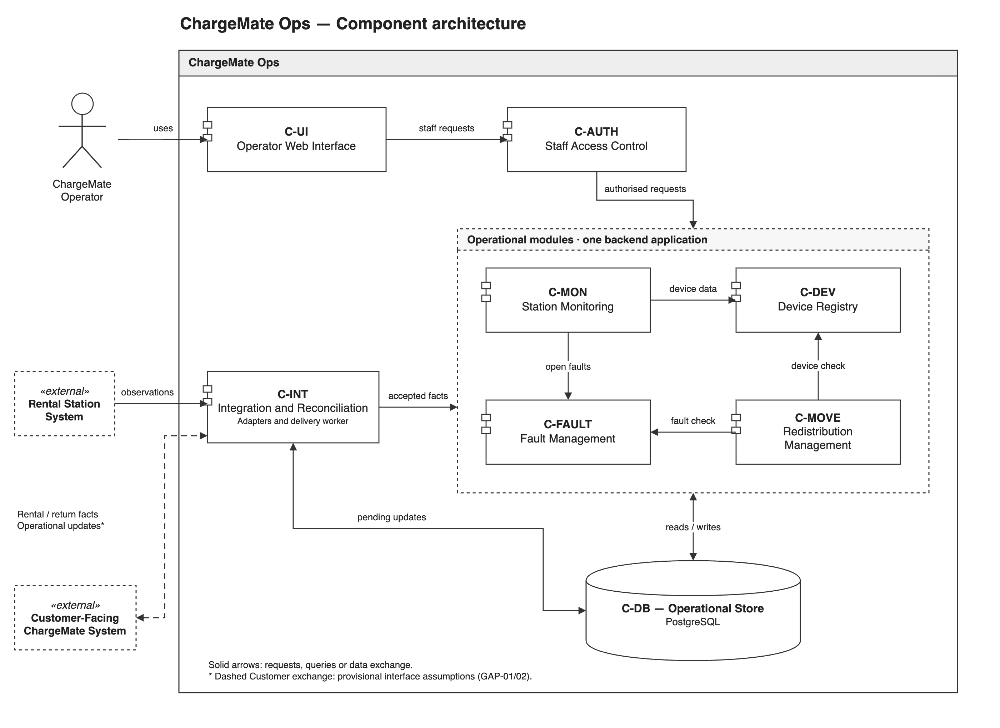

# ChargeMate Ops
## System Design Document (SDD) — COMP2050 Assignment 2

**Design team:** Group 3 — Team A  
**Requirements supplied by:** Group 3 — Team B    
**Date: 01/11/2026**   
**Document status:** Draft - Pending Review

| Team member | Student ID |
|---|---|
| Yousef | [FILL] |
| Harrison | [FILL] |
| Cooper  | 49067281 |
| Isaac  | [FILL] |

---

# Team working guide — remove before final PDF export

This is a ready-to-fill structure, not a completed submission. Replace every `[FILL]`, `[INSERT ...]` and other bracketed instruction. Remove author/reviewer prompts after review. Keep the completed academic content, genuine records, references and final figures.

**A2 project:** Team A is now designing **ChargeMate Ops**, using Team B's SRS. ChargeMate Customer is an external collaborating system.

**Suggested allocation:** Yousef and Harrison lead the technical decisions and final quality checks. Cooper and Isaac own complete, substantive deliverables, with review from the technical leads. These assignments are proposals, not evidence of a past team decision.

| Person | Primary sections | Concrete deliverables | Reviewer |
|---|---|---|---|
| Yousef | 1, 3, 4, 9.1–9.3, 10, 11, 13.1; coordinate 15 | Requirements/interface decisions; architecture and data strategy; trade-offs/concurrency; all 11 RTM rows; SRS reflection; overall document consistency | Harrison |
| Harrison | 6, 7, 8, 12; validate 13.3 and co-review 15 | Three state diagrams and guards; detailed test specifications and plan; check requirement/state/failure coverage; validate sprint analysis against real records | Yousef |
| Cooper | 2, 5 | Original vision; two actor descriptions; complete wireframes and numbered storyboards for UC-01 and UC-03, including failure/recovery screens; revise after review | Yousef checks requirements/UI behaviour; Harrison checks state/test consistency |
| Isaac | 9.4, 13.2–13.3, 14, Appendix; PDF assembly support | Maintenance/deployment strategy; actual A1/A2 tools comparison; collect and caption genuine sprint charts/snapshots; organise interaction records, references and formatting | Yousef reviews maintenance; Harrison reviews evidence and staff-report accuracy |
| Everyone | 13–15 and Appendix | Supply actual contributions, A1/A2 tool experience, sprint records, meeting/discussion evidence and review feedback | Whole team |

## Hand-offs and final checks

- **Yousef → everyone:** Agree the scope, component names, interface responsibilities and provisional assumptions first. Cooper and Isaac can draft in parallel while open decisions are clearly marked.
- **Harrison ↔ Yousef:** Cross-check architecture/data rules against state transitions, tests and the RTM. Resolve conflicting expectations together before final assembly.
- **Cooper → Yousef and Harrison:** Deliver the actual screen figures, actor descriptions and numbered storyboards. Include unknown/unavailable information, denied actions and failed saves. Cooper owns making the revisions identified in review.
- **Isaac → Yousef and Harrison:** Deliver a complete maintenance section and an organised evidence package with dates, captions and source links. Isaac drafts the tools/sprint narrative from actual records; Harrison checks that the interpretation matches those records.
- **Everyone → staff report:** Provide real examples of difficulties, decisions and changes in working method. Yousef writes the coherent SRS reflection from those inputs.
- **Final check:** Yousef checks scope, architecture, RTM and narrative consistency. Harrison checks state logic, test coverage and evidence accuracy. Cooper checks screen readability and storyboard completeness. Isaac checks references, captions, appendix organisation and PDF layout.

The staff report is worth 25 marks and the appendix 10, so the evidence and reflection need substantive review alongside the technical design. Record who actually authored, revised and reviewed each part; do not present the proposed allocation as completed work.

**Working rules**

- Work in the team's existing `a2docs` folder. Suggested main filename: `SDD.md`.
- Use real task/issue/commit/PR links when they exist. Keep review feedback with its actual date.
- Agree component IDs before writing other sections. Reuse the same names in every diagram, RTM row and test.
- Distinguish inherited requirements, provisional assumptions and agreed design decisions.
- A fault must exclude normal availability. Unknown availability is not confirmed zero. Failed saves must not appear successful. Physical movement needs confirmation before its new location is recorded. Fault resolution alone does not establish rental eligibility.
- Record genuine activity. Do not invent historical meetings, attendance, sprint progress, GitHub links, approvals or test results.
- This assessment asks for test **specifications and a plan**. Do not claim tests ran if they did not.
- Final deliverable: one professional PDF, **maximum 50 A4 pages including the appendix**. Aim for 48 pages. Each person also completes the individual contribution evaluation.

## Shared progress board

Fill this with the current position; blank fields are not evidence that work is complete.

| Deliverable | Owner | Current status | Actual draft/task link | Reviewer feedback link | Review date |
|---|---|---|---|---|---|
| Baseline, assumptions, architecture | Yousef | Sections 1, 3 and 4 drafted; review pending | [FILL] | [FILL] | [FILL] |
| Vision and two storyboard/wireframe sets | Cooper | [FILL] | [FILL] | [FILL] | [FILL] |
| Three state diagrams | Harrison | [FILL] | [FILL] | [FILL] | [FILL] |
| Persistence, caching and data access | Yousef | Section 9.1 drafted; 9.2–9.3 pending; review pending | [FILL] | [FILL] | [FILL] |
| Maintenance and deployment | Isaac; Yousef reviews | [FILL] | [FILL] | [FILL] | [FILL] |
| RTM | Yousef | [FILL] | [FILL] | [FILL] | [FILL] |
| Test specifications and plan | Harrison | [FILL] | [FILL] | [FILL] | [FILL] |
| SRS reflection | Yousef; everyone supplies examples | [FILL] | [FILL] | [FILL] | [FILL] |
| Tools comparison and sprint evidence | Isaac drafts/collects; Harrison validates | [FILL] | [FILL] | [FILL] | [FILL] |
| References and interaction appendix | Isaac coordinates; everyone supplies records; Harrison checks evidence | [FILL] | [FILL] | [FILL] | [FILL] |
| Final PDF and consistency review | Yousef + Harrison lead; Cooper + Isaac complete presentation checks | [FILL] | [FILL] | [FILL] | [FILL] |

**Suggested page budget:** cover/contents 2; scope, vision and assumptions 3; remaining system design 13; RTM 4; tests 12; staff report/references 7; appendix 7. Total 48. Adjust to fit the actual material legibly.

---

# Contents

1. Project scope and requirements baseline
2. Project vision
3. Assumptions, clarification gaps and design decisions
4. System architecture and rationale
5. User experience: two wireframe/storyboard sets
6. State diagram 1: FaultRecord
7. State diagram 2: RedistributionJob
8. State diagram 3: OperationalSnapshotQuality
9. Persistent data, caching and maintenance
10. Trade-offs and concurrent processes
11. Requirements Traceability Matrix
12. Test specifications and test plan
13. Report to COMP2050 staff
14. References and resources
15. Final integration and submission checklist
Appendix A. Team interaction log and full records
Appendix B. Evidence index and contributions

**List of figures:** [ADD FINAL FIGURE NUMBERS, TITLES AND PAGE NUMBERS]  
**List of tables:** [ADD IF USEFUL]

---

# 1. Project scope and requirements baseline

**Owner: Yousef | Reviewer: Harrison | Status: Section 1 drafted — review pending**

## 1.1 Purpose and intended audience

This System Design Document describes how ChargeMate Ops can be implemented to support the power bank network at Harbour North Plaza. It translates the paired Team B's requirements into component responsibilities, information flows, data rules and verification links. Its intended readers are a development team planning implementation and project managers allocating and reviewing that work. The accompanying test specifications describe how the proposed behaviour would be verified; they do not report an existing implementation.

For Assignment 2, Group 3 Team A designs the operator-facing project specified by Team B. The earlier ChargeMate Customer SRS supplies external interface context. It does not replace the Ops requirements baseline. [SRC-01, §4; SRC-04]

## 1.2 System scope and boundary

ChargeMate Ops helps authorised staff inspect stations, find registered devices, record and resolve faults, identify recorded operational issues and record confirmed redistribution. Different demand patterns around the plaza make a shared operational view useful, but the system does not assume that every external observation is current or correct. Unknown, unavailable and conflicting information remain visible rather than being replaced with plausible values. [SRC-01, §§5–6; SRC-05]

| Inside ChargeMate Ops | External responsibility or boundary |
|---|---|
| Station status, available power bank information and recorded attention indicators | The Rental Station System supplies physical observations; a displayed status does not independently prove hardware health |
| Registered device lookup and available recorded location/status | No GPS or guaranteed continuous physical tracking is assumed |
| Fault recording, unresolved-fault exclusion and valid resolution | Physical inspection/repair is staff work; clearing a fault does not itself certify rental eligibility |
| Recording suitable devices' confirmed movement between registered stations | A planned destination is not a completed physical transfer; staff provide confirmation |
| Receiving and reconciling relevant operational/rental/return information | Exact Customer/station contracts remain subject to the clarification register |
| Protected staff operations | Customer registration, payment processing, prices, late-fee calculation and the customer kiosk journey remain outside Ops |

The primary actor is the **ChargeMate Operator**. The **Rental Station System** and **Customer-Facing ChargeMate System** are external collaborators. Other staff may investigate or repair a device, but the source does not establish a separate maintenance-system role. Authorisation is therefore expressed through permissions until a staff permission matrix is confirmed. [SRC-01, pp.5–6,14–15]

Rental release and return-confirmation ownership requires an explicit decision. Customer's SRS expects Ops-side confirmations and device release, while Ops' numbered FRs mainly describe operational records and views. This design provides an adapter boundary for those exchanges without silently allocating payment processing or hardware release control to Ops. [SRC-03, pp.7–12,15,23–24]

## 1.3 Received baseline and source documents

| Source ID | Source and version | Precise locator | Use in this design |
|---|---|---|---|
| SRC-01 | Team B, *ChargeMate Ops Software Requirements Specification*, supplied as `SRS (1).pdf`; cover v1.2, 12 September 2026 | Requirements/fit criteria pp.7–9; use cases pp.12–19; recorded open questions pp.30–37 | Primary behaviour and acceptance baseline |
| SRC-02 | Team B handover, `Untitled design (3).mp4`, duration approximately 8:01; recording date not established | Approximately 4:23–6:07: information quality, physical confirmation and unanswered questions; 6:23–7:49: more specific workflow claims | Explanation and discrepancy identification |
| SRC-03 | Group 3 Team A, *ChargeMate Customer SRS*, `Group3_TeamA_COMP2050.pdf`; change log through v1.5 dated 13 September 2026 | Dependencies and requirements pp.7–12; Customer–Ops Q&A pp.23–24; return/problem flows pp.17–19 | External expectations and allocation conflicts |
| SRC-04 | Supplied COMP2050 Assignment 2 instructions | System Design, RTM, Test Specifications and Staff Report headings | Deliverable structure and project swap |
| SRC-05 | Released Project B brief, repository copy | [Project B — ChargeMate Ops](https://github.com/comp2050-2026/Group-3---Team-A/blob/main/project-briefs/PROJECT_B_CHARGEMATE_OPS.md), §§2–4; accessed 1 November 2026 | Plaza context and operator/customer boundary |

The supplied ChargeMate Ops SRS is the requirements baseline for this design. Additional or conflicting details in the handover video are recorded as clarification questions or clearly labelled design assumptions.

## 1.4 Requirement reference list

The baseline contains eight functional and three non-functional requirements. The following summaries preserve their design implications; the full requirement sentences and fit criteria remain in SRC-01, pp.7–9.

| ID | Requirement title | Acceptance consequence for the design |
|---|---|---|
| FR-01 | View Rental Station Status | Match latest available station information and identify unreliable information |
| FR-02 | View Power Bank Availability | Match available records; unknown is not a confirmed count; unresolved faults exclude normal availability |
| FR-03 | Track Individual Power Bank | Match a unique registered ID; not-found, unknown location and conflicting data have distinct outcomes |
| FR-04 | Record Power Bank Fault | Validate and save against the correct device; report missing details and failed saves |
| FR-05 | Identify Faulty Power Banks | Any unresolved fault keeps the device visibly requiring attention and excluded from normal availability |
| FR-06 | Resolve Power Bank Fault | Store a valid resolution and update the associated fault/device view |
| FR-07 | Support Power Bank Redistribution | Record suitable devices' confirmed movement and new station; exclude faulty/unavailable candidates |
| FR-08 | Identify Operational Issues | Distinguish recorded attention conditions from normal operation |
| NFR-01 | Usability | Ordinary staff tasks use visible controls without database/command-line intervention |
| NFR-02 | Operational Data Reliability | Do not display assumed values as confirmed; expose unavailable, unknown and conflicting information |
| NFR-03 | Security and Access Control | Deny unauthorised operational access; allow only permitted actions |

`FR-xx` refers to Ops throughout this document. A Customer requirement is prefixed `Customer.FR-xx` to prevent collisions between the two SRS numbering schemes.

## 1.5 Use-case baseline

| Source use case | Design interpretation | Source |
|---|---|---|
| UC-01 — View Station Status | Open monitoring, inspect available station information, select a station and recognise unavailable/conflicting/attention conditions | SRC-01 pp.12–13; Figure 3 p.16 |
| UC-02 — Track a Power Bank | Search a unique ID and inspect available status/location; distinguish missing ID from unknown location and conflicting observations | SRC-01 pp.13–14; Figure 4 p.17 |
| UC-03 — Report and Manage a Faulty Power Bank | Identify device, validate/save a fault, preserve exclusion and later record a permitted resolution; failed updates do not count as success | SRC-01 pp.14–19; Figure 5 p.18 |
| Supporting redistribution scenario | Select candidate/source/destination, revalidate suitability, confirm physical movement and commit the new recorded location | FR-07; overall model p.11 and historical UC-04 discussion pp.36–38 |
| Supporting issue-view scenario | Inspect the attention indicators generated by recorded faults, unavailable stations and inconsistent information | FR-08 and UC-01/02/03 failure/alternative branches |

Redistribution is required despite not having a fourth complete detailed use case in the final SRS. The supporting scenarios above are design elaborations. A successful return, a fault resolution and a rental-ready device are treated as different facts.

# 2. Project vision

**Owner: Cooper | Reviewer: Yousef | Status: Review Pending**

ChargeMate Ops gives the staff running the Harbour North Plaza pilot program one place they can trust to see the state of every rental station and power bank, and to act on whatever needs attention or change. With ChargeMate Ops, an operator can see which stations are running normally, which need attention, and where the system doesn’t have reliable information. They can also follow and track a single power bank from the moment an issue is reported, all the way through to a resolution is recorded, even across different shifts and staff. Our design treats data transparency as a core feature. The system will never present a guess as a fact, never present a failed save as a success, and never show a faulty power bank as available for rental or redistribution. The outcome we are designing for is a pilot in which issues are found by staff before customers find them, and staff members record problems that can be reviewed between shifts. 

[FILL: Write one original paragraph describing the value, intended staff users and operational outcome of your proposed ChargeMate Ops implementation. Do not copy Team B's vision statement.]

# 3. Assumptions, clarification gaps and design decisions

**Owner: Yousef | Reviewer: Harrison | Input: everyone | Status: Section 3 drafted — review pending**

This section distinguishes missing information from proposed implementation choices. A **clarification gap** is an unanswered question in the supplied material. A **design assumption** is a provisional condition used to continue planning. A **design decision** selects an approach and explains why it fits the requirements. Neither assumptions nor proposed decisions represent stakeholder approval.

## 3.1 Open clarification register

The SRS explicitly leaves several operational and integration details open. The following register identifies their effect on this design and the proposed handling while clarification is pending. Source labels refer to the documents listed in §1.3. No additional stakeholder response is recorded in this draft.

| Gap ID | Unanswered question and source | Affected requirements | Provisional handling | Status |
|---|---|---|---|---|
| GAP-01 | Which fields are exchanged between Ops, stations and Customer, which system owns them, and how quickly must updates arrive? [SRC-01, pp.5,30,33,37] | FR-01, FR-02, FR-03, NFR-02 | Define explicit interface fields and ownership; retain source/time information and show unavailable or conflicting values. Do not promise a numerical refresh interval. | Open — interface and update expectations need agreement |
| GAP-02 | Who authorises rentals, controls device release and confirms returns? Customer expects Ops-side actions that are not fully specified by Ops' numbered requirements. [SRC-03, pp.7–12,15,23–24; SRC-01, pp.7–9] | Cross-system allocation; FR-02, FR-03 | Keep an integration boundary for the exchanges. Do not silently add payment processing or an unconfirmed release controller to Ops. | Open — responsibilities must be allocated explicitly |
| GAP-03 | What makes a device sufficiently charged and available, and how are exact counts and return capacity determined? [SRC-01, pp.7–8,30–31,37; SRC-03, pp.8,23] | FR-02, FR-05, FR-07 | Keep charge, physical presence, rental occupancy and unresolved faults as separate facts. Missing eligibility information is not treated as confirmed suitability or a confirmed zero count. | Open — eligibility and capacity definitions needed |
| GAP-04 | What exact station/device statuses and fault fields are required, and who may resolve faults? [SRC-01, pp.31,37] | FR-01, FR-03, FR-04, FR-06, NFR-03 | Use the provisional fault fields in ASSUMP-03 and check permission for each protected action. Do not invent a separate staff role or fixed category/priority list. | Open — data dictionary and permission rules needed |
| GAP-05 | What happens if a movement's destination becomes unavailable, another operator changes the device, or physical movement occurs but recording fails? [SRC-01, pp.8,32] | FR-07, NFR-02 | Recheck suitability when recording completion. Require physical confirmation; preserve contradictory movement evidence for investigation instead of presenting an uncertain location as confirmed. | Open — capacity and reconciliation rules needed |
| GAP-06 | Which conditions generate automatic alerts, with what priorities and resolution process? [SRC-01, p.32] | FR-08 | Display recorded issues and attention indicators. Add automatic thresholds, notifications or recommendations only when their rules are established. | Open — automatic alert scope not confirmed |
| GAP-07 | How should the video's real-time telemetry, automatic dock blocking and restored-availability claims be reconciled with the written SRS? [SRC-02, approximately 6:23–7:49; SRC-01, pp.18–19,33] | FR-01, FR-03, FR-05, FR-06, NFR-02 | Use latest-available information. Keep faulty devices excluded locally; external blocking requires an agreed contract. Resolving a fault alone does not establish charge, physical presence or rental eligibility. | Open — conflicting handover details need clarification |
| GAP-08 | What performance, availability, backup, retention and recovery targets must the implementation meet? The numbered SRS gives qualitative fit criteria without these numerical targets. [SRC-01, pp.7–9] | NFR-01, NFR-02, NFR-03; operational planning | Specify failure/recovery mechanisms and testable qualitative behaviour. Record proposed numerical targets separately for agreement rather than presenting them as inherited requirements. | Open — operational targets needed |

These gaps do not remove confirmed behaviour. For example, FR-07 already requires confirmed physical movement and excludes faulty/unavailable candidates; only the additional capacity and exception rules remain unresolved. Similarly, FR-08 requires visibility of recorded issues even though automatic alert rules are open.

## 3.2 Design assumptions

The following assumptions make the proposal concrete while exposing what would need to change if they are incorrect. They are provisional planning assumptions, not extra requirements attributed to Team B.

| Assumption ID | Provisional assumption | Reason for using it | Risk if incorrect / required change | Affected area and validation status |
|---|---|---|---|---|
| ASSUMP-01 | Authorised staff can access a supported browser and network connection for normal operational tasks. | Provides a common staff interface without assuming a separate installed mobile or desktop application. | If tasks must work without connectivity or on restricted devices, the interface/deployment approach must be revised. | NFR-01, NFR-03; device/connectivity context unconfirmed |
| ASSUMP-02 | Registered station/device identities and authorised staff identities are supplied through an agreed setup process. | The SRS assumes registered unique identities and authorised access, but does not specify registration/account-administration screens. [SRC-01, p.6] | Agree a provisioning/import process before implementation; do not assume missing registration features already exist. | FR-01–FR-07, NFR-03; provisioning mechanism open |
| ASSUMP-03 | Fault creation requires the registered device ID and a non-empty fault description. Resolution requires a resolution note and an operator permitted to resolve that fault. | Gives concrete provisional validation rules for the SRS's requirement to save valid fault information against the correct device. | Stakeholders may require different/additional fields; update forms, validation and tests together. | FR-04, FR-06, NFR-03; fields and permission assignments open |
| ASSUMP-04 | A device may have multiple independent fault records. It remains excluded from normal availability while any fault is unresolved. | Prevents resolving one issue from hiding another unresolved issue. | If only one active fault record is permitted, revise the workflow/schema while preserving unresolved-fault exclusion. | FR-04–FR-06; multiple-fault policy unconfirmed |
| ASSUMP-05 | External sources can supply stable event identifiers and ordering information, such as a source revision, where automated deduplication/ordering is needed. | Allows repeated or late updates to be recognised without relying only on arrival time. | If ordering cannot be established, retain conflicting evidence for investigation rather than automatically treating the last arrival as correct. | FR-01–FR-03, NFR-02; external contract open |

No numerical charge threshold, refresh deadline, low-stock trigger or recovery target is assumed. Unique device IDs also do not imply GPS tracking: the design uses available recorded location information, including an explicit unknown/investigation outcome where required.

## 3.3 Proposed design decisions

The following choices are proposed for the design. They are recorded on **1 November 2026**, the date of this draft, and remain subject to review. This date does not represent a previous meeting or stakeholder agreement. Section 4 will show their architectural effect; the later data and test sections must remain consistent with them.

| Decision ID | Proposed choice and alternative | Rationale | Requirement / gap link | Status |
|---|---|---|---|---|
| DEC-01 | Use a staff web interface, a modular backend and a PostgreSQL relational database. Alternative: separately deployed services for each business feature. | Fault, device and movement updates are closely related. A shared transaction boundary simplifies consistent updates while named modules keep responsibilities clear. | FR-04–FR-07, NFR-01; ASSUMP-01 | Proposed — architecture review pending |
| DEC-02 | Store fault state, physical location, charge/occupancy facts and information quality separately. Alternative: one combined device-status flag. | A device can be at a known station while faulty or insufficiently charged. One cleared fault must not imply every other eligibility condition is satisfied. | FR-02, FR-03, FR-05, FR-06, NFR-02; GAP-03/04 | Proposed — detailed state dictionary pending |
| DEC-03 | Check permissions on the backend for every protected request, and recheck the relevant device/record version when a change is saved. Alternative: trusting a visible UI control and previously loaded data. | Prevents unauthorised direct requests and changes based on outdated suitability information. | NFR-03, FR-05, FR-07; GAP-04/05 | Proposed — permission assignments pending |
| DEC-04 | Save a pending outgoing-update record with the local business change, then deliver/retry it separately. Alternative: require an external response before recognising local save success. | A saved fault should remain durable when Customer is unreachable. Local success and confirmed external synchronisation must be distinguishable. | FR-04–FR-06, NFR-02; GAP-01/07 | Proposed — outgoing contract pending |
| DEC-05 | Use database-backed operational views without a separate business-data cache or offline browser write queue initially. Alternative: additional cached copies and queued offline changes. | Reduces inconsistent copies and stale management commands for the pilot. The UI can refresh, while the backend remains responsible for validating changes. | NFR-02, FR-05, FR-07; ASSUMP-01 | Proposed — revisit if measured workload or offline needs justify it |
| DEC-06 | Implement recorded-issue visibility first; introduce automatic alerts/recommendations only with defined rules. Alternative: invent alert thresholds or predictive features. | Meets the confirmed operator need without expanding an unspecified rule set. | FR-08; GAP-06; SRC-05, §3 | Proposed — automatic alert rules remain open |

Changes to a decision must update the affected diagrams, data rules, RTM and tests together. Once a question is answered or a decision reviewed, record the actual response/review evidence and date; an open item should not be marked agreed solely because a plausible design has been written.

# 4. System architecture and rationale

**Owner: Yousef | Reviewer: Harrison | Status: Section 4 drafted — review pending**

## 4.1 Architecture overview

The proposed system has three layers: an operator web interface, a modular application backend and a PostgreSQL operational database. Staff use the browser interface to monitor stations, search devices, manage faults and confirm redistribution. The backend checks permissions and applies the operational rules before reading or changing stored information. The database holds the persistent records used by these functions. This implements DEC-01 and the browser-access assumption in §3.

The backend separates responsibilities into named modules, but they form one application rather than independently deployed business services. This allows related fault, device and movement changes to be recorded in one database transaction. A transaction commits its related changes together or leaves them unsaved if it fails. External exchanges use a dedicated integration module and delivery worker so that station/Customer communication does not bypass the same operational rules.

**Figure ARCH-01.** The operator, Rental Station System and Customer-Facing ChargeMate System are outside the Ops software boundary. C-UI and C-AUTH lead into four domain modules: C-MON, C-DEV, C-FAULT and C-MOVE. Domain modules use C-DB for persistent information. C-INT validates incoming external information, routes it through domain rules and delivers recorded outgoing updates. Solid arrows show logical requests/data relationships; the dashed Customer connection identifies an exchange whose detailed contract remains provisional. The diagram does not allocate customer payments or imply automatic hardware control. The editable source is [ARCH-01.drawio](diagrams/ARCH-01.drawio), for [diagrams.net (draw.io)](https://app.diagrams.net/). PNG and SVG exports are included for report assembly.

The plaza pilot does not establish a need for separate deployment of each business function. A modular backend provides clear responsibilities while keeping device/fault/movement consistency within one transaction boundary. The trade-off is a shared application release and database dependency. Keeping module boundaries explicit supports later change without requiring distributed business services at this stage.

## 4.2 Component catalogue

`C-` identifies a component in this design. These IDs and names must be reused in the RTM, test specifications and other diagrams.

| Component | Responsibility | Main exchanges | Requirements supported |
|---|---|---|---|
| C-UI — Operator Web Interface | Presents station/device views, fault/resolution forms, movement confirmation and clear attention/recovery messages. Distinguishes unknown, unavailable and confirmed information. | Operator actions → backend requests; results and quality information → screens | FR-01–FR-08, NFR-01, NFR-02 |
| C-AUTH — Staff Access Control | Establishes staff identity and checks whether each requested action/resource is permitted. Access is denied when permission cannot be established. | Staff identity, requested action and target → allow/deny decision | NFR-03; all protected operational functions |
| C-MON — Station Monitoring | Combines accepted station observations with device/fault information to present station status, availability and recorded attention conditions. | Station query → summary/detail; uses C-DEV and C-FAULT information | FR-01, FR-02, FR-08, NFR-02 |
| C-DEV — Device Registry | Looks up registered device IDs and maintains available recorded location, operational facts and record versions. | Device ID → device details, not-found or investigation outcome | FR-03; identification/location support for FR-02, FR-04–FR-08 |
| C-FAULT — Fault Management | Validates and saves faults/resolutions. Preserves exclusion while any recorded fault remains unresolved. | Device-linked fault/resolution → saved record or explicit rejection/failure; exclusion information → other modules | FR-04, FR-05, FR-06, FR-08 |
| C-MOVE — Redistribution Management | Identifies suitable candidates, checks registered source/destination and records confirmed physical movement. Rechecks suitability/current record before completion. | Device, stations and physical confirmation → recorded movement/new location or conflict/failure | FR-07; affects FR-02, FR-03, FR-05 |
| C-INT — Integration and Reconciliation | Checks external source identity and message structure, recognises duplicates/ordering where supported, and preserves conflicting information for investigation. Delivers pending outgoing updates. | Station/Customer records → domain modules; committed outgoing records → agreed external recipient | FR-01–FR-03, FR-08, NFR-02; agreed fault/status exchange |
| C-DB — Operational Store | Persists registered stations/devices, faults, movements, observations, versions and integration processing records with integrity constraints. | Protected backend queries/transactions → committed data or rolled-back result | Persistent support for FR-01–FR-08 and NFR-02 |

C-MON obtains device and unresolved-fault information through domain query functions. C-MOVE uses C-DEV and C-FAULT checks before recording movement. C-FAULT and C-MOVE coordinate changes through the same device record/version. Sharing a database does not allow one module to ignore another module's business rules.

External systems do not access C-DB directly. C-INT authenticates/authorises external exchanges under the agreed service policy and sends accepted changes through domain operations. Its worker may read pending outgoing records and record delivery outcomes, but it cannot independently declare a faulty device eligible. Detailed storage, locking and retry rules are addressed in §§9–10.

## 4.3 Requirement-driven architecture rationale

| Requirement / concern | Design response | Reason and limitation |
|---|---|---|
| NFR-01 — Usability | C-UI follows monitoring, device lookup and fault-management tasks with visible controls and clear results. | Staff should not need direct database access or command-line tools for ordinary tasks. The actual screens and representative-user checks must still demonstrate this. |
| NFR-02 — Operational Data Reliability | C-INT preserves source/time information; C-MON/C-DEV expose unknown, unavailable and conflicting facts. | Missing information is not converted into zero or normal operation. A timestamp does not establish an unsupported freshness guarantee. |
| NFR-03 — Security and Access Control | C-AUTH checks protected requests on the backend; C-INT restricts service exchanges. | Hiding a button is insufficient protection. Permission assignments remain provisional, but denied requests must not change operational records. |
| FR-04–FR-06 — Fault lifecycle | C-FAULT and C-DEV use a shared transaction boundary and derive exclusion from unresolved faults. | A failed save cannot count as a successful resolution or leave a partially updated device view. Resolving one fault does not clear another. |
| FR-07 — Confirmed redistribution | C-MOVE checks suitability, expected device version and physical confirmation at completion. | Selecting a destination does not itself establish a new physical location. Conflicting reports require investigation. |
| GAP-01/02/07 — External boundary | C-INT isolates field mapping and communication from the core modules. | The design can describe provisional exchanges without treating unconfirmed rental-control or dock-blocking behaviour as an inherited requirement. |

The access-control approach follows the principles of least privilege, denial by default and permission checks on every request described in the [OWASP Authorization Cheat Sheet](https://cheatsheetseries.owasp.org/cheatsheets/Authorization_Cheat_Sheet.html) (accessed 1 November 2026). The ability to coordinate short record-changing transactions using row locks is documented in [PostgreSQL 18: Explicit Locking](https://www.postgresql.org/docs/18/explicit-locking.html) (accessed 1 November 2026). These sources support implementation choices; they do not supply ChargeMate business requirements.

## 4.4 External interface responsibilities

The following exchanges are proposed for implementation planning under the assumptions in §3. They describe intended responsibilities and minimum information, rather than an existing deployed API. Exact field formats, source ownership and timing remain identified gaps; the proposed approach allows the design to proceed without claiming external approval.

| Exchange | Direction and proposed information | Processing / failure behaviour | Responsibility and assumption |
|---|---|---|---|
| Station observations | Rental Station System → C-INT: station/device identifiers, observation time, available status/location/availability facts, event ID and source revision where supplied | Validate source and registration; preserve missing fields; record conflicts rather than overwrite contradictory facts blindly | Stations supply physical observations. Charge/capacity semantics and ordering support remain GAP-01/03 and ASSUMP-05. |
| Rental/return facts | Customer → C-INT: event ID, device ID, station ID where applicable, event type/time and source revision where available | Route accepted facts through C-DEV/domain rules; repeated or late input cannot silently erase newer or conflicting evidence | Customer supplies its recorded rental/return information. This exchange does not itself define who authorises release or confirms physical docking. |
| Operational changes | C-INT → agreed Customer/station recipient: entity ID, changed operational facts, local revision and event ID | Save the pending outgoing update with the business change; retry delivery separately and distinguish pending from acknowledged delivery | Ops owns its recorded fault/movement changes. Remote exclusion/blocking requires the recipient's agreed handling; local success alone does not prove it happened. |
| Operational information requests | Agreed external caller → C-INT: permitted station/device query; response includes accepted values and quality/source/time information | Apply service access checks; return unknown/unavailable/conflicting information explicitly | Share only the fields needed by the agreed interface. Exact-count/return-capacity ownership remains GAP-01/03. |

For this proposal, physical docking/release hardware remains part of the external Rental Station System, and customer accounts, prices and payment processing remain with the customer-facing system. Ops manages its operational records and views. The software route for rental authorisation/release commands and return acknowledgements remains GAP-02; it is not silently implemented by the fault or redistribution modules. No payment credentials or customer card data are needed in the proposed operational exchanges.

### Consistent command results

Protected record-changing requests carry the target identifier, expected record version and a unique operation ID. The backend returns a consistent outcome: **committed**, **validation rejected**, **not found**, **access denied**, **version conflict** or **save failed**. A committed result includes the saved record ID and new version. Repeating the same operation ID with the same input returns the recorded outcome rather than creating a duplicate; conflicting reuse is rejected. These are proposed interface conventions for aligning screens, state diagrams and tests.

## 4.5 Example: recording a power bank fault

1. The operator finds a device through C-UI. C-AUTH checks access, and C-DEV returns the registered device information.
2. The operator submits fault details for that selected device. C-AUTH checks permission to record the fault.
3. C-FAULT validates the details and coordinates with C-DEV/C-DB to save the fault, update the device version and record any pending outgoing update together.
4. C-UI shows success only after the save commits. C-DEV/C-MON/C-MOVE use the unresolved-fault rule so the device is visibly requiring attention and is not normally available or a suitable movement candidate.
5. C-INT delivers the outgoing status update under the proposed contract. If delivery fails temporarily, the saved fault remains active and external synchronisation remains pending.

This example shows why the interface, permissions, business modules, database and integration worker have separate responsibilities while preserving one consistent operational result.

# 5. User experience: two wireframe/storyboard sets

**Owner: Cooper | Reviewers: Yousef for requirements/UI behaviour; Harrison for state/test consistency | Status: [FILL]**

Use multi-step operator interactions. Suggested choices are UC-01 and UC-03. Include actual screens and the sequence between them, not only a written use-case summary.

## 5.1 Storyboard SB-01 — UC-01 View Station Status

**Actor:** [DESCRIBE AUTHORISED OPERATOR, GOAL, WORKING CONTEXT AND KNOWLEDGE]  
**Preconditions:** [FILL]  
**Requirements:** [FILL]  
**Related tests:** [FILL]

| Step | Screen ID/title | Operator action | System response and information displayed | Next screen / branch |
|---|---|---|---|---|
| 1 | WF-01 — Station overview | [FILL] | [FILL] | [FILL] |
| 2 | WF-02 — Selected station | [FILL] | [FILL] | [FILL] |
| 3 | WF-03 — Attention/recovery view | [FILL] | [FILL] | [FILL] |

**Figures WF-01 to WF-03:** [INSERT ANNOTATED WIREFRAMES]

[FILL: Explain unavailable data, conflicting data, confirmed zero versus unknown availability, attention indicators and recovery navigation.]

## 5.2 Storyboard SB-03 — UC-03 Report and Manage a Faulty Power Bank

**Actor:** [DESCRIBE OPERATOR; DISTINGUISH RESOLUTION PERMISSION IF APPLICABLE]  
**Preconditions:** [FILL]  
**Requirements:** [FILL]  
**Related tests:** [FILL]

| Step | Screen ID/title | Operator action | System response and information displayed | Next screen / branch |
|---|---|---|---|---|
| 1 | WF-04 — Device search/detail | [FILL] | [FILL] | [FILL] |
| 2 | WF-05 — Fault entry | [FILL] | [FILL] | [FILL] |
| 3 | WF-06 — Save result | [FILL] | [FILL] | [FILL] |
| 4 | WF-07 — Later fault review | [FILL] | [FILL] | [FILL] |
| 5 | WF-08 — Resolution entry/result | [FILL] | [FILL] | [FILL] |

**Figures WF-04 to WF-08:** [INSERT ANNOTATED WIREFRAMES]

[FILL: Show not-found, missing information, save failure, unresolved investigation, denied resolution and failed resolution. Later resolution can occur in a different session. Do not show success before a successful save or automatic rental eligibility after resolution.]

# 6. State diagram 1 — FaultRecord

**Owner: Harrison | Reviewer: Yousef | Cooper checks the related screen behaviour | Status: [FILL]**

The object choice is proposed. If replaced, choose another object with meaningful states and update the contents and links.

**Object and purpose:** [FILL]  
**Requirements/use cases:** [FILL]  
**Figure SD-01:** [INSERT UML STATE DIAGRAM]

| Current state | Event | Guard / condition | Action | Next state | Related test |
|---|---|---|---|---|---|
| [FILL] | [FILL] | [FILL] | [FILL] | [FILL] | [FILL] |
| [FILL] | [FILL] | [FILL] | [FILL] | [FILL] | [FILL] |

[FILL: Explain valid creation, unresolved investigation, successful resolution, failed save and unauthorised resolution. State what remains unchanged when an operation fails.]

# 7. State diagram 2 — RedistributionJob

**Owner: Harrison | Reviewer: Yousef | Coordinate the movement/data rules with section 9 | Status: [FILL]**

**Object and purpose:** [FILL]  
**Requirements/use cases:** [FILL]  
**Figure SD-02:** [INSERT UML STATE DIAGRAM]

| Current state | Event | Guard / condition | Action | Next state | Related test |
|---|---|---|---|---|---|
| [FILL] | [FILL] | [FILL] | [FILL] | [FILL] | [FILL] |
| [FILL] | [FILL] | [FILL] | [FILL] | [FILL] | [FILL] |

[FILL: Distinguish selecting/planning a movement from confirming physical movement and successfully recording completion. Handle faulty/unavailable devices, competing updates and failed recording after a physical move. Mark capacity/in-transit policies as assumptions where not agreed.]

# 8. State diagram 3 — OperationalSnapshotQuality

**Owner: Harrison | Reviewer: Yousef | Cooper checks the related screen behaviour | Status: [FILL]**

**Object and purpose:** [FILL]  
**Requirements/use cases:** [FILL]  
**Figure SD-03:** [INSERT UML STATE DIAGRAM]

| Current state | Event | Guard / condition | Action | Next state | Related test |
|---|---|---|---|---|---|
| [FILL] | [FILL] | [FILL] | [FILL] | [FILL] | [FILL] |
| [FILL] | [FILL] | [FILL] | [FILL] | [FILL] | [FILL] |

[FILL: Distinguish reliable available information, unknown, unavailable and inconsistent information. Keep information quality separate from physical device/station health. Do not invent a freshness deadline.]

# 9. Persistent data, caching and maintenance

**Owners: Yousef for 9.1–9.3; Isaac for 9.4 | Reviewers: Harrison for data strategy; Yousef for maintenance | Status: Section 9.1 drafted — review pending; 9.2–9.4 pending**

## 9.1 Persistent data strategy

C-DB is the proposed server-side PostgreSQL database for Ops' durable operational records. These records must remain available between staff sessions rather than exist only in a browser screen. A relational database fits the linked station, device, fault and movement records and the need to save related changes together. This follows DEC-01–DEC-04; PostgreSQL is a design choice, not a technology required by the SRS.

The backend accesses C-DB after the relevant access and validation checks. C-UI and external systems have no direct database access. C-INT submits incoming operational facts through the domain modules; its delivery worker accesses integration processing records without bypassing fault or movement rules. Registered station/device IDs and staff identity references depend on the agreed setup process in ASSUMP-02; this does not add unrequested registration screens.

The following is a proposed logical data model. Field names describe the intended information, rather than a completed database schema. All records listed are stored in C-DB.

| Entity / record | Main information and relationships | Responsible component / access | Integrity rule |
|---|---|---|---|
| Station | Unique station ID, location description, record version; linked station observations | C-MON reads; agreed setup process supplies registration; C-INT routes observations | Only registered stations are referenced by completed movements. Missing status, capacity or availability is not stored as a confirmed normal or zero value. |
| PowerBank | Unique device ID, record version, last confirmed station where known; links to separate location, charge and occupancy facts | C-DEV coordinates changes; other domain modules request its information | Preserve the difference between last recorded location and reliable current location. An unknown station is not replaced with an invented location. |
| FaultRecord | Fault ID, device ID, description, unresolved/resolved state, reporting actor/time, resolution note and resolving actor/time, version | C-FAULT writes; C-MON/C-DEV/C-MOVE use its fault information | Each fault references a registered device. Apply ASSUMP-03 validation; any remaining unresolved fault continues to exclude normal rental availability and redistribution suitability. |
| RedistributionJob | Movement ID, device and source/destination station IDs, lifecycle state, expected device version, physical confirmation and actor/time | C-MOVE writes; C-DEV/C-MON read committed effects | A plan is not completed movement. Completion and the recorded destination change must be saved together. Align lifecycle states with §7. |
| Observation / information quality | Entity and field, supplied value, source identity, event ID/revision where available, observation time, received time, quality and conflicting evidence | C-INT validates/routes; C-DEV/C-MON accept and present operational facts | Keep source evidence separate from accepted values. Arrival time alone does not establish which conflicting report is correct. Align quality states with §8. |
| Incoming processing record | Source identity plus event ID, input fingerprint, processing result and related record/version | C-INT coordinates with the responsible domain module | Recognise a repeated event within its source. Conflicting reuse is rejected; automatic deduplication/ordering depends on ASSUMP-05. |
| Command receipt | Requesting identity, operation ID, input fingerprint, committed result and resulting record/version | Responsible domain module records the result; C-AUTH checks access | Save the successful receipt with its business change. Repeating the same authorised operation must not create another fault or movement. A failed save must not leave a success receipt. |
| Pending outgoing update | Event ID, entity/version, agreed operational payload, intended recipient, delivery state and attempt/acknowledgement information | Domain transaction creates; C-INT delivers and records outcomes | Save with the local business change under DEC-04. Local commit and acknowledged external delivery are distinct outcomes; an acknowledgement does not itself prove physical hardware action. |

Unique keys protect record identities; foreign keys link faults and movements to registered devices/stations. Required-field and allowed-value constraints reject structurally invalid records. Cross-record business rules, such as checking all unresolved faults before confirming suitability, remain the responsibility of the backend transaction rather than a single device-status field. PostgreSQL documents these identity and relationship mechanisms in its [constraints guidance](https://www.postgresql.org/docs/18/ddl-constraints.html) (accessed 1 November 2026).

### Separate operational facts from information quality

Fault state, location, charge, rental occupancy and information quality are stored separately under DEC-02. A device can have a known station, an unresolved fault and unknown charge information at the same time. Resolving its fault changes that fault record; it does not prove sufficient charge, physical presence or rental availability. Missing or conflicting eligibility information must not produce a confirmed suitable candidate. Likewise, a partial device list must not be presented as a confirmed exact station total. These rules support FR-02, FR-03, FR-05–FR-07 and NFR-02. [SRC-01, pp.7–9; GAP-03/04]

Observation time and received time remain separate so delayed input can be recognised. A previous observation may be useful as labelled last-known information, but its timestamp alone does not establish current reliability. No freshness deadline or charge threshold is invented here.

### Changes that must be saved together

- **Record a fault:** save the validated fault, increment the coordinated device version, and save the command receipt and any required outgoing update in one transaction.
- **Resolve a fault:** save the resolution and related version/receipt/outgoing changes together. Recheck remaining unresolved faults before deriving the device's exclusion result.
- **Complete redistribution:** recheck permission, suitability, expected device version and physical confirmation; save movement completion and the destination/version change together with the receipt and any outgoing update.
- **Accept an external event:** save its processing result with any accepted domain changes. Repeated input must not apply the same change again; contradictory evidence is retained for investigation rather than silently replacing a reliable value.

Success is returned only after commit. If the transaction fails, its related database changes are rolled back together, consistent with PostgreSQL's [transaction model](https://www.postgresql.org/docs/18/tutorial-transactions.html) (accessed 1 November 2026). A database rollback cannot undo a physical movement: recording failure after an actual move requires the investigation/reconciliation handling in §7. External delivery occurs after the local commit and is retried separately. Detailed concurrency controls follow in §10; backup and recovery are addressed in §9.3. These are proposed behaviours and test obligations, not claims that an implementation or recovery test has already run.

## 9.2 Caching and component data access

[FILL: Say what is cached, where, when invalidated and how stale/last-known facts are labelled. Explain how components request data, access controls and what occurs when a source is unavailable. If you choose no cache, explain why.]

## 9.3 Backup, recovery and retention

[FILL: Describe the proposed approach and how recovery would be checked. Clearly label unconfirmed retention, backup frequency and recovery targets as assumptions.]

## 9.4 Maintenance, updates and deployment

**Owner: Isaac | Reviewer: Yousef | Coordinate with: Harrison on recovery/deployment test coverage**

| System part | Update/deployment approach | Compatibility and failure handling | Rollback/recovery |
|---|---|---|---|
| Operator interface | [FILL] | [FILL] | [FILL] |
| Backend/business logic | [FILL] | [FILL] | [FILL] |
| Database/schema | [FILL] | [FILL] | [FILL] |
| Station/customer adapters | [FILL] | [FILL] | [FILL] |
| External physical devices | [EXPLAIN OWNER/BOUNDARY; DO NOT ASSUME FIRMWARE OWNERSHIP] | [FILL] | [FILL] |

# 10. Trade-offs and concurrent processes

**Owner: Yousef | Reviewer: Harrison | Input: Isaac and Cooper | Status: [FILL]**

## 10.1 Important trade-offs

| Decision | Alternatives | Competing needs | Choice and justification | Limitation |
|---|---|---|---|---|
| [FILL] | [FILL] | [FILL] | [FILL] | [FILL] |
| [FILL] | [FILL] | [FILL] | [FILL] | [FILL] |

[FILL: Consider data reliability versus responsiveness, usability versus access controls, deployment complexity and consistency. Explain your actual design choices.]

## 10.2 Concurrent activities and race conditions

| Concurrent events | Possible incorrect outcome | Coordination/guard/priority | Expected failure or conflict response | Related test |
|---|---|---|---|---|
| Fault report versus movement confirmation | [FILL] | [FILL] | [FILL] | [FILL] |
| Two operators update the same device | [FILL] | [FILL] | [FILL] | [FILL] |
| Station/customer events arrive twice or out of order | [FILL] | [FILL] | [FILL] | [FILL] |
| Resolution of one fault while another remains open | [FILL] | [FILL] | [FILL] | [FILL] |
| Local save succeeds while an outgoing update fails | [FILL] | [FILL] | [FILL] | [FILL] |

# 11. Requirements Traceability Matrix

**Owner: Yousef | Reviewer: Harrison | All component owners confirm their allocation | Status: [FILL]**

Keep exactly the five required columns below and one row for every inherited requirement. Use the final architecture names and actual test IDs. Explain meaningful change-impact links; do not fill every cell with every ID.

| Requirement-ID from SRS | Other requirement IDs impacted if it changes | Related use cases | Responsible/affected system components | Related test cases |
|---|---|---|---|---|
| FR-01 | [FILL] | [FILL] | [FILL] | [FILL] |
| FR-02 | [FILL] | [FILL] | [FILL] | [FILL] |
| FR-03 | [FILL] | [FILL] | [FILL] | [FILL] |
| FR-04 | [FILL] | [FILL] | [FILL] | [FILL] |
| FR-05 | [FILL] | [FILL] | [FILL] | [FILL] |
| FR-06 | [FILL] | [FILL] | [FILL] | [FILL] |
| FR-07 | [FILL] | [FILL] | [FILL] | [FILL] |
| FR-08 | [FILL] | [FILL] | [FILL] | [FILL] |
| NFR-01 | [FILL] | [FILL] | [FILL] | [FILL] |
| NFR-02 | [FILL] | [FILL] | [FILL] | [FILL] |
| NFR-03 | [FILL] | [FILL] | [FILL] | [FILL] |

[FILL: Explain significant dependency links. Put approved new requirements and supporting design safeguards in a separate change/decision register, preserving the received IDs.]

# 12. Test specifications and test plan

**Owner: Harrison | Reviewer: Yousef | Input: all design owners | Status: [FILL]**

Suggested length: approximately 10–15 pages in the final PDF. Specify how the future implementation would be verified. Proposed tests in the earlier review can be reused after checking them against your final design. Keep IDs stable across this section and the RTM.

## 12.1 Test approach and fixtures

[FILL: Explain test levels, requirement/state/branch coverage, simulated external systems, synthetic test data and fault injection. Identify acceptance rules still blocked by unanswered questions.]

| Fixture ID | Synthetic input / setup | Purpose | Relevant assumption |
|---|---|---|---|
| DATA-01 | [FILL: AUTHORISED AND UNAUTHORISED USER FIXTURES] | [FILL] | [FILL] |
| DATA-02 | [FILL: REGISTERED STATIONS/DEVICES] | [FILL] | [FILL] |
| DATA-03 | [FILL: VALID, MISSING AND CONFLICTING OBSERVATIONS] | [FILL] | [FILL] |
| DATA-04 | [FILL: FAULTS, RESOLUTIONS AND MOVEMENT REQUESTS] | [FILL] | [FILL] |

## 12.2 Test inventory

Add a row for every actual test specification. The example IDs below are empty slots, not completed cases or required case counts.

| Test ID | Description | Requirement/decision | Main/success/failure branch | Detailed specification location |
|---|---|---|---|---|
| T-01 | [FILL] | [FILL] | [FILL] | [FILL] |
| T-02 | [FILL] | [FILL] | [FILL] | [FILL] |
| T-03 | [FILL] | [FILL] | [FILL] | [FILL] |

## 12.3 Detailed test-case specifications

### T-01 — [TEST TITLE]

| Field | Specification |
|---|---|
| Requirement(s) / design decision | [FILL] |
| Description and objective | [FILL] |
| Preconditions / initial state | [FILL] |
| Input specification / exact test data | [FILL: IDENTIFIERS, VALUES, PERMISSIONS AND INJECTED FAILURES] |
| Steps | 1. [FILL]   2. [FILL]   3. [FILL] |
| Expected output specification | [FILL: OBSERVABLE UI/API OUTPUT AND PERSISTED STATE] |
| Pass criteria | [FILL: OBJECTIVE EXPECTED RESULT] |
| Cleanup | [FILL] |
| Dependencies / unresolved rules | [FILL OR NONE, WITH EVIDENCE] |

**Duplicate the complete block above for T-02, T-03 and every further test.** Give each case its own input and expected output; do not substitute a title-only list.

### Coverage prompts

- Station data success, unavailable retrieval and conflicting information.
- Confirmed zero availability versus unknown availability.
- Valid device ID, invalid/unknown ID and unknown/conflicting location.
- Valid fault, missing required fields and failed fault save.
- Persistent unresolved-fault exclusion and successful/failed resolution.
- Authorised/unauthorised access, including direct backend requests.
- Confirmed redistribution, unsuitable device, missing confirmation and failed recording.
- Normal operator tasks using visible controls without technical intervention.
- State transitions, concurrent updates and duplicate/late events under the proposed design.
- Customer/station contract behaviour only where responsibilities and rules are established.

## 12.4 Test plan

### Schedule and milestones

This is a proposed **implementation test schedule**, separate from historical A2 design-sprint evidence.

| Milestone | Entry condition | Testing activities / test IDs | Resources and responsible role/person | Proposed timing/dependency | Deliverables / exit condition |
|---|---|---|---|---|---|
| M0 — baseline ready | [FILL] | [FILL] | [FILL] | [FILL] | [FILL] |
| M1 — domain logic ready | [FILL] | [FILL] | [FILL] | [FILL] | [FILL] |
| M2 — integration ready | [FILL] | [FILL] | [FILL] | [FILL] | [FILL] |
| M3 — UI / acceptance ready | [FILL] | [FILL] | [FILL] | [FILL] | [FILL] |
| M4 — release candidate | [FILL] | [FILL] | [FILL] | [FILL] | [FILL] |

### Environments, resources and reporting

[FILL: Browsers/devices, database, external-system simulators, representative users, test roles, fixtures and tools actually proposed. Describe defect recording, retesting, regression and acceptance reporting.]

### Blocked or conditional test specifications

| Test ID | Missing rule / prerequisite | Gap ID | What can be specified now | What must be confirmed |
|---|---|---|---|---|
| [FILL] | [FILL] | [FILL] | [FILL] | [FILL] |

Do not include fabricated pass results. If any tests really were run, record build/version, actual data, date, executor, actual result and evidence separately.

# 13. Report to COMP2050 staff

## 13.1 Reflection on using the received SRS

**Owner: Yousef | Reviewer: Harrison | Everyone supplies their actual experience | Status: [FILL]**

Suggested length: approximately 1–3 pages.

[FILL: Which parts were useful? Which ambiguities or contradictions made implementation planning difficult? Give concrete examples. Explain what the team actually did to address them and cite the relevant question, decision or revision. Distinguish a proposed response from a response your team has completed.]

| Concrete issue | Effect on design | Action actually taken | Result / unresolved limitation | Evidence |
|---|---|---|---|---|
| [FILL] | [FILL] | [FILL] | [FILL] | [FILL] |
| [FILL] | [FILL] | [FILL] | [FILL] | [FILL] |

## 13.2 Tools, communication and changes from A1 to A2

**Owner: Isaac | Reviewer: Harrison | Everyone supplies their actual experience | Status: [FILL]**

Suggested length: approximately 1–2 pages.

| Activity | What the team actually used in A1 | What the team actually used in A2 | What changed and its effect | Evidence |
|---|---|---|---|---|
| Communication and clarification | [FILL] | [FILL] | [FILL] | [FILL] |
| Tasks and sprint planning | [FILL] | [FILL] | [FILL] | [FILL] |
| Document and diagram authoring | [FILL] | [FILL] | [FILL] | [FILL] |
| Review and version control | [FILL] | [FILL] | [FILL] | [FILL] |

[FILL: Discuss real benefits/problems with examples. Do not assume the team used a tool simply because this template recommends it.]

## 13.3 Sprint allocations and GitHub burn-up evidence

**Owner: Isaac drafts and organises evidence | Harrison validates charts, interpretation and source links | Everyone supplies genuine records | Status: [FILL]**

Suggested length: approximately 3–4 pages. The brief specifies Sprint 1 from the end of Week 8, Sprint 2 from the end of the mid-session break and Sprint 3 from the end of Week 10, each for two weeks. Fill actual calendar dates from course/team records.

### Sprint 1 — [ACTUAL START AND END DATES]

**Goal:** [ACTUAL GOAL, WITH SOURCE]  
**Allocation snapshot SP1-A:** [INSERT GENUINE SNAPSHOT AND CAPTION]  
**End-of-sprint GitHub burn-up SP1-B:** [INSERT GENUINE CHART AND CAPTION]

| Actual task/issue | Allocated person(s) | Planned work / estimate | Status at sprint end | Evidence |
|---|---|---|---|---|
| [FILL] | [FILL] | [FILL] | [FILL] | [FILL] |

[FILL: Explain actual scope changes, completed work, carry-over and chart units. Cite the source board/filter and snapshot date.]

### Sprint 2 — [ACTUAL START AND END DATES]

**Goal:** [ACTUAL GOAL, WITH SOURCE]  
**Allocation snapshot SP2-A:** [INSERT GENUINE SNAPSHOT AND CAPTION]  
**End-of-sprint GitHub burn-up SP2-B:** [INSERT GENUINE CHART AND CAPTION]

| Actual task/issue | Allocated person(s) | Planned work / estimate | Status at sprint end | Evidence |
|---|---|---|---|---|
| [FILL] | [FILL] | [FILL] | [FILL] | [FILL] |

[FILL: Explain actual progress, scope changes and carry-over.]

### Sprint 3 — [ACTUAL START AND END DATES]

**Goal:** [ACTUAL GOAL, WITH SOURCE]  
**Allocation snapshot SP3-A:** [INSERT GENUINE SNAPSHOT AND CAPTION]  
**End-of-sprint GitHub burn-up SP3-B:** [INSERT GENUINE CHART AND CAPTION]

| Actual task/issue | Allocated person(s) | Planned work / estimate | Status at sprint end | Evidence |
|---|---|---|---|---|
| [FILL] | [FILL] | [FILL] | [FILL] | [FILL] |

[FILL: Explain actual progress, remaining work and final review.]

### Evidence limitations

[FILL: Disclose any missing snapshots/records. If reconstructing a chart from genuine timestamped history, label the method and limits; do not call it an original snapshot. A1 minutes are not A2 sprint evidence.]

# 14. References and resources

**Owner: Isaac coordinates | Reviewer: Harrison | Everyone adds sources they actually used | Status: [FILL]**

| Reference ID | Author / organisation | Resource title | Version/date and access date | Link / source location | Where used |
|---|---|---|---|---|---|
| REF-01 | Team B | ChargeMate Ops SRS | [FILL] | [FILL] | [FILL] |
| REF-02 | [FILL] | [FILL] | [FILL] | [FILL] | [FILL] |

[FILL: Include diagram tools, borrowed assets/templates, technical resources and AI assistance actually used, with the required acknowledgement. Cite sources within the relevant sections as well as in this list.]

# 15. Final integration and submission checklist

**Coordinators: Yousef and Harrison | Cooper checks wireframes/storyboards; Isaac checks references, evidence captions and PDF layout**

Move this checklist to the team's working records or remove it from the final PDF if it is not useful to the submission audience.

- [ ] All names, IDs, full workshop/team identifiers and paired-team nickname are correct.
- [ ] The design target is ChargeMate Ops; Customer responsibilities are clearly separated.
- [ ] Vision is original; source baseline and assumptions are clear.
- [ ] Architecture figure names components and their connections; rationale covers FRs and NFRs.
- [ ] Two multi-step use cases have actor descriptions, actual wireframes and numbered storyboards.
- [ ] Three object state diagrams include meaningful states, events and guards.
- [ ] Persistence, caching, component access, maintenance and deployment are explained.
- [ ] Trade-offs and concurrent processes/race conditions are addressed.
- [ ] RTM has all 11 inherited requirement rows and the five required columns.
- [ ] Every RTM component and test ID exists and uses the same name throughout.
- [ ] Test cases contain IDs, descriptions, inputs and expected outputs; plan includes resources, schedule, milestones and deliverables.
- [ ] Staff report reflects actual work and includes A1/A2 tools and genuine sprint evidence.
- [ ] Appendix contains all required genuine meeting/discussion records.
- [ ] Sources/resources and actual assistance are acknowledged.
- [ ] All placeholders, drafting prompts and working-guide material are removed or completed.
- [ ] Latest exported PDF is legible, consistently numbered and no more than 50 A4 pages including appendices.
- [ ] Group PDF is submitted through iLearn and receipt checked.
- [ ] Each member completes the individual contribution evaluation within the stated five-day grace period.

# Appendix A. Team interaction log and full records

**Coordinator: Isaac | Reviewer: Harrison | Everyone supplies their own genuine records**

Include meetings and discussions held in person, through chat and online. Add rows only for actual interactions; attach or transcribe the full relevant records with their source context.

## A.1 Interaction index

| Record ID | Actual date/time | Channel/place | Evidenced participants | Topic | Full record location |
|---|---|---|---|---|---|
| [FILL] | [FILL] | [FILL] | [FILL] | [FILL] | [FILL] |

## A.2 Full record template — duplicate for each actual interaction

**Record ID:** [FILL]  
**Actual date/time:** [FILL]  
**Channel/place:** [FILL]  
**Participants/attendance:** [FILL FROM EVIDENCE]  
**Recorder/source:** [FILL]  
**Agenda/topic:** [FILL]

**Discussion:** [RECORD WHAT WAS ACTUALLY DISCUSSED]

**Decisions:** [RECORD ACTUAL DECISIONS, OR STATE NONE]

| Action | Actual owner | Due date if agreed | Status at the time of the record |
|---|---|---|---|
| [FILL] | [FILL] | [FILL] | [FILL] |

**Unresolved points:** [FILL]  
**Source link / evidence reference:** [FILL]

# Appendix B. Evidence index and contributions

## B.1 Evidence index

| Evidence ID | What it demonstrates | Actual date/period | Source link/file | Related section |
|---|---|---|---|---|
| [FILL] | [FILL] | [FILL] | [FILL] | [FILL] |

## B.2 Individual contributions supported by evidence

These are actual contributions, not the proposed allocation in the working guide.

| Team member | Work actually contributed | Review/collaboration actually performed | Supporting issue/commit/PR/record |
|---|---|---|---|
| Yousef | [FILL] | [FILL] | [FILL] |
| Harrison | [FILL] | [FILL] | [FILL] |
| Cooper | [FILL] | [FILL] | [FILL] |
| Isaac | [FILL] | [FILL] | [FILL] |
