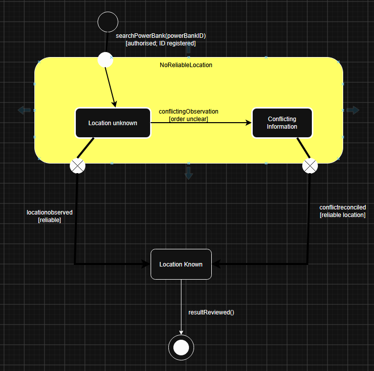
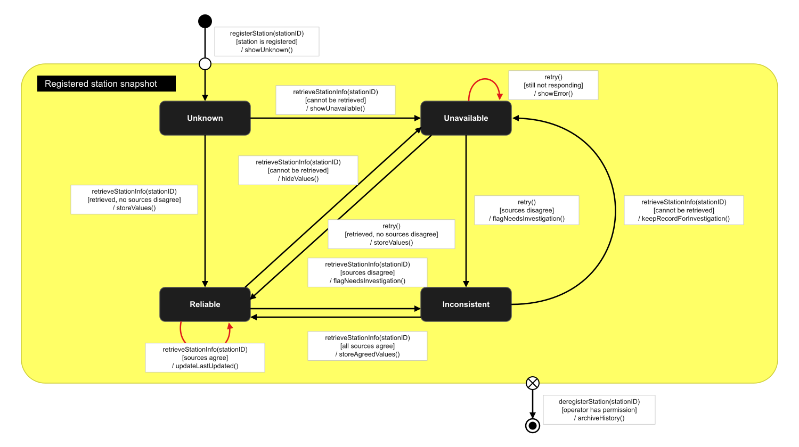
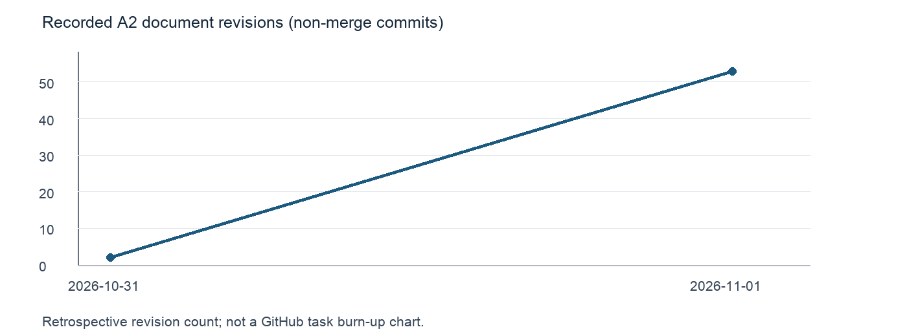

# ChargeMate Ops
## System Design Document (SDD) — COMP2050 Assignment 2

**Design team:** Group 3 — Team A  
**Requirements supplied by:** Group 3 — Team B    
**Source team members:** Christopher Youssef, Daksh Arora, Zeu Sul and Ayaan Ali.

**Date: 01/11/2026**   

| Team member | Student ID |
|---|---|
| Yousef Mustafa | 48603090 |
| Harrison McLuckie | 49154788 |
| Cooper Went | 49067281 |
| Isaac Lynn | [FILL] |

---

# Contents

- [1. Project scope and requirements baseline](#1-project-scope-and-requirements-baseline)
  - [1.1 Purpose and intended audience](#11-purpose-and-intended-audience)
  - [1.2 System scope and boundary](#12-system-scope-and-boundary)
  - [1.3 Received baseline and source documents](#13-received-baseline-and-source-documents)
  - [1.4 Requirement reference list](#14-requirement-reference-list)
  - [1.5 Use-case baseline](#15-use-case-baseline)
- [2. Project vision](#2-project-vision)
- [3. Assumptions, clarification gaps and design decisions](#3-assumptions-clarification-gaps-and-design-decisions)
  - [3.1 Open clarification register](#31-open-clarification-register)
  - [3.2 Design assumptions](#32-design-assumptions)
  - [3.3 Proposed design decisions](#33-proposed-design-decisions)
- [4. System architecture and rationale](#4-system-architecture-and-rationale)
  - [4.1 Architecture overview](#41-architecture-overview)
  - [4.2 Component catalogue](#42-component-catalogue)
  - [4.3 Requirement-driven architecture rationale](#43-requirement-driven-architecture-rationale)
  - [4.4 External interface responsibilities](#44-external-interface-responsibilities)
  - [4.5 Example: recording a power bank fault](#45-example-recording-a-power-bank-fault)
- [5. User experience: two wireframe/storyboard sets](#5-user-experience-two-wireframestoryboard-sets)
  - [5.1 Storyboard SB-01 — UC-01 View Station Status](#51-storyboard-sb-01--uc-01-view-station-status)
  - [5.2 Storyboard SB-03 — UC-03 Report and Manage a Faulty Power Bank](#52-storyboard-sb-03--uc-03-report-and-manage-a-faulty-power-bank)
- [6. State diagram 1 — FaultRecord](#6-state-diagram-1--faultrecord)
- [7. State diagram 2 — PowerBank Tracking Status](#7-state-diagram-2--powerbank-tracking-status)
- [8. State diagram 3 — OperationalSnapshotQuality](#8-state-diagram-3--operationalsnapshotquality)
- [9. Persistent data, caching and maintenance](#9-persistent-data-caching-and-maintenance)
  - [9.1 Persistent data strategy](#91-persistent-data-strategy)
  - [9.2 Caching and component data access](#92-caching-and-component-data-access)
  - [9.3 Backup, recovery and retention](#93-backup-recovery-and-retention)
  - [9.4 Maintenance, updates and deployment](#94-maintenance-updates-and-deployment)
- [10. Trade-offs and concurrent processes](#10-trade-offs-and-concurrent-processes)
  - [10.1 Important trade-offs](#101-important-trade-offs)
  - [10.2 Concurrent activities and race conditions](#102-concurrent-activities-and-race-conditions)
- [11. Requirements Traceability Matrix](#11-requirements-traceability-matrix)
- [12. Test specifications and test plan](#12-test-specifications-and-test-plan)
  - [12.1 Test approach and fixtures](#121-test-approach-and-fixtures)
  - [12.2 Test inventory](#122-test-inventory)
  - [12.3 Detailed test-case specifications](#123-detailed-test-case-specifications)
  - [12.4 Test plan](#124-test-plan)
- [13. Report to COMP2050 staff](#13-report-to-comp2050-staff)
  - [13.1 Reflection on using the received SRS](#131-reflection-on-using-the-received-srs)
  - [13.2 Tools, communication and changes from A1 to A2](#132-tools-communication-and-changes-from-a1-to-a2)
  - [13.3 Sprint allocations and repository evidence](#133-sprint-allocations-and-repository-evidence)
- [14. References and resources](#14-references-and-resources)
- [Appendix A. Team interaction log and full records](#appendix-a-team-interaction-log-and-full-records)
  - [A.1 Interaction index](#a1-interaction-index)
  - [A.2 Full record template — duplicate for each actual interaction](#a2-full-record-template--duplicate-for-each-actual-interaction)
- [Appendix B. Evidence index and contributions](#appendix-b-evidence-index-and-contributions)
  - [B.1 Evidence index](#b1-evidence-index)
  - [B.2 Individual contributions supported by evidence](#b2-individual-contributions-supported-by-evidence)

---

# 1. Project scope and requirements baseline

## 1.1 Purpose and intended audience

This SDD translates Team B’s ChargeMate Ops requirements into architecture, data rules and planned verification for the Harbour North Plaza network. It supports implementation planning by developers and project managers; it does not report an implemented or tested system.

For A2, Group 3 Team A designs Team B’s operator-facing Ops project. The earlier Customer SRS supplies external interface context, not the Ops baseline. [SRC-01, Section 4; SRC-04]

## 1.2 System scope and boundary

Authorised staff inspect stations/devices, record and resolve faults, view issues and record confirmed redistribution. Unknown, unavailable and conflicting information remain explicit. [SRC-01, Sections 5–6; SRC-05]

| Inside ChargeMate Ops | External responsibility or boundary |
|---|---|
| Station status, available power bank information and recorded attention indicators | The Rental Station System supplies physical observations; a displayed status does not independently prove hardware health |
| Registered device lookup and available recorded location/status | No GPS or guaranteed continuous physical tracking is assumed |
| Fault recording, unresolved-fault exclusion and valid resolution | Physical inspection/repair is staff work; clearing a fault does not itself certify rental eligibility |
| Recording suitable devices' confirmed movement between registered stations | A planned destination is not a completed physical transfer; staff provide confirmation |
| Receiving and reconciling relevant operational/rental/return information | Exact Customer/station contracts remain subject to the clarification register |
| Protected staff operations | Customer registration, payment processing, prices, late-fee calculation and the customer kiosk journey remain outside Ops |

The **ChargeMate Operator** is the primary actor; the **Rental Station System** and **Customer-Facing ChargeMate System** are external collaborators. The SRS establishes no separate maintenance role, so access uses action permissions pending GAP-04. [SRC-01, pp.5–6,14–15]

Customer expects Ops-side release/return confirmations, but Ops’ FRs do not fully allocate them. C-INT provides the proposed exchange boundary while hardware-command ownership remains GAP-02. [SRC-03, pp.7–12,15,23–24]

## 1.3 Received baseline and source documents

| Source ID | Source and version | Precise locator | Use in this design |
|---|---|---|---|
| SRC-01 | Team B, *ChargeMate Ops Software Requirements Specification*, supplied as `SRS (1).pdf`; cover v1.2, 12 September 2026 | Requirements/fit criteria pp.7–9; use cases pp.12–19; recorded open questions pp.30–37 | Primary behaviour and acceptance baseline |
| SRC-02 | Team B handover, `Untitled design (3).mp4`, duration approximately 8:01; recording date not established | Approximately 4:23–6:07: information quality, physical confirmation and unanswered questions; 6:23–7:49: more specific workflow claims | Explanation and discrepancy identification |
| SRC-03 | Group 3 Team A, *ChargeMate Customer SRS*, `Group3_TeamA_COMP2050.pdf`; change log through v1.5 dated 13 September 2026 | Dependencies and requirements pp.7–12; Customer–Ops Q&A pp.23–24; return/problem flows pp.17–19 | External expectations and allocation conflicts |
| SRC-04 | Supplied COMP2050 Assignment 2 instructions | System Design, RTM, Test Specifications and Staff Report headings | Deliverable structure and project swap |
| SRC-05 | Released Project B brief, repository copy | [Project B — ChargeMate Ops](https://github.com/comp2050-2026/Group-3---Team-A/blob/main/project-briefs/PROJECT_B_CHARGEMATE_OPS.md), Sections 2–4 | Plaza context and operator/customer boundary |

The supplied ChargeMate Ops SRS is the requirements baseline for this design. Additional or conflicting details in the handover video are recorded as clarification questions or clearly labelled design assumptions.

## 1.4 Requirement reference list

The following design summaries cover all eight FRs and three NFRs; exact requirements and fit criteria remain in SRC-01, pp.7–9.

| ID | Requirement title | Acceptance consequence for the design |
|---|---|---|
| FR-01 | View Rental Station Status | Match latest available station information and identify unreliable information |
| FR-02 | View Power Bank Availability | Match available records; unknown is not a confirmed count; unresolved faults exclude normal availability |
| FR-03 | Track Individual Power Bank | Match a unique registered ID; not-found, unknown location and conflicting data have distinct outcomes |
| FR-04 | Record Power Bank Fault | Validate and save against the correct device; report missing details and failed saves |
| FR-05 | Identify Faulty Power Banks | Any unresolved fault keeps the device visibly requiring attention and excluded from normal availability |
| FR-06 | Resolve Power Bank Fault | Store a valid resolution and update the associated fault/device view |
| FR-07 | Support Power Bank Redistribution | Record suitable devices' confirmed movement and new station; exclude faulty/unavailable candidates |
| FR-08 | Identify Operational Issues | Distinguish recorded attention conditions from normal operation |
| NFR-01 | Usability | Ordinary staff tasks use visible controls without database/command-line intervention |
| NFR-02 | Operational Data Reliability | Do not display assumed values as confirmed; expose unavailable, unknown and conflicting information |
| NFR-03 | Security and Access Control | Deny unauthorised operational access; allow only permitted actions |

`FR-xx` refers to Ops throughout this document. A Customer requirement is prefixed `Customer.FR-xx` to prevent collisions between the two SRS numbering schemes.

## 1.5 Use-case baseline

| Source use case | Design interpretation | Source |
|---|---|---|
| UC-01 — View Station Status | Open monitoring, inspect available station information, select a station and recognise unavailable/conflicting/attention conditions | SRC-01 pp.12–13; Figure 3 p.16 |
| UC-02 — Track a Power Bank | Search a unique ID and inspect available status/location; distinguish missing ID from unknown location and conflicting observations | SRC-01 pp.13–14; Figure 4 p.17 |
| UC-03 — Report and Manage a Faulty Power Bank | Identify device, validate/save a fault, preserve exclusion and later record a permitted resolution; failed updates do not count as success | SRC-01 pp.14–19; Figure 5 p.18 |
| Supporting redistribution scenario | Select candidate/source/destination, revalidate suitability, confirm physical movement and commit the new recorded location | FR-07; overall model p.11 and historical UC-04 discussion pp.36–38 |
| Supporting issue-view scenario | Inspect the attention indicators generated by recorded faults, unavailable stations and inconsistent information | FR-08 and UC-01/02/03 failure/alternative branches |

FR-07 requires redistribution despite the absence of a fourth complete detailed use case. The supporting scenarios are design elaborations; return, fault resolution and rental readiness remain separate facts.

# 2. Project vision

ChargeMate Ops gives Harbour North Plaza staff a shared view of rental stations, power banks and issues requiring attention. Operators can inspect reliable status information and follow a reported fault through investigation and resolution across shifts. The design makes unknown data and failed saves visible and excludes unresolved faulty devices from rental availability and redistribution. Its intended outcome is coordinated operational work with clear records that staff can trust and hand over between shifts.

# 3. Assumptions, clarification gaps and design decisions

A **gap** is an unanswered source question; an **assumption** is a provisional planning condition; a **decision** selects and justifies an implementation approach. Neither assumptions nor decisions imply stakeholder approval.

## 3.1 Open clarification register

The register records unresolved source questions, their impact and provisional handling. Source labels are defined in Section 1.3; no later stakeholder response is claimed.

| Gap ID | Unanswered question and source | Affected requirements | Provisional handling | Status |
|---|---|---|---|---|
| GAP-01 | Exchange fields, ownership and update timing? [SRC-01, pp.5,30,33,37] | FR-01–FR-03, NFR-02 | Agree the contract; retain source/time and expose unavailable/conflicting data. No numerical refresh promise. | Open — interface/timing |
| GAP-02 | Who authorises rentals, releases devices and confirms returns? [SRC-03, pp.7–12,15,23–24; SRC-01, pp.7–9] | Cross-system allocation; FR-02, FR-03 | Keep C-INT as the exchange boundary; do not assume payment or hardware-control responsibilities. | Open — ownership |
| GAP-03 | Charge/availability criteria, exact counts and return capacity? [SRC-01, pp.7–8,30–31,37; SRC-03, pp.8,23] | FR-02, FR-05, FR-07 | Separate charge, presence, occupancy and faults. Missing eligibility does not establish suitability or zero stock. | Open — eligibility/capacity |
| GAP-04 | Required statuses/fault fields and resolver permissions? [SRC-01, pp.31,37] | FR-01, FR-03, FR-04, FR-06, NFR-03 | Use ASSUMP-03 fields and per-action permission checks; no invented roles, categories or priorities. | Open — dictionary/access |
| GAP-05 | Unavailable destination, competing changes or failed recording after physical movement? [SRC-01, pp.8,32] | FR-07, NFR-02 | Recheck suitability/version and require physical confirmation; retain contradictory movement evidence for investigation. | Open — reconciliation/capacity |
| GAP-06 | Automatic alert triggers, priority and resolution rules? [SRC-01, p.32] | FR-08 | Show recorded issues; add automatic thresholds/notifications only after agreement. | Open — automation |
| GAP-07 | Video claims of real-time telemetry, dock blocking and restored availability versus the SRS? [SRC-02, 6:23–7:49; SRC-01, pp.18–19,33] | FR-01, FR-03, FR-05, FR-06, NFR-02 | Use latest-available facts. Keep local fault exclusion; agree remote blocking separately. Resolution alone proves neither charge, presence nor eligibility. | Open — handover conflict |
| GAP-08 | Performance, availability, backup, retention and recovery targets? [SRC-01, pp.7–9] | NFR-01–NFR-03; operations | Specify mechanisms and qualitative checks; seek agreement on numerical targets. | Open — operational targets |

Open details do not weaken confirmed FRs: FR-07 still requires confirmed movement and excludes unsuitable candidates; FR-08 still requires recorded-issue visibility.

## 3.2 Design assumptions

These provisional assumptions support planning without adding requirements attributed to Team B.

| Assumption ID | Provisional assumption | Reason for using it | Risk if incorrect / required change | Affected area and validation status |
|---|---|---|---|---|
| ASSUMP-01 | Staff have a supported browser and network for normal tasks. | Common interface without separate installed apps. | Offline/restricted-device needs would change interface/deployment. | NFR-01/03; context unconfirmed |
| ASSUMP-02 | An agreed setup process supplies registered station/device IDs and authorised staff identities. | SRS presupposes registration/access, not administration screens. [SRC-01, p.6] | Agree provisioning/import before implementation. | FR-01–FR-07, NFR-03; setup open |
| ASSUMP-03 | Faults need a registered device ID and non-empty description; resolutions need a note and permitted operator. | Concrete provisional validation for valid device-linked records. | Revised fields require coordinated form, validation and test changes. | FR-04/06, NFR-03; fields/access open |
| ASSUMP-04 | Multiple faults may coexist; any unresolved fault keeps the device excluded. | One resolution cannot hide another issue. | A one-active-fault policy would change schema/workflow, while retaining exclusion. | FR-04–FR-06; policy unconfirmed |
| ASSUMP-05 | Sources supply stable event IDs and ordering information where automated deduplication/ordering is required. | Recognise retries and late data independently of arrival time. | Without comparable ordering, retain contradictions for investigation. | FR-01–FR-03, NFR-02; contract open |

No charge threshold, refresh deadline, low-stock trigger or recovery target is invented. Unique IDs do not imply GPS: location may remain unknown or require investigation.

## 3.3 Proposed design decisions

Drafted 1 November 2026, these choices remain proposals where confirmation is open. Their implications appear in Sections 4 and 9–12; the date is not evidence of a meeting or approval.

| Decision ID | Proposed choice and alternative | Rationale | Requirement / gap link | Status |
|---|---|---|---|---|
| DEC-01 | Web UI, modular backend and PostgreSQL; alternative: separate business services. | Shared transactions keep fault/device/movement changes consistent; modules separate responsibilities. | FR-04–FR-07, NFR-01; ASSUMP-01 | Proposed deployment |
| DEC-02 | Separate fault, location, charge/occupancy and quality facts; alternative: one status flag. | Known location or resolved fault does not establish full eligibility. | FR-02/03/05/06, NFR-02; GAP-03/04 | Dictionary pending |
| DEC-03 | Backend action permissions and save-time version checks; alternative: trusting UI controls/stale reads. | Reject unauthorised requests and outdated decisions. | NFR-03, FR-05/07; GAP-04/05 | Access assignments pending |
| DEC-04 | Commit an outgoing-update record with the business change; deliver/retry separately. Alternative: await remote response. | Preserve local durability during remote outages and distinguish saved from synchronised. | FR-04–FR-06, NFR-02; GAP-01/07 | Contract pending |
| DEC-05 | Database-backed reads, no separate business cache or offline write queue; alternative: cached copies/queued changes. | Reduce stale copies and commands; backend validates every change. | NFR-02, FR-05/07; ASSUMP-01 | Revisit with measured/offline needs |
| DEC-06 | Recorded issues first; automatic alerts need defined rules. Alternative: assumed thresholds/predictions. | Meet the confirmed need without inventing business rules. | FR-08; GAP-06; SRC-05 Section 3 | Alert rules open |

Decision changes require coordinated diagrams, data rules, RTM and tests. Record actual responses/reviews with evidence and date before marking an open item agreed.

# 4. System architecture and rationale

## 4.1 Architecture overview

The three layers are C-UI, a modular backend and C-DB (PostgreSQL). Staff monitor, search, manage faults and confirm redistribution through C-UI; the backend checks permission and business rules before accessing persistent records. [DEC-01; ASSUMP-01]

Backend modules form one application, allowing related fault/device/movement changes to commit atomically. C-INT routes external input through the same domain rules and delivers outgoing updates separately.

**Figure ARCH-01.** Ops contains C-UI/C-AUTH, four domain modules, C-INT and C-DB. Operator, station and Customer systems are external. Solid arrows show logical exchanges; the dashed Customer exchange has a provisional contract. The figure assigns neither payments nor automatic hardware control. Editable source: [ARCH-01.drawio](diagrams/ARCH-01.drawio), using [draw.io](https://app.diagrams.net/).

A modular backend fits the pilot’s shared transaction needs. It trades independent business-service scaling/releases for simpler consistency and a shared application/database dependency.

## 4.2 Component catalogue

`C-` IDs are proposed component labels derived from the SRS functions. Use them consistently in architecture, RTM and tests; state diagrams may name the objects those components manage.

| Component | Responsibility | Main exchanges | Requirements supported |
|---|---|---|---|
| C-UI — Operator Web Interface | Station/device views, fault/resolution forms, movement confirmation and qualified recovery messages. | Actions → backend; results/quality → screens | FR-01–FR-08, NFR-01, NFR-02 |
| C-AUTH — Staff Access Control | Identify staff and check each action/resource; deny when permission is unestablished. | Identity/action/target → allow/deny | NFR-03; all protected operational functions |
| C-MON — Station Monitoring | Combine station observations, device/fault facts and attention indicators. | Station query → summary/detail via C-DEV/C-FAULT | FR-01, FR-02, FR-08, NFR-02 |
| C-DEV — Device Registry | Registered-ID lookup, location/facts and record versions. | Device ID → details, not-found or investigation | FR-03; identification/location support for FR-02, FR-04–FR-08 |
| C-FAULT — Fault Management | Validate/save faults and resolutions; retain exclusion while any fault is unresolved. | Device-linked input → saved result or rejection/failure; exclusion → domain modules | FR-04, FR-05, FR-06, FR-08 |
| C-MOVE — Redistribution Management | Check registered stations/current suitability and record confirmed movement. | Device/stations/physical confirmation → destination or conflict/failure | FR-07; affects FR-02, FR-03, FR-05 |
| C-INT — Integration and Reconciliation | Validate source/message, deduplicate/order where supported, preserve conflicts and deliver updates. | External records → domain rules; outgoing updates → agreed recipient | FR-01–FR-03, FR-08, NFR-02; agreed fault/status exchange |
| C-DB — Operational Store | Persist stations/devices, faults, movements, observations, versions and processing records with constraints. | Protected transactions → commit/rollback | Persistent support for FR-01–FR-08 and NFR-02 |

C-MON queries device/fault data; C-MOVE checks C-DEV/C-FAULT before completion. C-FAULT/C-MOVE coordinate through the same device/version. Shared storage never bypasses domain rules.

External systems cannot access C-DB directly. C-INT validates service access and routes domain changes; its worker records delivery status without changing eligibility independently. Storage and concurrency rules follow in Sections 9–10.

## 4.3 Requirement-driven architecture rationale

| Requirement / concern | Design response | Reason and limitation |
|---|---|---|
| NFR-01 — Usability | C-UI presents visible task controls/results. | Ordinary tasks need no database/CLI access; representative-user tests must verify usability. |
| NFR-02 — Operational Data Reliability | C-INT keeps source/time; C-MON/C-DEV expose data quality. | Unknown/unavailable/conflicting never becomes normal/zero. Timestamps imply no freshness guarantee. |
| NFR-03 — Security and Access Control | Backend C-AUTH checks; restricted C-INT exchanges. | Hidden buttons are insufficient. Denial changes no records; permission assignments remain open. |
| FR-04–FR-06 — Fault lifecycle | C-FAULT/C-DEV share transactions; exclusion derives from unresolved faults. | No partial successful resolution; one resolution cannot clear another fault. |
| FR-07 — Confirmed redistribution | C-MOVE rechecks suitability, version and physical confirmation. | A selected destination is not a physical location; conflicts require investigation. |
| GAP-01/02/07 — External boundary | C-INT separates external mapping/communication from domain logic. | Provisional exchanges do not silently allocate rental control or dock blocking. |

Least privilege, default denial and per-request checks follow [OWASP authorisation guidance](https://cheatsheetseries.owasp.org/cheatsheets/Authorization_Cheat_Sheet.html); short row-locked writes follow [PostgreSQL locking](https://www.postgresql.org/docs/18/explicit-locking.html). These support technical choices, not ChargeMate business rules.

## 4.4 External interface responsibilities

The proposed exchanges below support planning, not an existing API. Exact formats, ownership and timing remain open under Section 3.

| Exchange | Direction and proposed information | Processing / failure behaviour | Responsibility and assumption |
|---|---|---|---|
| Station observations | Rental Station System → C-INT: station/device identifiers, observation time, available status/location/availability facts, event ID and source revision where supplied | Validate source and registration; preserve missing fields; record conflicts rather than overwrite contradictory facts blindly | Stations supply physical observations. Charge/capacity semantics and ordering support remain GAP-01/03 and ASSUMP-05. |
| Rental/return facts | Customer → C-INT: event ID, device ID, station ID where applicable, event type/time and source revision where available | Route accepted facts through C-DEV/domain rules; repeated or late input cannot silently erase newer or conflicting evidence | Customer supplies its recorded rental/return information. This exchange does not itself define who authorises release or confirms physical docking. |
| Operational changes | C-INT → agreed Customer/station recipient: entity ID, changed operational facts, local revision and event ID | Save the pending outgoing update with the business change; retry delivery separately and distinguish pending from acknowledged delivery | Ops owns its recorded fault/movement changes. Remote exclusion/blocking requires the recipient's agreed handling; local success alone does not prove it happened. |
| Operational information requests | Agreed external caller → C-INT: permitted station/device query; response includes accepted values and quality/source/time information | Apply service access checks; return unknown/unavailable/conflicting information explicitly | Share only the fields needed by the agreed interface. Exact-count/return-capacity ownership remains GAP-01/03. |

Docking/release hardware stays with the external station system; accounts, pricing and payments stay with Customer. Ops owns operational records/views. Command/acknowledgement ownership remains GAP-02; exchanges need no payment credentials.

### Consistent command results

Protected writes carry a target ID, expected version and operation ID. Outcomes are **committed**, **validation rejected**, **not found**, **access denied**, **version conflict** or **save failed**. Commit returns the saved ID/version. An authorised retry with the same identity, operation ID and input returns that result without repeating the change; altered reuse is rejected. Rejected/rolled-back requests never leave success receipts.

## 4.5 Example: recording a power bank fault

1. The operator finds a device through C-UI. C-AUTH checks access, and C-DEV returns the registered device information.
2. The operator submits fault details for that selected device. C-AUTH checks permission to record the fault.
3. C-FAULT validates the details and coordinates with C-DEV/C-DB to save the fault, update the device version and record any pending outgoing update together.
4. C-UI shows success only after the save commits. C-DEV/C-MON/C-MOVE use the unresolved-fault rule so the device is visibly requiring attention and is not normally available or a suitable movement candidate.
5. C-INT delivers the outgoing status update under the proposed contract. If delivery fails temporarily, the saved fault remains active and external synchronisation remains pending.

The sequence separates responsibilities while preserving one committed operational result.

# 5. User experience: two wireframe/storyboard sets

## 5.1 Storyboard SB-01 — UC-01 View Station Status

**Actor:** An authorised ChargeMate Operator checks the plaza network at shift start or busy periods, using a desktop or tablet (ASSUMP-01). Visible controls must support station checks without database or command-line access (NFR-01).

**Preconditions:** The operator is signed in and authorised to view station information (NFR-03). The stations are registered in ChargeMate Ops (SRC-01 A01).

**Requirements:** FR-01, FR-02, FR-05, FR-08, NFR-01, NFR-02, NFR-03

### SB-01 Storyboard sequence

| Step | Operator action / screen | System response and next step |
|---|---|---|
| 1 | Open station monitoring (WF-01). | Show station identities and available status/availability; qualify missing information. |
| 2 | Select a station (WF-02). | Show that station’s recorded details and last-update information. |
| 3 | Inspect an attention or data-quality condition (WF-03). | Distinguish recorded faults from unavailable/conflicting data; retain source evidence for investigation. |
| 4 | Retry after a failed retrieval. | Replace qualified values only after reliable information arrives; a failure is never displayed as a confirmed zero. |

### SB-01 Wireframes

*Figure 5.1.1 — WF-01 Station overview.*

*Figure 5.1.2 — WF-02 Selected station.*

*Figure 5.1.3 — WF-03 Attention / recovery view.*

## 5.2 Storyboard SB-03 — UC-03 Report and Manage a Faulty Power Bank

**Actor:** The same operator reports a damaged/non-charging device, often at its station. Another shift may later resolve it. The short form supports device-side reporting; resolution is an action permission, not an invented separate role. [SRC-01 Section 7.3.3; GAP-04; ASSUMP-03]

**Preconditions:** The operator is signed in and has permission to record faults (NFR-03). The power bank is registered with a unique ID (SRC-01 A02).

**Requirements:** FR-03, FR-04, FR-05, FR-06, FR-08, NFR-01, NFR-02, NFR-03

### SB-03 Storyboard sequence

| Step | Operator action / screen | System response and next step |
|---|---|---|
| 1 | Search the power-bank ID (WF-04). | Match a registered device; distinguish not-found from unknown location. |
| 2 | Enter a fault description (WF-05). | Validate required details and action permission. Missing details keep the operator on the form. |
| 3 | Submit and inspect the result (WF-06). | Confirm only a committed save; retain input on rejection. A lost response is unconfirmed and is checked using the same operation ID. |
| 4 | Later inspect the unresolved fault (WF-07). | Preserve its device association, attention indication and exclusion while unresolved. |
| 5 | An authorised operator records a resolution (WF-08). | Keep the fault active after a failed save; after success retain resolution history. Other unresolved faults still exclude the device, and charge/location eligibility is checked separately. |

### SB-03 Wireframes

*Figure 5.2.1 — WF-04 Device search / detail.*

*Figure 5.2.2 — WF-05 Fault entry.*

*Figure 5.2.3 — WF-06 Save result.*

*Figure 5.2.4 — WF-07 Later fault review.*

*Figure 5.2.5 — WF-08 Resolution entry / result.*

# 6. State diagram 1 — FaultRecord

**Owner: Harrison | Reviewer: Yousef | Cooper checks the related screen behaviour | Status: [FILL]**

The object choice is proposed. If replaced, choose another object with meaningful states and update the contents and links.

**Object and purpose:** FaultRecord Represents a reported fault against a submitted power bank. It tracks when the faulty record was submitted, and what is wrong with it.
**Requirements/use cases:** UC-03 – Report and Manage a Faulty Power Ban, FR-04, FR-05, FR-06, FR-07, FR-08
**Figure SD-01:** 

| Current state | Event | Guard / condition | Action | Next state | Related test |
|---|---|---|---|---|---|
| Initial | reportfault(powerbankID, powerbankproblem) | Power bank is registered, details are valid | Create record for the power bank, mark it as faulty | Active -> reported | [FILL] |
| Reported | reviewfault(FaultID) | fault exists | record that the fault is under investigation | Reviewing | [FILL] |
| Under-Investigation | fixfault(FaultID, status) | fault fix is successful | store that bank is fixed, remove record, allow for rehiring | Resolved | [FILL] |
| Under-Investigation | fixfault() | save fails | show error, leave record unchanged | Under-Investigation | [FILL] |
| Under-Investigation | fixfault() | reviewer has improper access | show error, leave record unchanged | Under-Investigation | [FILL] |
| Resolved | None | None | None | FinalState | n/a |

**Valid Creation**: Only an authorised person can report that a fault has been created/fixed. it is then flagged as needing repairs, and that the repair is active.
**Unresolved Investigation**: The record stays active when an error occurs, leaving the data untouched so it can be successfully resolved
**Successfull Resolution**: The authorised user submits the fixed fault, and the save succeeds. the records are resolved and the device status is updated to reflect this.
**Failed Save**: If the save fails, the record of the fault remains active, and no further data is saved. The failure isnt treated as a resolution to the fault.
**Unauthorised Resolution**: the resolution is denied, and the record remains active.

# 7. State diagram 2 — PowerBank Tracking Status

**Owner: Harrison | Reviewer: Yousef | Coordinate the movement/data rules with section 9 | Status: [FILL]**

**Object and purpose:** Powerbank tracking status. represents the data that ChargeMate Ops can see about the location of a power bank, seperating known location, and information that needs to be investigated.
**Requirements/use cases:** UC-02 - Track a Power Bank, FR-03 
**Figure SD-02:**

| Current state | Event | Guard / condition | Action | Next state | Related test |
|---|---|---|---|---|---|
| Initial | searchPowerBank(powerBankID) | Operator authorised; ID registered; information retrievable | Open tracking lookup; display "unknown" until reliable information is available | No reliable location → Location unknown (via entry point) | [FILL] |
| Location unknown | locationObserved(id, location, source, time) | Observation is reliable and consistent with recorded data | Display recorded status and location | Location known (via exit point) | [FILL] |
| Location unknown | conflictingObservation(id) | Sources disagree and order cannot be established (ASSUMP-05) | Keep both observations; display "requires investigation" | Information conflicting | [FILL] |
| Information conflicting | conflictReconciled(id) | A reliable location is established | Record outcome; clear the investigation flag; display location | Location known (via exit point) | [FILL] |
| Location known | resultReviewed() | Operator has viewed the information | Close the lookup | Final | [FILL] |

**What the Object is:** Diagram shows 1 pass of the location tracking on the power bank
**How the Lookup Starts:** an authorised operator starts the search with an id for a powerbank. Location is put into location unknown state until a valid location is found.
**Failed Search:** If the id is not registered or cannot be retrieved, an error is shown and nothing is stored.
**Unknown State:** If the operator cannot see the current state of the power bank, a specific unknown value is returned, instead of a guessed value.
**Conflicting Information:** if multiple sources of data come in and the order is not proper, the operator will see a requires investivation flag to try and fix it.
**Successful Outcome:** in order for the outcome to be successful, a meaningfully ordered location data must be transmitted and saved to the main operator
**Unchanged on failure:** if something fails, the system saves no data and nothing is altered.

# 8. State diagram 3 — OperationalSnapshotQuality

**Object and purpose:** OperationalSnapshotQuality represents how trustworthy the information ChargeMate Ops currently holds about a rental station is. It does not track whether the station itself is working. A station can be reported as offline and that report can still be reliable. It only tracks whether the system can trust the status and availability it is showing the operator in UC-01.

**Requirements/use cases:** UC-01 – View Station Status, FR-01, FR-02, FR-08, NFR-02

**Related screens:** WF-01, WF-02, WF-03

**Figure SD-03:** 

| Current state | Event | Guard / condition | Action | Next state | Related test |
|---|---|---|---|---|---|
| Initial | registerStation(stationID) | station is registered | create a snapshot with no values, show "Unknown" | Unknown | [T-01](#t-01--view-station-status-with-reliable-information) |
| Unknown | retrieveStationInfo(stationID) | information retrieved, no sources disagree | store status and availability with source and time, show "Last updated" | Reliable | [T-03](#t-03--conflicting-station-information-flagged-and-cleared) |
| Unknown | retrieveStationInfo(stationID) | information retrieved but sources disagree | preserve both observations and their source/time; flag “Needs investigation” | Inconsistent | [T-03](#t-03--conflicting-station-information-flagged-and-cleared) |
| Unknown | retrieveStationInfo(stationID) | information cannot be retrieved | show "Unavailable" and "—" instead of a number | Unavailable | [T-02](#t-02--station-information-unavailable-then-retry) |
| Reliable | retrieveStationInfo(stationID) | information retrieved, sources agree | update values and "Last updated" time | Reliable | [T-01](#t-01--view-station-status-with-reliable-information) |
| Reliable | retrieveStationInfo(stationID) | Rental Station System and Customer system disagree | keep both values with their source, flag "Needs investigation" | Inconsistent | [T-03](#t-03--conflicting-station-information-flagged-and-cleared) |
| Reliable | retrieveStationInfo(stationID) | information cannot be retrieved | hide values, show "Unavailable" with the time of the last response | Unavailable | [T-02](#t-02--station-information-unavailable-then-retry) |
| Unavailable | retry() | information retrieved, no sources disagree | store values, remove "Unavailable" label | Reliable | [T-03](#t-03--conflicting-station-information-flagged-and-cleared) |
| Unavailable | retry() | information retrieved but sources disagree | keep both values, flag "Needs investigation" | Inconsistent | [T-03](#t-03--conflicting-station-information-flagged-and-cleared) |
| Unavailable | retry() | station still not responding | show error, leave values hidden | Unavailable | [T-02](#t-02--station-information-unavailable-then-retry) |
| Inconsistent | retrieveStationInfo(stationID) | all sources now agree | store agreed values, remove "Needs investigation" | Reliable | [T-03](#t-03--conflicting-station-information-flagged-and-cleared) |
| Inconsistent | retrieveStationInfo(stationID) | information cannot be retrieved | show "Unavailable", keep record for investigation | Unavailable | [T-03](#t-03--conflicting-station-information-flagged-and-cleared) |
| Any state | deregisterStation(stationID) | operator has permission | archive the snapshot history | Final state | [T-26](#t-26--station-snapshot-archival-permitted-and-denied) |

**Initial conflicting retrieval:** The Unknown → Inconsistent transition in the table also applies when the first successful retrieval already contains conflicting observations. This supplements the supplied SD-03 figure; no confirmed count is shown in that case.

- **Unknown information**: The snapshot starts as Unknown because nothing has been retrieved for the station yet. The system shows "Unknown" and "—", never 0, so a station with no data can't be mistaken for an empty station.
- **Reliable information**: The latest station information was retrieved and no source disagrees with it (UC-01 main success scenario). Status and availability are shown with the time they were last updated.
- **Unavailable information**: The station information couldn't be retrieved (UC-01 alternative flow "Station Information Unavailable"). The system hides the old values instead of showing them as if they were current, and shows when the station last responded (NFR-02).
- **Inconsistent information**: The sources disagree, for example the Rental Station System says 6 docked but the rental records imply 5 (UC-01 alternative flow "Inconsistent Station Information"). Both values are kept side by side and the station is flagged "Needs investigation". Neither value is treated as confirmed and the operator can't overwrite either one (WF-03).
- **Quality vs health**: This  only describes how much the station information can be trusted. Whether the station is offline or has a faulty power bank is stored separately (DEC-02).
- **No deadline**: The SRS doesn't give a time limit for how old station information can be (GAP-01), so it only moves to unavailable when it actually fails, not after a set amount of time.
# 9. Persistent data, caching and maintenance

## 9.1 Persistent data strategy

C-DB is server-side PostgreSQL storage for durable, linked station/device/fault/movement records. It supports shared transactions under DEC-01–DEC-04; PostgreSQL is a design choice, not an SRS mandate.

Only authorised backend functions access C-DB. C-INT routes facts through domain rules; its worker handles integration records. Staff/external systems have no direct database access. Identity provisioning remains ASSUMP-02, without assumed registration screens.

The logical model below describes proposed information and relationships stored in C-DB, not a completed schema.

| Entity / record | Main information and relationships | Responsible component / access | Integrity rule |
|---|---|---|---|
| Station | ID, location description, version; linked observations | C-MON reads; setup registers; C-INT routes observations | Completed moves reference registered stations. Missing facts remain unknown, never normal/zero. |
| PowerBank | ID, version, last confirmed station; separate location/charge/occupancy facts | C-DEV coordinates; domain modules query | Distinguish last-recorded from reliable current location; never invent a station. |
| FaultRecord | ID, device, description, unresolved/resolved condition, investigation progress, report/resolution actors/times/note, version | C-FAULT writes; C-MON/C-DEV/C-MOVE query | Registered device; ASSUMP-03 validation. Any unresolved fault excludes rental availability and redistribution. |
| RedistributionJob | ID, device, source/destination IDs, state, expected version, physical confirmation, actor/time | C-MOVE writes; C-DEV/C-MON read effects | Plans are not completed moves. Save completion/location atomically under Section 10.2 guards. |
| Observation / information quality | Entity/field/value, source, event/revision, observation/received times, quality/conflicting evidence | C-INT validates; C-DEV/C-MON accept/present | Preserve source evidence separately from accepted values. Arrival time alone cannot resolve conflicts. See Section 9.2. |
| Incoming processing record | Source/event ID, input fingerprint, result, affected record/version | C-INT and domain module | Source-scoped deduplication; reject conflicting ID reuse. Ordering depends on ASSUMP-05. |
| Command receipt | Identity/operation ID, input fingerprint, committed result/version | Domain module saves; C-AUTH checks access | Commit with business change. Identical authorised retries return saved results; failed saves leave no success receipt. |
| Pending outgoing update | Event/entity/version, payload, recipient, delivery state, attempts/acknowledgement | Domain transaction creates; C-INT delivers | Commit locally under DEC-04; remote acknowledgement is separate and does not prove hardware action. |

Unique/foreign keys enforce identities and registered-device/station relationships; required/allowed-value constraints reject malformed records. Cross-record suitability rules remain backend transaction checks. See PostgreSQL [constraints](https://www.postgresql.org/docs/18/ddl-constraints.html).

### Separate operational facts from information quality

Store fault state, location, charge, occupancy and quality separately. A resolved fault proves neither charge nor presence/eligibility; missing/conflicting eligibility cannot establish suitability. A partial inventory cannot yield a confirmed exact total. [DEC-02; FR-02/03/05–07; NFR-02; SRC-01 pp.7–9; GAP-03/04]

Reported/investigating faults remain unresolved until a valid resolution commits. Progress names need not match a combined device-status field.

Keep observation and received times separate. Label useful previous evidence last-known; timestamps alone prove neither reliability nor a freshness guarantee.

### Changes that must be saved together

- **Record a fault:** save the validated fault, increment the coordinated device version, and save the command receipt and any required outgoing update in one transaction.
- **Resolve a fault:** save the resolution and related version/receipt/outgoing changes together. Recheck remaining unresolved faults before deriving the device's exclusion result.
- **Complete redistribution:** recheck permission, suitability, expected device version and physical confirmation; save movement completion and the destination/version change together with the receipt and any outgoing update.
- **Accept an external event:** save its processing result with any accepted domain changes. Repeated input must not apply the same change again; contradictory evidence is retained for investigation rather than silently replacing a reliable value.

Return success only after commit; failure rolls back all related database changes ([PostgreSQL transactions](https://www.postgresql.org/docs/18/tutorial-transactions.html)). Physical movement cannot roll back: investigate recording failure under Sections 9.3/10.2. Deliver external updates separately after commit. These are planned behaviours, not executed tests.

## 9.2 Caching and component data access

### Cache scope and refresh rules

Under DEC-05, operational reads use C-DB without a separate business cache, reducing stale copies at the cost of database availability. Stored observations remain source/time-qualified evidence, not proof of a currently connected station or unchanged physical state.

C-UI keeps displayed results in memory, with no persistent offline operational store or write queue. Static assets may be cached without staff records; protected responses avoid persistent browser/shared caching.

Fetch fresh results on opening/manual refresh. Re-fetch affected device/fault/station results after successful changes, version conflicts or reconnection. Sign-out and denied/expired access clear protected data. Failed retrieval qualifies retained evidence as last-known; the Section 8 station view hides current counts while unavailable. Automatic polling/push and timing remain GAP-01.

### Component requests and consistency

| Request / activity | Component route | Data and checks |
|---|---|---|
| Station status, availability and recorded issues | C-UI → C-AUTH → C-MON; C-MON uses C-DEV/C-FAULT query functions | Combine accepted station observations with device records and unresolved faults. Return relevant quality, source/time and record-version information with values. |
| Individual device lookup | C-UI → C-AUTH → C-DEV; C-DEV uses C-FAULT information | Check access and registration; distinguish not-found from a registered device whose location or other facts are unknown/unavailable. |
| Fault creation/resolution or movement completion | C-UI → C-AUTH → C-FAULT/C-MOVE, coordinating with C-DEV and C-DB | Recheck permission, input, expected versions and current business rules; use the transaction boundaries in Section 9.1 and command outcomes in Section 4.4. |
| External observations and outgoing delivery | External system ↔ C-INT; accepted changes pass through domain modules | Validate the source and agreed fields, recognise duplicate input where supported, and keep delivery status separate from committed local records. |

Routes are calls within the modular backend; restricted service credentials mediate C-DB access.

Assemble multi-query views in short read-only repeatable-read transactions, keeping fault/eligibility facts on one database snapshot ([PostgreSQL isolation](https://www.postgresql.org/docs/18/transaction-iso.html#XACT-REPEATABLE-READ)). This guarantees stored-data consistency, not physical freshness. Writes recheck current state under Section 10.

C-AUTH checks every protected request, including receipt retrieval; UI visibility never grants access or proves suitability. [DEC-03; [OWASP authorisation](https://cheatsheetseries.owasp.org/cheatsheets/Authorization_Cheat_Sheet.html)]

### Unavailable information and uncertain outcomes

Distinguish unknown, unavailable and conflicting facts under NFR-02. Preserve useful qualified evidence, never substitute zero/healthy/suitable. Database read failure shows unavailable; confirmed rollback shows save failed; only commit establishes a saved result.

A lost post-submission response leaves the outcome unconfirmed. Recheck/retry with the same operation ID/input, checking permission and receipt first. Local faults remain effective during outgoing-delivery failure; show synchronisation pending separately. Screens and Section 12 specify these paths, not execution results.

## 9.3 Backup, recovery and retention

### Proposed backup approach

Propose scheduled PostgreSQL base backups plus continuous write-ahead-log (WAL) archiving. Restore a base backup and replay its uninterrupted log sequence to a consistent point; changes beyond recoverable material may be lost. See [PostgreSQL recovery](https://www.postgresql.org/docs/18/continuous-archiving.html).

Recover the entire C-DB together: operational records, observations, receipts, incoming-processing and outgoing-update records. Preserve deployment configuration, database access definitions and recovery keys as well as data.

Encrypt recovery sets in restricted storage separate from the application/database host; control key access. Record backup/archive results and latest recoverable point. Never replace a usable set with an incomplete one. Agree schedules, storage and responsibilities under Section 9.4; no existing backups are claimed.

### Recovery sequence and verification

1. **Contain:** suspend writes/outgoing delivery, show maintenance/unavailability and preserve incident evidence.
2. **Restore separately:** use an isolated environment, compatible versions and verified recovery material. Record the recovery point, errors and possible data-loss interval; keep delivery disabled.
3. **Verify:** check schema/access, IDs/relationships, unresolved-fault exclusion, movement/location/version agreement and matching receipts/outgoing records.
4. **Reconcile:** compare restored facts with station/Customer evidence and staff investigation. Qualify uncertain locations and exclude devices from confirmed suitability until resolved.
5. **Resume:** reopen only after checks/reconciliation succeed. Enable duplicate-safe processing/delivery and retain pending/investigation outcomes. Record the recovery decision and limitations.

The isolated restore exercise covers usable/corrupt recovery sets, restored exclusion, movement/location consistency, old observations, duplicates and uncertain delivery. Failed restore/checks block reopening. Measure restoration time and unrecovered interval against agreed targets; no executed exercise is claimed. [T-25]

Receipts created after the recovery point may be absent. Their absence cannot prove an action never happened: reconcile uncertain commands/delivery before replay. External deduplication/acknowledgement remains GAP-01/ASSUMP-05. Recovery cannot reverse physical movement or guarantee exactly-once external effects.

### Retention and unconfirmed targets

GAP-08 leaves backup frequency, retention, acceptable loss and restoration time open; establish and validate them before deployment.

Agree retention for records, evidence, receipts and recovery sets. Preserve unresolved exclusion/relationships and deduplication through the supported retry period; older commands require review. Coordinate backup expiry to avoid silently reintroducing purged data on restore. No automatic purge interval is assumed.

## 9.4 Maintenance, updates and deployment

| System part | Update/deployment approach | Compatibility and failure handling | Rollback/recovery |
|---|---|---|---|
| Operator interface | Build as a versioned web bundle. Staff get the new version on their next page load. | The backend accepts the current and previous interface version for one release. An out-of-date page that sends an incompatible request is rejected with a “refresh and retry” message and nothing is partially saved. | Redeploy the previous bundle. No data migration is needed. |
| Backend/business logic | Deploy a new version while the old one finishes in-flight requests, so a fault save is not dropped mid-write. Permission checks and version rechecks (DEC-03) are part of every release. | On startup the backend checks that the database schema version matches, and takes no traffic if it doesn’t. Changes commit fully or not at all, so a failed save is never shown as successful (FR-04, FR-06). | Redeploy the previous build, but only if the schema is still compatible. |
| Database/schema | Changes go through versioned, scripted migrations. We add new structures first, switch the code over, and only remove the old ones in a later release. A backup is taken before every migration. | We rehearse each migration on a copy loaded with synthetic test data (see Section 12). Existing faults, resolutions, movements and observations are kept, including each station’s last-response time. | If the change only added things, roll back the code and leave the data alone. If it removed or changed things, restore the pre-migration backup and manually review anything entered after it was taken. |
| Station/customer adapters | Each adapter is versioned against its agreed message format and deployed separately from the core logic, so a change on the station or Customer side doesn’t force a full release. | Messages we can’t recognise or that are corrupted are kept and flagged, not guessed at. Outgoing updates (DEC-04) wait in a queue while the other system is down and retry once it’s back. | Revert to the previous adapter version. Before replaying any queued messages, check for duplicates (ASSUMP-05). |
| External physical devices | These sit outside Ops (SRS Figure 1). Updating them is up to the station hardware supplier or ChargeMate. Who owns the station firmware isn’t established (GAP-01), so we don’t assume it, and Ops doesn’t install or update it. | If the station side changes its data format or behaviour, we treat it as an interface change (GAP-01, GAP-07). | Ops can roll back its own adapter. Until data arrives again, affected stations show as Unavailable with the time they last responded (NFR-02, SD-03). |

# 10. Trade-offs and concurrent processes

## 10.1 Important trade-offs

These Section 3 choices balance reliability, usability and implementation cost; they are design decisions, not additional inherited requirements.

| Decision | Alternative considered | Competing needs | Choice and justification | Limitation |
|---|---|---|---|---|
| Modular backend + relational DB (DEC-01) | Separate business services | Atomic updates versus independent scaling/releases | One transaction for related fault/device/movement changes; distinct modules. | Shared dependency and coordinated releases. |
| Database-backed views (DEC-05) | Business-data cache | Less staleness versus faster reads | Read domain records; add caching only for measured need. | DB outages block reads; screens can still become stale. |
| Explicit quality (DEC-02) | Trust latest arrival | Reliable decisions versus simpler display | Keep qualified evidence; distinguish unknown/unavailable/conflicting from confirmed zero. | Investigation may delay action; labels must be clear. |
| Online validated writes (DEC-03/05) | Offline write queue | Disconnected convenience versus current validity | Recheck faults, suitability, access and version at save; no automatic stale-command replay. | Outages prevent confirmed saves; physical work may need reconciliation. |
| Backend permissions (DEC-03) | Login/hidden buttons only | Simple UI versus protected operations | Check every action/resource, including retries; expose permitted controls. | GAP-04 assignments; understandable denial messages. |
| Local save, separate delivery (DEC-04) | Await remote response | Durability versus immediate synchronisation | Commit business change/outgoing record together; C-INT delivers. | Local success proves no remote blocking; pending/uncertain delivery remains visible. |
| Base backup + archived changes (Section 9.3) | Periodic copies alone | Later recovery versus maintenance/storage cost | Replay available logs beyond the base backup. | Needs usable logs, archive monitoring and restore checks; GAP-08 targets. |

The design addresses qualitative usability, reliability and access without inventing update intervals/availability percentages. Recorded issues stay in scope; unconfirmed alert thresholds do not justify extra infrastructure. [SRC-01 pp.7–9; GAP-01/06/08]

## 10.2 Concurrent activities and race conditions

Overlapping operations can produce timing-dependent outcomes. Every fault, movement and accepted operational-fact change—including C-INT input—coordinates through C-DEV’s device/version and a short transaction.

| Concurrent events | Possible incorrect outcome | Coordination / guard | Expected result or recovery | Required Section 12 coverage and related specifications |
|---|---|---|---|---|
| Fault report versus movement confirmation | A stale selection admits a now-faulty device. | Lock device; recheck version, unresolved faults, suitability and physical confirmation. | Fault-first rejects stale movement. Move-first is not undone by a later fault; investigate conflicting physical evidence. | Both commit orders; records/exclusion/messages. [T-20](#t-20--fault-report-versus-movement-confirmation-race) |
| Two destination confirmations | Silent location overwrite. | Check device/source version and movement state/version in the same transaction. | Only compatible completion commits; conflict refreshes state. Reconcile any physical move already performed. | Competing destinations, same starting version. [T-21](#t-21--two-operators-confirm-different-destinations) |
| Resolution overlaps another fault | Resolution hides remaining fault/exclusion. | Same device lock/version; derive exclusion from all unresolved records. | Preserve remaining faults; stale versions require refresh. | [T-13](#t-13--resolve-one-of-several-faults-exclusion-persists) covers multiple-fault baseline; concurrent-create extension remains unspecified. |
| Duplicate/late external events | Double application or stale overwrite. | Source/event ID, fingerprint and supported ordering (ASSUMP-05); same device transaction. | Return identical duplicate result; reject altered ID reuse; investigate incomparable contradictions. | Duplicates, older revisions, unordered conflicts. [T-22](#t-22--duplicate-late-and-conflicting-external-events) |
| Lost response and retry | Duplicate fault/movement. | Check access and identity/operation ID/input receipt before treating an old version as a new command. | Return committed result; reject altered reuse. Missing restored receipts require reconciliation. | Lost response; identical/changed retries. [T-23](#t-23--lost-response-and-retry-with-the-same-operation-id) |
| Delivery/acknowledgement fails after local commit | Lost local fault or false remote success. | Atomic local change/outgoing record; stable event ID for retries. | Retain local commit and pending/uncertain delivery; no exactly-once external guarantee. | Delivery failure and lost acknowledgement. [T-24](#t-24--outgoing-delivery-fails-after-local-commit) |

These are planned verification links, not execution results. The concurrent-create extension remains an additional specification obligation.

### Coordination and retry rules

Writes use short read-committed transactions: reserve/check request/event ID, lock device, read current facts, validate version/rules and commit Section 9.1 changes. For multiple devices, lock by consistent device-ID order, then associated records consistently. Section 9.2’s read-only repeatable-read snapshots do not replace write checks.

[PostgreSQL locking](https://www.postgresql.org/docs/18/explicit-locking.html) supports conflicting row locks and consistent acquisition/deadlock retry. A lock cannot prioritise an unreceived fault or reverse physical action. Once a fault commits, later movement validation must exclude that device; a loaded screen cannot authorise completion.

Release database locks before staff movement/repair or external network waits. Preserve conflicting physical movement as investigation evidence with source/actor/time/destination; do not overwrite accepted location or report normal success. If evidence saving also fails, disclose that failure for later reconciliation. Existing location remains last-known.

Bounded transient rollback retries repeat all checks. Stale versions/uncertain physical facts need review. Changed input gets a new operation ID; unchanged retransmission keeps its ID. Retry/escalation limits remain GAP-08. Different devices can proceed concurrently, but device locks alone cannot enforce a future station-capacity rule (GAP-03).

# 11. Requirements Traceability Matrix

The five-column matrix covers all 11 Ops requirements. See [Section 1.4](#14-requirement-reference-list) for summaries, [Section 1.5](#15-use-case-baseline) for use cases and [Section 4.2](#42-component-catalogue) for component IDs. [SRC-01 pp.7–9; SRC-04]

Impact links identify implementation/interface/test dependencies for review, not stakeholder-approved changes to every linked SRS sentence. Links need not be symmetrical.

**Test-link status:** The references below link to the 26 detailed specifications in Section 12.3. They identify planned verification, not executed tests or passing results. Conditional acceptance rules remain documented in Section 12.4.

| Requirement-ID from SRS | Other requirement IDs impacted if it changes | Related use cases | Responsible/affected system components | Related test cases |
|---|---|---|---|---|
| FR-01 | FR-02, FR-08, NFR-01, NFR-02 | UC-01 — View Station Status | C-UI, C-AUTH, C-MON, C-DEV, C-FAULT, C-INT, C-DB | 	[T-01](#t-01--view-station-status-with-reliable-information), [T-02](#t-02--station-information-unavailable-then-retry), [T-03](#t-03--conflicting-station-information-flagged-and-cleared), [T-17](#t-17--recorded-issues-distinguished-from-normal-operation) |
| FR-02 | FR-01, FR-05, FR-07, FR-08, NFR-02 | UC-01; availability checks in supporting redistribution scenario | C-UI, C-AUTH, C-MON, C-DEV, C-FAULT, C-INT, C-DB | 	[T-04](#t-04--confirmed-zero-availability-versus-unknown-availability), [T-05](#t-05--faulty-device-excluded-from-normal-availability) |
| FR-03 | FR-04, FR-06, FR-07, FR-08, NFR-02 | UC-02 — Track a Power Bank; device identification in UC-03 | C-UI, C-AUTH, C-DEV, C-FAULT, C-INT, C-DB | 	[T-06](#t-06--track-a-device-unknown-then-known-location), [T-07](#t-07--track-a-device-unknown-id-retrieval-failure-denied-access), [T-08](#t-08--conflicting-device-location-and-reconciliation) |
| FR-04 | FR-02, FR-03, FR-05, FR-06, FR-07, FR-08 | UC-03 — Report and Manage a Faulty Power Bank | C-UI, C-AUTH, C-DEV, C-FAULT, C-INT, C-DB | [T-09](#t-09--record-a-valid-fault), [T-10](#t-10--fault-rejected-for-missing-details), [T-11](#t-11--fault-save-fails-and-rolls-back), [T-23](#t-23--lost-response-and-retry-with-the-same-operation-id) |
| FR-05 | FR-02, FR-03, FR-04, FR-06, FR-07, FR-08 | UC-03; faulty-device information in UC-01/UC-02; supporting redistribution scenario | C-UI, C-AUTH, C-MON, C-DEV, C-FAULT, C-MOVE, C-INT, C-DB | 	[T-05](#t-05--faulty-device-excluded-from-normal-availability), [T-09](#t-09--record-a-valid-fault), [T-13](#t-13--resolve-one-of-several-faults-exclusion-persists), [T-16](#t-16--redistribution-rejected), [T-20](#t-20--fault-report-versus-movement-confirmation-race) |
| FR-06 | FR-02, FR-03, FR-04, FR-05, FR-07, FR-08 | UC-03 — resolution branch | C-UI, C-AUTH, C-DEV, C-FAULT, C-INT, C-DB | 	[T-12](#t-12--review-and-successfully-resolve-a-fault), [T-13](#t-13--resolve-one-of-several-faults-exclusion-persists), [T-14](#t-14--resolution-rejected-blank-note-no-permission-failed-save) |
| FR-07 | FR-01, FR-02, FR-03, FR-05, FR-08, NFR-02 | Supporting redistribution scenario in Section 1.5; resulting station/device information in UC-01/UC-02 | C-UI, C-AUTH, C-MON, C-DEV, C-FAULT, C-MOVE, C-INT, C-DB | [T-15](#t-15--confirmed-redistribution-of-a-suitable-device), [T-16](#t-16--redistribution-rejected), [T-20](#t-20--fault-report-versus-movement-confirmation-race), [T-21](#t-21--two-operators-confirm-different-destinations) |
| FR-08 | FR-01, FR-02, FR-03, FR-05, NFR-01, NFR-02 | UC-01/UC-02/UC-03 alternative and failure branches; supporting issue-view scenario | C-UI, C-AUTH, C-MON, C-DEV, C-FAULT, C-MOVE, C-INT, C-DB | [T-03](#t-03--conflicting-station-information-flagged-and-cleared), [T-17](#t-17--recorded-issues-distinguished-from-normal-operation) |
| NFR-01 | FR-01–FR-08 | UC-01, UC-02, UC-03; supporting redistribution and issue-view scenarios | C-UI; C-MON, C-DEV, C-FAULT and C-MOVE provide task results and validation feedback | 	[T-19](#t-19--operator-tasks-via-visible-controls-only) |
| NFR-02 | FR-01, FR-02, FR-03, FR-05, FR-07, FR-08 | UC-01/UC-02; information used in UC-03 and supporting scenarios | C-UI, C-MON, C-DEV, C-MOVE, C-INT, C-DB | 	[T-02](#t-02--station-information-unavailable-then-retry), [T-03](#t-03--conflicting-station-information-flagged-and-cleared), [T-04](#t-04--confirmed-zero-availability-versus-unknown-availability), [T-06](#t-06--track-a-device-unknown-then-known-location), [T-08](#t-08--conflicting-device-location-and-reconciliation), [T-22](#t-22--duplicate-late-and-conflicting-external-events), [T-25](#t-25--isolated-restore-and-consistency-check) |
| NFR-03 | FR-01–FR-08, NFR-01 | Every protected operational use case/scenario | C-AUTH; C-UI, C-MON, C-DEV, C-FAULT, C-MOVE, C-INT and C-DB apply the access boundaries | [T-07](#t-07--track-a-device-unknown-id-retrieval-failure-denied-access), [T-14](#t-14--resolution-rejected-blank-note-no-permission-failed-save), [T-18](#t-18--access-control-on-direct-backend-requests), [T-23](#t-23--lost-response-and-retry-with-the-same-operation-id) |

Fault changes affect availability, device views and movement: review FR-02/05/07 when changing resolution so remaining faults or unknown charge cannot be hidden. [DEC-02; ASSUMP-04]

FR-03 affects correct fault/movement association; FR-07 affects station/device views when destinations change. These concrete dependencies explain the impact links.

C-AUTH/C-DB provide shared protection/storage, while C-FAULT owns faults, C-MOVE movement, C-DEV device facts and C-MON station views. NFR-01/03 span those modules’ usable, authorised outcomes.

Concurrency, receipts, retries and recovery are DEC-03–DEC-05 safeguards, not new inherited requirements. Their tests identify relevant decisions. Redistribution elaborates FR-07 without claiming an approved UC-04.

Customer responsibilities remain in the clarification register, outside the 11-row baseline. Conditional tests identify unresolved rules. Check every requirement/test/component link in both directions.

# 12. Test specifications and test plan

**Owner: Harrison | Reviewer: Yousef | Input: all design owners | Status: [FILL]**

Suggested length: approximately 10–15 pages in the final PDF. Specify how the future implementation would be verified. Proposed tests in the earlier review can be reused after checking them against your final design. Keep IDs stable across this section and the RTM.

## 12.1 Test approach and fixtures

Testing is proposed for a future implementation of the design in Sections 4 and 9–10. Expected behaviour is derived from the eight functional and three non-functional requirements and their fit criteria in SRC-01, pp.7–9. Design safeguards such as record versions, duplicate handling and recovery are additionally traced to the relevant DEC/ASSUMP entries. This section defines the approach and synthetic setup; it does not report completed tests or pass results.

### Test levels and observations

| Level | Focus | Evidence to collect during implementation testing |
|---|---|---|
| Component/domain | C-MON station summaries, C-DEV lookup, C-FAULT validation/exclusion, C-MOVE suitability and C-AUTH permission decisions, with controlled dependencies | Actual versus expected outputs for valid, missing, unknown, denied and conflicting inputs. Check that unresolved faults remain effective through reporting/investigation. |
| Integration | Domain modules with an isolated PostgreSQL database and C-INT connected to station/Customer simulators | Saved records, versions, command receipts and pending updates before/after each operation; transaction rollback, duplicates, delayed events and delivery failures. |
| End-to-end/operator | The proposed C-UI workflows for UC-01, UC-02, UC-03 and the supporting redistribution scenario | Visible navigation, labels, messages and resulting saved state. Representative staff perform normal tasks through the interface without database/command-line access or administrative help, as required by NFR-01. |
| Recovery/concurrency | The isolated restore process and overlapping operations described in Sections 9.3/10.2 | Consistent restored records, qualified old information, conflict responses and duplicate protection. Control the order of competing submissions so both relevant commit orders can be examined. |

The test harness may inspect stored records to verify outcomes; ordinary operator tasks must still use the normal interface. A failure message is insufficient evidence of rollback on its own: check that the relevant fault, movement, device version and receipt/outgoing records agree with the expected transaction outcome.

### Coverage and case selection

The detailed specifications must collectively cover every inherited requirement, the main and alternative/failure branches of the three supplied use cases, and the FR-07 supporting redistribution scenario. Include registered versus unknown identifiers, required values present versus missing, permitted versus denied actions, confirmed zero availability versus unknown information, unresolved faults, valid/failed resolution and confirmed versus unconfirmed movement.

For the final state diagrams in Sections 6–8, identify tests for the permitted transitions, guarded rejections and relevant same-state queries. A rejected operation must leave the protected business state unchanged; a rejected or rolled-back new fault submission must not create a fault record. Resolving one fault must not clear another unresolved fault or independently establish rental eligibility. The concurrency scenarios in Section 10.2 also need explicit detailed cases.

Each case in Section 12.3 must identify its requirement/decision, chosen fixture variant, exact input, steps and expected UI/API and persisted outcomes. Section 12.2 supplies the case IDs; fixture IDs below are not test-case IDs. Record conditional or uncovered behaviour explicitly so the RTM does not imply coverage that has not been specified.

### Fault-record coverage from Section 6

Expand these checks into detailed cases for UC-03, FR-04–FR-06, unresolved-fault exclusion in FR-02/FR-07 and protected access under NFR-03. Use DATA-01/DATA-02/DATA-04, with DATA-06 for lost-response retries. Final case IDs belong in Sections 12.2–12.3; these checks are specifications, not results.

| Transition / check | Fixture and action | Expected observable result |
|---|---|---|
| Valid creation → Reported | An authorised test identity submits a non-empty fault description for PB-001, which starts with no faults. | Save one fault linked to PB-001 and its reporting details; show success only after commit. The unresolved fault requires attention and excludes normal rental availability/redistribution. |
| Rejected or rolled-back creation | Separately use a blank description, PB-999, an unauthorised identity or a confirmed database rollback before commit. | Show the relevant rejection/failure. Create no fault, successful command receipt or outgoing business update; do not claim the fault was recorded. |
| Reported → Under investigation | Review existing F-001 on PB-002 and leave the issue unresolved. | Record investigation progress while retaining the unresolved fault and its exclusion effect. Reviewing the record alone does not resolve it. |
| Resolution rejected or save rolled back | Start with F-001 under investigation. Separately submit a missing required note, deny the action to the test identity, or force a confirmed rollback. | Show the appropriate rejection/failure. Keep the prior fault, device version and exclusion unchanged; create no saved resolution success. Required-note validation is provisional ASSUMP-03. |
| Resolve one of multiple faults | Successfully resolve F-001 while F-002 remains unresolved on PB-002. | Save F-001's resolution note and actor/time; preserve F-002 and keep PB-002 excluded. Do not clear all faults with a single resolution. [ASSUMP-04] |
| Last fault resolved → Completed workflow | Use a separate variant where F-001 is the last unresolved fault and charge eligibility is unknown. Save its valid resolution, then end the fault workflow. | Retain the resolved record and device association. Clear that unresolved-fault indication, but do not certify rental eligibility or delete the device/history. An unchanged retry after a lost response returns the saved result without another resolution. |

Use consistent progress-state names when linking the final Section 6 model to these cases. Its current resolution action says “remove record, allow for rehiring”; this needs alignment with the retained resolution in Section 9.1 and SRC-01 p.19, which does not make a resolution certify charge, physical availability or rental eligibility. Harrison's diagram/table is left unchanged here. A lost response after commit is an unconfirmed outcome, not evidence that the save rolled back.

### Tracking-state coverage from Section 7

The updated PowerBank Tracking Status table needs the following explicit coverage. These are checks to expand into the detailed Section 12.3 specifications and assign actual test IDs; they do not report execution results.

| Transition / check | Fixture and action | Expected observable result |
|---|---|---|
| Initial lookup → Location unknown | With DATA-01/DATA-03, an authorised operator searches for registered PB-003 with no reliable location. | Show the matching device ID and an explicit unknown location; do not invent a station or treat the device as unregistered. |
| Location unknown → Location known | Supply an accepted, reliable ST-01 observation for PB-003, including its source and time. | Display the established location for that device. The update does not clear faults or certify charge/rental eligibility. |
| Location unknown → Information conflicting | Use PB-004's contradictory SRC-A/ST-01 and SRC-B/ST-02 reports in DATA-03, without comparable ordering. | Preserve both reports and display “requires investigation”; do not choose one as a confirmed location merely because it arrived last. |
| Information conflicting → Location known | Supply a verified reconciliation outcome establishing PB-004 at ST-02. Separately, attempt reconciliation without a reliable outcome. | Clear the investigation flag only when the reliable outcome is established; the unresolved variant remains conflicting. Production source/permission policy remains GAP-01/GAP-04. |
| Location known → Final lookup state | Open and review PB-001's known location from DATA-02, close the lookup with resultReviewed(), then search again. | Close only the lookup. The registered device, location/version and fault records remain intact; reopening retrieves available information again. |
| Unmet lookup guards | Run separate unknown-ID (PB-999), denied-access (USR-NONE) and retrieval-unavailable variants. | An authorised unknown-ID search reports not found; denied access reveals no protected result; unavailable retrieval is labelled unavailable. Search-only failures do not change recorded device facts. |

The initial unknown view must not overwrite an existing accepted location. The final lookup state must not be interpreted as device deletion, fault resolution or completed redistribution. These distinctions link the state table to FR-03, NFR-02/NFR-03 and DEC-02.

### Station snapshot-quality coverage from Section 8

Expand the following groups into separate detailed cases for each starting state and alternative outcome. They cover Cooper's OperationalSnapshotQuality model and its FR-01/FR-02/FR-08/NFR-02 links; they are proposed checks, not executed results.

| Transition / check | Controlled setup or event | Expected observable result |
|---|---|---|
| Initial → Unknown | Create the registered station's snapshot with no retrieved facts in DATA-08. | Show Unknown and “—”, not a confirmed zero; do not invent a last-successful-response time. |
| Unknown → Reliable; Reliable → Reliable | Return consistent comparable facts, then refresh successfully. Include a complete-inventory variant with confirmed zero availability. | Store/display the accepted values with source/time; show 0 only in the confirmed-zero variant. Update the response time after successful retrieval. |
| Unknown/Reliable/Inconsistent → Unavailable | Fail retrieval from each starting state separately. | Show Unavailable and hide current numeric values. Preserve last-response metadata and any unresolved conflicting evidence; a failed attempt is not a new successful update. |
| Unavailable retry outcomes | Separately return agreeing facts, disagreeing facts, or another retrieval failure. | Move to Reliable, Inconsistent, or remain Unavailable respectively; remove only labels whose conditions have actually cleared. |
| Reliable → Inconsistent | Supply comparable reports of 6 versus 5 for the same test count field. | Keep both values and sources, show Needs investigation, and treat neither as confirmed. |
| Inconsistent → Reliable | Establish an accepted agreeing outcome; separately keep the sources disagreeing. | Clear the investigation flag only for the agreeing outcome; persistent disagreement remains flagged. |
| First retrieval already conflicts | Start Unknown and return disagreeing comparable facts on the first retrieval. | FR-01/NFR-02 require an investigation indication. This transition is not explicit in the current Section 8 table/figure and needs diagram alignment; do not mark this branch covered solely by the existing model. |
| Any state → Final (conditional design branch) | Exercise snapshot archival from each active state with permitted and denied test profiles. | Permitted archival ends the snapshot lifecycle while preserving history and operational references; denial changes no protected records. This branch depends on the agreed provisioning/permission policy, not a new inherited requirement. |

Also check that a reliable report of an offline station remains reliable information about a non-operating station: data quality and physical health must stay separate. Advancing the test clock alone must not introduce an unspecified freshness deadline or a fabricated new observation time. A new station-registration interface is not implied by seeding these snapshot fixtures. [DEC-02; ASSUMP-02; GAP-01/04]

### Synthetic fixture definitions

All identities, devices, faults and messages below are proposed test data, not production records, actual accounts or historical team activity. Reset the database and simulators before each independent case and apply only the stated variant. Complete-inventory, unavailable-source and conflicting-location variants are separate setups; do not combine them while retaining an unsupported confirmed total.

| Fixture ID | Synthetic input / setup | Purpose | Relevant assumption / dependency |
|---|---|---|---|
| DATA-01 | Two test identities, `USR-OPS-A` and `USR-OPS-B`, permitted for the tested action; `USR-VIEW` permitted to view but denied changes; `USR-NONE` unauthorised. Add an expired-session variant. | Allowed/denied requests, concurrent operators and changed access. These are test permission profiles, not proposed production staff roles. | ASSUMP-02; GAP-04; NFR-03 |
| DATA-02 | Registered `ST-01`/`ST-02`; baseline `PB-001` at ST-01, version 7, with no faults; `PB-002` at ST-01, version 3, with unresolved faults. For the complete-inventory variant, ST-02 has confirmed zero devices. `PB-999` is unregistered. | Station/device matching, known-empty versus unknown information, correct device association and movement setup. | ASSUMP-02; completeness/eligibility semantics remain GAP-03 |
| DATA-03 | Separate variants add registered `PB-003` with unknown location, registered `PB-004` reported at ST-01 by `SRC-A` and ST-02 by `SRC-B` without comparable ordering, or registered `ST-03` whose source cannot supply information. Retain observation/received times; include reliable-update, verified-reconciliation and still-conflicting variants. | Unknown/known/conflicting transitions, reconciliation and preservation of useful last-known evidence. | GAP-01; ASSUMP-05; NFR-02 |
| DATA-04 | `F-001` (“damaged connector”) and `F-002` (“charging issue”) both unresolved on PB-002. Use reported/investigation progress variants, plus a last-fault variant with F-002 already resolved and charge eligibility unknown. Fault-input variants use a non-empty/blank description; resolution variants use a non-empty/blank note and permitted/denied identities. | Correct fault creation, missing details, multiple-fault exclusion and successful/failed/denied resolution. | ASSUMP-03/04; final field/permission rules remain GAP-04 |
| DATA-05 | Proposed `MOVE-001`: PB-001, ST-01 → ST-02, expected version 7, physical confirmation true/false. For competing destinations, add registered available ST-04 and submit ST-02 versus ST-04 confirmations against the same starting version. | Confirmed movement, missing confirmation, outdated versions and competing reports. | Charge/capacity inputs use a configured test policy; actual fault, registration, version and confirmation guards still run. GAP-03/05 |
| DATA-06 | Source `SRC-STATION` sends event `EVT-001`, revision 10; replay identical input, conflicting input with the same ID, and a different event with older revision 9. Command variants reuse `OP-001` unchanged or with altered input; outgoing variants lose delivery/acknowledgement. | Duplicate/late messages, lost responses, command receipts and pending synchronisation. | ASSUMP-05; acknowledgement/recipient rules remain GAP-01 |
| DATA-07 | Prepare a consistent recovery set containing unresolved faults, a completed movement with matching location/version, receipts and pending outgoing updates. Add an unusable recovery-set variant, such as a missing required archived log. | Restore consistency, unrecovered intervals, old observations and uncertain replay. These are setup definitions, not existing backup files. | Section 9.3; recovery/retention targets remain GAP-08 |
| DATA-08 | Registered test snapshots: `ST-Q01` starts Unknown with no facts; `ST-Q02` starts Reliable with an accepted count of 6 and a recorded response time. Variants provide count 0 from a complete inventory, comparable source counts 6/5, a reliable offline-station report, failed retrieval, recovery and permitted/denied archival. | Station-quality transitions, zero versus unknown, preserved conflict evidence and quality versus health. | Section 8; ASSUMP-02; external field/completeness and archival permissions remain GAP-01/03/04 |

### Controlled failures and unresolved acceptance rules

Station/Customer simulators use the proposed Section 4.4 fields to produce successful, missing, conflicting, duplicate, delayed and unavailable responses without operating real rental hardware. Inject database failure before commit, loss of the response after commit and external delivery/acknowledgement failure as distinct conditions. A confirmed rollback leaves no successful business update; a lost post-submission response leaves the outcome unconfirmed until checked using the original operation ID. A local commit can coexist with pending external delivery.

Movement fixtures may supply controlled charge/capacity facts to exercise transaction mechanics while the actual fault, registration, version and confirmation rules remain active. This does not validate an unconfirmed charge threshold or capacity policy. Numerical freshness, charge, alert, performance, recovery and retention limits are not invented for testing. Cases depending on those values, exact exchanged fields or permission assignments must identify their gap and conditional expected result; the missing rule must be established before the corresponding acceptance claim can be finalised.

## 12.2 Test inventory

| Test ID | Description | Requirement/decision | Main/success/failure branch | Detailed specification location |
|---|---|---|---|---|
| T-01 | View station status with reliable information | FR-01, FR-02, NFR-01, NFR-02 | Main success (UC-01) | Section 12.3, T-01 |
| T-02 | Station information unavailable, then retry | FR-01, NFR-02; SD-03 | Alternative: unavailable; retry success/failure | Section 12.3, T-02 |
| T-03 | Conflicting station information flagged and cleared | FR-01, FR-08, NFR-02; SD-03 | Alternative: inconsistent; reconciliation | Section 12.3, T-03 |
| T-04 | Confirmed zero availability versus unknown availability | FR-02, NFR-02 | Success and failure distinction | Section 12.3, T-04 |
| T-05 | Faulty device excluded from normal availability | FR-02, FR-05, DEC-02 | Main success | Section 12.3, T-05 |
| T-06 | Track a device: unknown, then known location | FR-03, NFR-02; SD-02 | Main success (UC-02) | Section 12.3, T-06 |
| T-07 | Track a device: unknown ID, retrieval failure, denied access | FR-03, NFR-03 | Failure (UC-02) | Section 12.3, T-07 |
| T-08 | Conflicting device location and reconciliation | FR-03, NFR-02; SD-02 | Alternative: conflicting | Section 12.3, T-08 |
| T-09 | Record a valid fault | FR-04, FR-05; SD-01 | Main success (UC-03) | Section 12.3, T-09 |
| T-10 | Fault rejected for missing details | FR-04 | Failure: validation | Section 12.3, T-10 |
| T-11 | Fault save fails and rolls back | FR-04, NFR-02 | Failure: failed save | Section 12.3, T-11 |
| T-12 | Review and successfully resolve a fault | FR-06, FR-05; SD-01; DEC-02 | Main success: resolution | Section 12.3, T-12 |
| T-13 | Resolve one of several faults; exclusion persists | FR-05, FR-06; ASSUMP-04 | Alternative: multiple faults | Section 12.3, T-13 |
| T-14 | Resolution rejected: blank note, no permission, failed save | FR-06, NFR-03; SD-01 | Failure | Section 12.3, T-14 |
| T-15 | Confirmed redistribution of a suitable device | FR-07 | Main success | Section 12.3, T-15 |
| T-16 | Redistribution rejected: faulty device, no confirmation, invalid destination | FR-07, FR-05 | Failure | Section 12.3, T-16 |
| T-17 | Recorded issues distinguished from normal operation | FR-08; DEC-06 | Main success | Section 12.3, T-17 |
| T-18 | Access control on direct backend requests | NFR-03; DEC-03 | Success and failure | Section 12.3, T-18 |
| T-19 | Operator tasks via visible controls only | NFR-01 | Usability | Section 12.3, T-19 |
| T-20 | Fault report versus movement confirmation race | DEC-03; Section 10.2 | Concurrency (both orders) | Section 12.3, T-20 |
| T-21 | Two operators confirm different destinations | DEC-03; Section 10.2 | Concurrency | Section 12.3, T-21 |
| T-22 | Duplicate, late and conflicting external events | NFR-02; ASSUMP-05 | Integration | Section 12.3, T-22 |
| T-23 | Lost response and retry with the same operation ID | FR-04; DEC-03; Section 10.2 | Failure/recovery | Section 12.3, T-23 |
| T-24 | Outgoing delivery fails after local commit | DEC-04; NFR-02 | Failure/recovery | Section 12.3, T-24 |
| T-25 | Isolated restore and consistency check | Section 9.3; NFR-02 | Success and failure | Section 12.3, T-25 |
| T-26 | Station snapshot archival, permitted and denied | SD-03; GAP-04 | Conditional | Section 12.3, T-26 |

## 12.3 Detailed test-case specifications

### T-01 — View station status with reliable information

| Field | Specification |
|---|---|
| Requirement(s) / design decision | FR-01, FR-02, NFR-01, NFR-02 |
| Description and objective | Check an operator can open monitoring and see a selected station's latest available information with source and time. |
| Preconditions / initial state |USR-OPS-A signed in. ST-Q02 is Reliable (count 6, recorded response time) from DATA-08. |
| Input specification / exact test data | DATA-01 (USR-OPS-A), DATA-08 (ST-Q02). |
| Steps | 1. Open the station overview. 2. Select ST-Q02. |
| Expected output specification | Overview lists ST-Q02. Detail shows status, availability 6 and a "Last updated" time with source. |
| Pass criteria | Displayed values equal the stored values. No Unknown or attention label appears. |
| Cleanup | Standard reset |
| Dependencies / unresolved rules | Exact exchanged fields: GAP-01. |

### T-02 — Station information unavailable, then retry

| Field | Specification |
|---|---|
| Requirement(s) / design decision | FR-01, NFR-02; SD-03 (Unknown/Reliable → Unavailable → Reliable) |
| Description and objective | Check failed retrieval shows Unavailable instead of stale or zero values, and that retry outcomes are handled correctly. |
| Preconditions / initial state | Variant A starts ST-Q01 (Unknown). Variant B starts ST-Q02 (Reliable, count 6). |
| Input specification / exact test data | DATA-08, DATA-03 (ST-03 source unavailable). Simulator returns a failure. Retry variants return agreeing data (C) or fail again (D). |
| Steps | 1. Trigger retrieval with the simulator failing. 2. View the station. 3. Retry with agreeing data (C), or with a failure (D). |
| Expected output specification | A/B: "Unavailable" and "—", no number; last-response time kept for B. C: Reliable, Unavailable label removed. D: stays Unavailable with an error. |
| Pass criteria | No count of 0 or 6 shown while Unavailable. A failed attempt does not update the response time. |
| Cleanup | Standard reset |
| Dependencies / unresolved rules | No freshness deadline is used (GAP-01). |

### T-03 — Conflicting station information flagged and cleared

| Field | Specification |
|---|---|
| Requirement(s) / design decision | FR-01, FR-08, NFR-02; SD-03 |
| Description and objective | Check disagreeing sources are both kept and flagged, and that the flag clears only when sources agree. 
| Preconditions / initial state | ST-Q02 Reliable. |
| Input specification / exact test data | DATA-08 comparable counts 6 (Rental Station System) and 5 (Customer records). Variant C: all sources then report 6. Variant D: first retrieval for ST-Q01 already returns 6/5. Variant E: reliable offline-station report. |
| Steps | 1. Supply the 6/5 reports. 2. View the station. 3. Supply agreeing data (C). 4. Run D and E separately. |
| Expected output specification | Both values and sources shown with "Needs investigation". After C, the agreed value shows and the flag is removed. D shows the flag. E stays Reliable. |
| Pass criteria | Neither value is shown as confirmed while they disagree. A reliable offline report is not treated as poor-quality data. |
| Cleanup | Standard reset |
| Dependencies / unresolved rules | Variant D is not an explicit row in the Section 8 table; align the diagram before claiming coverage. |

### T-04 — Confirmed zero availability versus unknown availability

| Field | Specification |
|---|---|
| Requirement(s) / design decision | FR-02, NFR-02 |
| Description and objective | Check a known-empty station and a station with no data look different. |
| Preconditions / initial state | Variant A: ST-02 complete inventory, zero devices. Variant B: ST-Q01 Unknown. Variant C: partial device list. |
| Input specification / exact test data | DATA-02 complete-inventory variant, DATA-08 ST-Q01. |
| Steps | 1. View ST-02. 2. View ST-Q01. 3. View the partial-list station. |
| Expected output specification | A shows 0 as confirmed. B shows "Unknown" and "—". C shows no exact total. |
| Pass criteria | 0 appears only in A. |
| Cleanup | Standard reset |
| Dependencies / unresolved rules | What counts as a complete inventory: GAP-03. |

### T-05 — Faulty device excluded from normal availability

| Field | Specification |
|---|---|
| Requirement(s) / design decision | FR-02, FR-05, DEC-02 |
| Description and objective | Check unresolved faults visibly exclude a device from normal availability. |
| Preconditions / initial state | PB-001 (no faults) and PB-002 (F-001, F-002 unresolved) both at ST-01. |
| Input specification / exact test data | DATA-02, DATA-04. |
| Steps | 1. Open ST-01 availability. 2. Open the PB-002 device view. |
| Expected output specification | PB-001 counted as available. PB-002 not counted and marked as requiring attention. |
| Pass criteria | The exclusion comes from the unresolved faults, not a separate flag. |
| Cleanup | Standard reset |
| Dependencies / unresolved rules | Charge eligibility: GAP-03. |

### T-06 — Track a device: unknown, then known location

| Field | Specification |
|---|---|
| Requirement(s) / design decision | FR-03, NFR-02; SD-02 (Initial → Unknown → Known → Final) |
| Description and objective | Check lookup shows unknown until a reliable observation arrives, then the location, and closes cleanly. |
| Preconditions / initial state | PB-003 registered, no reliable location. |
| Input specification / exact test data | DATA-01, DATA-03 (PB-003, reliable ST-01 observation with source and time). |
| Steps | 1. Search PB-003. 2. Supply the reliable observation. 3. Review the result (resultReviewed()). 4. Search again. |
| Expected output specification | Step 1: "unknown", no invented station. Step 2: location ST-01. Step 3: lookup closed, device and fault records unchanged. Step 4: information retrieved again. |
| Pass criteria | Lookup never alters device version, faults or charge facts. |
| Cleanup | Standard reset |
| Dependencies / unresolved rules | Event names are provisional (Section 7). |

### T-07 — Track a device: unknown ID, retrieval failure, denied access

| Field | Specification |
|---|---|
| Requirement(s) / design decision | FR-03, NFR-03 |
| Description and objective | Check each failed search gives the right distinct outcome and stores nothing. |
| Preconditions / initial state | PB-001 registered. |
| Input specification / exact test data | PB-999 (unregistered) with USR-OPS-A. PB-001 with retrieval failure injected. PB-001 with USR-NONE. |
| Steps | 1. Run the three variants separately. |
| Expected output specification | Not found. Unavailable/read failed. Access denied with no device data shown. |
| Pass criteria | No lookup opened, no stored record changed, and the three messages differ. |
| Cleanup | Standard reset |
| Dependencies / unresolved rules | None. |

### T-08 — Conflicting device location and reconciliation

| Field | Specification |
|---|---|
| Requirement(s) / design decision | FR-03, NFR-02; SD-02; ASSUMP-05 |
| Description and objective | Check disagreeing reports are preserved and the flag clears only on a reliable outcome. |
| Preconditions / initial state | PB-004 reported at ST-01 by SRC-A and ST-02 by SRC-B, no comparable ordering. |
| Input specification / exact test data | DATA-03 conflicting variant, then verified-reconciliation (ST-02) and still-conflicting variants. |
| Steps | 1. Search PB-004. 2. Apply the verified reconciliation (variant A).3. Repeat with no reliable outcome (variant B). |
| Expected output specification | "Requires investigation" with both reports kept. After A, location ST-02 and the flag cleared. B stays conflicting. |
| Pass criteria | The last-arrived report is never chosen automatically. |
| Cleanup | Standard reset |
| Dependencies / unresolved rules | Who may reconcile: GAP-04. |

### T-09 — Record a valid fault

| Field | Specification |
|---|---|
| Requirement(s) / design decision | FR-04, FR-05; SD-01 (Initial → Reported) |
| Description and objective | Check a valid fault is saved against the correct device and excludes it. |
| Preconditions / initial state | PB-001 at ST-01, version 7, no faults. USR-OPS-A permitted. |
| Input specification / exact test data | DATA-04 non-empty variant: device PB-001, description "cracked casing", operation ID OP-001. |
| Steps | 1. Find PB-001. 2. Submit the fault. |
| Expected output specification | New fault linked to PB-001, state Reported. Device version 8. Receipt and pending outgoing update saved. Success shown only after commit. PB-001 shown as requiring attention and excluded. |
| Pass criteria | One fault stored against the correct device. |
| Cleanup | Standard reset |
| Dependencies / unresolved rules | Final field list: GAP-04. |

### T-10 — Fault rejected for missing details

| Field | Specification |
|---|---|
| Requirement(s) / design decision | FR-04 |
| Description and objective | Check an incomplete fault is rejected with a clear message. |
| Preconditions / initial state | As T-09. |
| Input specification / exact test data | DATA-04 blank-description variant for PB-001. A second variant has no device selected. |
| Steps | 1. Submit each incomplete form. |
| Expected output specification | Validation rejection naming the missing item. |
| Pass criteria | No fault, receipt or outgoing record created. Device version stays 7. |
| Cleanup | Standard reset |
| Dependencies / unresolved rules | ASSUMP-03 validation rules. |

### T-11 — Fault save fails and rolls back

| Field | Specification |
|---|---|
| Requirement(s) / design decision | FR-04, NFR-02 |
| Description and objective | Check a failed save is never shown as successful. |
| Preconditions / initial state | As T-09. |
| Input specification / exact test data | Valid fault for PB-001, with a database failure injected before commit. |
| Steps | 1. Submit the fault. |
| Expected output specification | "Save failed" message. Fault, receipt and outgoing update all absent. Version stays 7. |
| Pass criteria | No success message. No partial record. |
| Cleanup | Standard reset |
| Dependencies / unresolved rules | None. |

### T-12 — Review and successfully resolve a fault

| Field | Specification |
|---|---|
| Requirement(s) / design decision | FR-06, FR-05; SD-01; DEC-02 |
| Description and objective | Check an authorised resolution is stored, the record is kept, and resolution alone does not make the device rental-ready. |
| Preconditions / initial state | PB-001 has one unresolved fault F-003 in state Reported. |
| Input specification / exact test data | USR-OPS-A; resolution note "connector replaced". |
| Steps | 1. Review F-003. 2. Submit the resolution. |
| Expected output specification | F-003 moves to Under investigation, then Resolved with note, actor and time. Record retained, not deleted. Device version incremented. Outgoing update saved. |
| Pass criteria | Exclusion clears only because no unresolved fault remains. No "rental ready" is shown, and charge and location are unchanged. |
| Cleanup | Standard reset |
| Dependencies / unresolved rules | Resolver permission: GAP-04. |

### T-13 — Resolve one of several faults; exclusion persists

| Field | Specification |
|---|---|
| Requirement(s) / design decision | FR-05, FR-06; ASSUMP-04 |
| Description and objective | Check clearing one fault does not hide another. |
| Preconditions / initial state | PB-002 with F-001 and F-002 unresolved. |
| Input specification / exact test data | Valid resolution of F-001, then of F-002. |
| Steps | 1. Resolve F-001. 2. View PB-002 and ST-01 availability. 3. Resolve F-002. 4. View again. |
| Expected output specification | After step 1, PB-002 is still excluded and requiring attention. After step 3, exclusion clears. |
| Pass criteria | Exclusion follows the count of unresolved faults. |
| Cleanup | Standard reset |
| Dependencies / unresolved rules | ASSUMP-04 is unconfirmed. |

### T-14 — Resolution rejected: blank note, no permission, failed save

| Field | Specification |
|---|---|
| Requirement(s) / design decision | FR-06, NFR-03; SD-01 (same-state outcomes) |
| Description and objective | Check each failed resolution leaves the fault unresolved. |
| Preconditions / initial state | F-003 Under investigation. |
| Input specification / exact test data | Variant A blank note. Variant B `USR-VIEW`. Variant C database failure before commit. |
| Steps | 1. Run each variant separately. |
| Expected output specification | Validation error, access denied, "save failed" respectively. |
| Pass criteria | F-003 stays unresolved, device version unchanged, nothing shown as successful. |
| Cleanup | Standard reset |
| Dependencies / unresolved rules | GAP-04. |

### T-15 — Confirmed redistribution of a suitable device

| Field | Specification |
|---|---|
| Requirement(s) / design decision | FR-07 |
| Description and objective | Check a confirmed move records the new location. |
| Preconditions / initial state | PB-001 at ST-01, version 7, no faults. |
| Input specification / exact test data | DATA-05 MOVE-001 to ST-02, expected version 7, physical confirmation true. The test policy supplies charge and capacity. |
| Steps | 1. Select the device and destination. 2. Confirm physical movement. 3. Complete. |
| Expected output specification | Movement completed, PB-001 at ST-02, version 8, receipt and outgoing update saved. Both station views updated. |
| Pass criteria | Location changes only after confirmation and commit. |
| Cleanup | Standard reset |
| Dependencies / unresolved rules | Charge and capacity rules: GAP-03, GAP-05. |

### T-16 — Redistribution rejected

| Field | Specification |
|---|---|
| Requirement(s) / design decision | FR-07, FR-05 |
| Description and objective | Check unsuitable moves are refused. |
| Preconditions / initial state | As T-15, plus PB-002. |
| Input specification / exact test data | Variant A PB-002 (unresolved faults). Variant B confirmation false. Variant C unregistered destination. |
| Steps | 1. Attempt each variant. |
| Expected output specification | A: not offered or rejected. B: no completion. C: rejected. |
| Pass criteria | Locations and versions unchanged, with a clear reason shown. |
| Cleanup | Standard reset |
| Dependencies / unresolved rules | GAP-05. |

### T-17 — Recorded issues distinguished from normal operation

| Field | Specification |
|---|---|
| Requirement(s) / design decision | FR-08; DEC-06 |
| Description and objective | Check issues are visible and distinct. |
| Preconditions / initial state | PB-002 faulty, ST-03 unavailable, ST-Q02 6/5 conflict, one normal station. |
| Input specification / exact test data | DATA-02, DATA-03, DATA-08. |
| Steps | 1. Open the attention view (WF-03). |
| Expected output specification | Each issue shown with its own type and reason. The normal station has no indicator. |
| Pass criteria | No automatic alert or threshold appears. |
| Cleanup | Standard reset |
| Dependencies / unresolved rules | Alert rules: GAP-06. |

### T-18 — Access control on direct backend requests

| Field | Specification |
|---|---|
| Requirement(s) / design decision | NFR-03; DEC-03 |
| Description and objective | Check protected actions are denied without relying on the UI. |
| Preconditions / initial state | DATA-01 profiles. |
| Input specification / exact test data | Direct requests to record a fault, resolve and confirm movement as USR-NONE, USR-VIEW, an expired session, and USR-OPS-A. |
| Steps | 1. Send each request. |
| Expected output specification | Denied for the first three. The permitted request commits. |
| Pass criteria | Denied requests change no record and reveal no protected data. |
| Cleanup | Standard reset |
| Dependencies / unresolved rules | Permission matrix: GAP-04. |

### T-19 — Operator tasks via visible controls only

| Field | Specification |
|---|---|
| Requirement(s) / design decision | NFR-01 |
| Description and objective | Check ordinary tasks need no technical help. |
| Preconditions / initial state | UI built (WF-01 to WF-08). |
| Input specification / exact test data | Three task scripts: view a station, find a device, record a fault. Representative staff using USR-OPS-A. |
| Steps | 1. Observer gives each script. 2. Participant completes it. |
| Expected output specification | Tasks completed through visible controls. |
| Pass criteria | No database access, command line or administrator help needed. Record any interventions. |
| Cleanup | Standard reset |
| Dependencies / unresolved rules | No numeric time target exists (GAP-08), so record times without a pass limit. |

### T-20 — Fault report versus movement confirmation race

| Field | Specification |
|---|---|
| Requirement(s) / design decision | DEC-03; Section 10.2 |
| Description and objective | Check the result is correct in both commit orders. |
| Preconditions / initial state | PB-001 version 7. |
| Input specification / exact test data | Fault by USR-OPS-A, MOVE-001 by USR-OPS-B, released together with a controlled barrier. Run order 1 (fault first) and order 2 (movement first). |
| Steps | 1. Run each order. 2. Inspect stored records. |
| Expected output specification | Order 1: movement rejected or conflicted, location stays ST-01. Order 2: movement completes, then the fault saves against the device. |
| Pass criteria | No silent loss. The device is excluded once the fault is committed. |
| Cleanup | Standard reset |
| Dependencies / unresolved rules | GAP-05. |

### T-21 — Two operators confirm different destinations

| Field | Specification |
|---|---|
| Requirement(s) / design decision | DEC-03; Section 10.2 |
| Description and objective | Check competing reports cannot both commit. |
| Preconditions / initial state | PB-001 version 7. |
| Input specification / exact test data | ST-02 by USR-OPS-A and ST-04 by USR-OPS-B, same starting version. |
| Steps | 1. Submit both at once. |
| Expected output specification | One commits (version 8). The other gets a conflict and refreshed data. |
| Pass criteria | The device has exactly one recorded location. |
| Cleanup | Standard reset |
| Dependencies / unresolved rules | GAP-05. |

### T-22 — Duplicate, late and conflicting external events

| Field | Specification |
|---|---|
| Requirement(s) / design decision | NFR-02; ASSUMP-05 |
| Description and objective | Check repeated or out-of-order input is handled safely. |
| Preconditions / initial state | SRC-STATION configured. |
| Input specification / exact test data | EVT-001 revision 10. Then an identical replay, the same ID with different input, and revision 9 after revision 10. |
| Steps | 1. Send each message. |
| Expected output specification | Applied once. The replay returns the stored result. Conflicting reuse is rejected. Revision 9 does not overwrite revision 10. |
| Pass criteria | No double-apply, and incomparable evidence is retained. |
| Cleanup | Standard reset |
| Dependencies / unresolved rules | Ordering support: ASSUMP-05, GAP-01. |

### T-23 — Lost response and retry with the same operation ID

| Field | Specification |
|---|---|
| Requirement(s) / design decision | FR-04; DEC-03; Section 10.2 |
| Description and objective | Check a retry never creates a second change. |
| Preconditions / initial state | As T-09. |
| Input specification / exact test data | OP-001 fault submission with the response dropped after commit. Retry unchanged. Retry with altered input. Retry as USR-NONE. |
| Steps | 1. Submit and drop the response. 2. Retry each variant. |
| Expected output specification | Unchanged retry returns the saved result. Altered input is rejected. USR-NONE is denied. |
| Pass criteria | Exactly one fault exists. |
| Cleanup | Standard reset |
| Dependencies / unresolved rules | None. |

### T-24 — Outgoing delivery fails after local commit

| Field | Specification |
|---|---|
| Requirement(s) / design decision | DEC-04; NFR-02 |
| Description and objective | Check a saved fault survives delivery failure and the status is honest. |
| Preconditions / initial state | Customer simulator unreachable. |
| Input specification / exact test data | Valid fault (as T-09). Then a lost-acknowledgement variant. |
| Steps | 1. Save the fault. 2. View status. 3. Restore the simulator. |
| Expected output specification | Fault stays committed. "Saved locally, sync pending". Retry uses the same event ID. Lost acknowledgement stays "uncertain". |
| Pass criteria | The interface never claims remote blocking or confirmed delivery. |
| Cleanup | Standard reset |
| Dependencies / unresolved rules | Recipient handling: GAP-01, GAP-07. |

### T-25 — Isolated restore and consistency check

| Field | Specification |
|---|---|
| Requirement(s) / design decision | Section 9.3; NFR-02 |
| Description and objective | Check a restore produces consistent data and a bad restore blocks service. |
| Preconditions / initial state | Isolated environment. |
| Input specification / exact test data | DATA-07 usable set, then the unusable variant (missing archived log). |
| Steps | 1. Restore. 2. Run consistency checks. 3. Repeat with the unusable set. |
| Expected output specification | Usable: unresolved faults still exclude, movements match locations and versions, old observations labelled last-known. Unusable: restore fails. |
| Pass criteria | Normal service does not resume after a failed restore or failed check. Record elapsed time and unrecovered interval. |
| Cleanup | Standard reset |
| Dependencies / unresolved rules | Targets: GAP-08. |

### T-26 — Station snapshot archival, permitted and denied

| Field | Specification |
|---|---|
| Requirement(s) / design decision | SD-03 (Any state → Final); GAP-04 |
| Description and objective | Check archival ends the snapshot lifecycle only when permitted. |
| Preconditions / initial state | Snapshots in Unknown, Reliable, Unavailable and Inconsistent states. |
| Input specification / exact test data | DATA-08 permitted and denied profiles. |
| Steps | 1. Attempt archival from each state. |
| Expected output specification | Permitted: lifecycle ends, history kept. Denied: no change. |
| Pass criteria | No history lost, and denial changes nothing. |
| Cleanup | Standard reset |
| Dependencies / unresolved rules | Conditional on the permission policy (GAP-04, ASSUMP-02). |

### Coverage prompts

- Station data success, unavailable retrieval and conflicting information.
- Confirmed zero availability versus unknown availability.
- Valid device ID, invalid/unknown ID and unknown/conflicting location.
- Valid fault, missing required fields and failed fault save.
- Persistent unresolved-fault exclusion and successful/failed resolution.
- Authorised/unauthorised access, including direct backend requests.
- Confirmed redistribution, unsuitable device, missing confirmation and failed recording.
- Normal operator tasks using visible controls without technical intervention.
- State transitions, concurrent updates and duplicate/late events under the proposed design.
- Customer/station contract behaviour only where responsibilities and rules are established.

## 12.4 Test plan

### Schedule and milestones

| Milestone | Entry condition | Testing activities / test IDs | Resources and responsible role/person | Proposed timing/dependency | Deliverables / exit condition |
|---|---|---|---|---|---|
| M0 — baseline ready | Sections 1–11 reviewed. DATA-01 to DATA-08 agreed. | Review T-01 to T-26 against the RTM and state diagrams. Prepare fixtures and simulators. No execution. | Test lead (Harrison, proposed), RTM reviewer (Yousef), screen checker (Cooper) | Before implementation starts | Reviewed inventory. Every requirement has a test. Blocked tests identified. |
| M1 — domain logic ready | C-AUTH, C-DEV, C-FAULT, C-MON and C-MOVE built against an isolated database. | T-04 to T-18 (backend level), T-26 | Test lead with module developers | After M0 and each module's completion | Recorded results. Defects logged. |
| M2 — integration ready | C-INT and simulators connected to the domain modules. | T-02, T-03, T-17, T-20 to T-25 | Test lead, integration developer, isolated restore environment | After M1 exit | Integration results. Race and recovery outcomes recorded. |
| M3 — UI / acceptance ready | C-UI built (WF-01 to WF-08). | T-01, T-19, plus visible-outcome re-runs of T-06 to T-16 | Test lead, representative staff, Cooper for screen behaviour | After M2 exit | Acceptance results. Usability observations. |
| M4 — release candidate | All open defects triaged. | Full regression of T-01 to T-26 and any conditional tests whose gap has closed | Whole team | After M3 exit | Final results against the RTM. Remaining gaps listed. |

### Environments, resources and reporting
- **Browsers and devices:** a supported desktop browser and a tablet browser (ASSUMP-01).
- **Database:** an isolated PostgreSQL test instance (DEC-01), reset to fixtures between cases.
- **Simulators:** Rental Station System and Customer simulators using the Section 4.4 fields. They produce successful, missing, conflicting, duplicate, delayed and unavailable responses. No real hardware is operated.
- **Test data and users:** DATA-01 to DATA-08, plus representative staff for T-19.
- **Tools:** an automated test runner for the chosen backend language, and browser automation for UI flows. Specific tools are to be confirmed.
- **Defect recording:** one GitHub issue per defect with test ID, fixture, expected and actual result, and severity.
- **Retest and regression:** a fixed defect is retested with its own case, then the affected requirement's cases are re-run before M4.
- **Acceptance reporting:** each result records build/version, data, date, executor, actual result and evidence. The RTM is updated per requirement.

### Blocked or conditional test specifications

| Test ID | Missing rule / prerequisite | Gap ID | What can be specified now | What must be confirmed |
|---|---|---|---|---|
| T-15, T-16 | Charge and capacity rules for suitability | GAP-03, GAP-05 | Transaction mechanics using a test policy | Real suitability and capacity rules |
| T-14, T-18, T-26 | Who may resolve faults, and archival permissions | GAP-04 | Permitted versus denied behaviour with test profiles | Real permission assignments |
| T-22 | Event ordering support and exchanged fields | GAP-01, ASSUMP-05 | Duplicate and conflicting-ID handling | Revision and ordering contract |
| T-24 | Recipient acknowledgement and remote blocking | GAP-01, GAP-07 | Local commit, pending status, retry | Recipient handling |
| T-25, T-19 | Recovery and usability targets | GAP-08 | Consistency and failure behaviour, recorded times | Numerical targets |
| T-03 (variant D) | First-retrieval conflict is not a row in Section 8 | — | Expected result from FR-01 and NFR-02 | Diagram alignment |

# 13. Report to COMP2050 staff

## 13.1 Reflection on using the received SRS

The Ops SRS was useful because its eight FRs, three NFRs and observable fit criteria gave architecture and tests common targets. FR-04, for example, requires a fault saved against the correct registered device and visible failure when saving fails. Those conditions drove the domain and transaction boundaries. [SRC-01, pp.7–9]

The use cases distinguish not-found, unknown and conflicting location outcomes. NFR-02 therefore requires more than success screens: Sections 4/9 preserve these distinctions in views, observations and failure handling. [SRC-01, pp.12–19]

The harder issue was Customer/Ops allocation. Customer expects availability/charge/capacity and release/return exchanges that Ops’ FRs do not fully assign. We defined C-INT and GAP-01–GAP-03 rather than silently adding payment or hardware-control responsibilities. This supports planning while exposing the missing contract. [SRC-03, pp.7–12,15,23–24; SRC-01, pp.5,7–9,37]

The video describes blocking and restoring active inventory, but the written SRS says resolution alone establishes neither charge, presence nor rental eligibility. Section 9.1 therefore separates these facts; ASSUMP-04 preserves exclusion while another fault remains unresolved. The multiple-fault policy still needs confirmation. [SRC-02, 7:26–7:49; SRC-01, pp.18–19; DEC-02]

FR-07 requires confirmed movement, yet the SRS details only UC-01–UC-03. We elaborated a supporting scenario and save-time checks in Sections 9–10. Failed recording after physical movement remains a reconciliation problem: rollback cannot reverse the move. Capacity/exception rules stay open. [SRC-01, pp.8,11,19,32,36–38; GAP-03/05]

The table links completed document changes to their limitations. Commits evidence revisions, not stakeholder approval or implementation results.

| Concrete issue | Effect on design | Action recorded in the draft | Remaining limitation | Evidence |
|---|---|---|---|---|
| Unallocated Customer/Ops responsibilities | Component and message ownership could be inconsistent. | Added clarification questions and the C-INT boundary/interface proposal. | Exact fields, ownership and acknowledgements remain open. | Sections 3.1/4.4; [Section 3 draft](https://github.com/comp2050-2026/Group-3---Team-A/commit/3d64851813c50ea421219aa52aa42dc3c60f08a5), [Section 4 draft](https://github.com/comp2050-2026/Group-3---Team-A/commit/3b22b3babbfabc97b22c203aabf3e14cd422e05f) |
| Resolution does not establish full eligibility | A single status flag could incorrectly restore availability. | Separated operational facts and retained exclusion while any fault remains unresolved under the proposed multiple-fault policy. | Detailed field/eligibility rules and the multiple-fault policy need confirmation. | Section 9.1; [storage draft](https://github.com/comp2050-2026/Group-3---Team-A/commit/dc9cecea2f570b9f85a81464a2e3af089a99f58c) |
| Incomplete redistribution exception detail | Planning, physical movement and successful recording could be confused. | Added transaction boundaries and competing-update/reconciliation scenarios. | Capacity and exception rules remain open; state/test integration needs review. | Sections 9.1/10.2; [concurrency draft](https://github.com/comp2050-2026/Group-3---Team-A/commit/90cda9f10c7da25b36e74868b1d74748a8579acb) |
| Requirement/design/test relationships need checking | Shared rules could diverge between the different deliverables. | Added all 11 baseline rows and their use-case/component mappings with explicit required test coverage. | Test specifications are linked in Section 11; acceptance rules remain conditional where recorded in Section 12.4. | Section 11; [RTM draft](https://github.com/comp2050-2026/Group-3---Team-A/commit/5743fb892d672519eb4fa9ab8c2fa2fd2e78a6d8) |

Separating gaps, assumptions and decisions allowed progress without disguising provisional rules. PostgreSQL and module labels are justified design choices; charge thresholds, refresh deadlines, permission assignments and recovery targets require business agreement. This limits acceptance claims even when a technical mechanism can already be specified.

A stronger handover would add a field/status dictionary, interface ownership, complete redistribution exceptions and measurable operational targets. Consistent written/video claims about freshness, hardware control and eligibility would reduce interpretation across screens, models and tests.

The result is a traceable design with linked tests and explicit unresolved rules. Final review must align state wording and conditional acceptance; later stakeholder responses or team reviews need genuine evidence and dates.

## 13.2 Tools, communication and changes from A1 to A2

| Activity | What the team actually used in A1 | What the team actually used in A2 | What changed and its effect | Evidence |
|---|---|---|---|---|
| Communication and clarification | Joint WhatsApp channels with Team B, plus six minuted meetings with all four members present | WhatsApp group chat | A1 had a stakeholder who could answer questions. In A2 the gaps in the SRS had to be handled as documented assumptions | A1 SRS Appendices A–B; Section 3 (GAP-01 to GAP-08) |
| Tasks and sprint planning | Tasks allocated in meetings and recorded in the minutes (e.g. UC-01 to Cooper, UC-02 to Harrison, UC-03 to Isaac) | Sections allocated by owner and reviewer in the SDD working guide | Each section had a named owner and reviewer, so it was clear who was responsible, but most of the integration still happened close to the deadline | A1 minutes, 18 August 2026; SDD section headers |
| Document and diagram authoring | SRS in Markdown on GitHub; diagrams in Draw.io and Lucid.app | SDD in Markdown on GitHub; state diagrams in Draw.io (SD-01, SD-02) and Lucidchart (SD-03); wireframes in Lucidchart (WF-01 to WF-08) | Design needed far more visual work than requirements did, so Lucidchart was added for drawing screens and diagrams | Section 5 and 6–8 figures; REF-06, REF-07 |
| Review and version control | GitHub with pull requests (PR #1, PR #2) and a change log tracking who changed what | GitHub `a2docs` folder, with an owner and reviewer listed on each section | Reviewers were named for every section, so cross checking was planned instead of happening only at the end | A1 SRS change log; SDD section headers; repository history |

### Discussion
The biggest change from A1 to A2 was that we no longer had a stakeholder we could ask. In A1, Team B answered our questions, which shaped most of our requirements. In A2 we had to work from Team B’s final SRS, so anything unclear became a gap or assumption in Section 3 instead of a question. The workload also contained more diagrams and visuals. Wireframes and state diagrams needed tools like Lucidchart instead of just Markdown and Draw.io. Naming an owner and a reviewer for every section helped make it clear who was doing what, and it meant sections were checked against each other, for example the wireframes against the state diagrams. One thing we would do differently is start merging and reviewing sections earlier, since most of the final integration happened close to the deadline.

## 13.3 Sprint allocations and repository evidence

The brief requires three two-week sprints. Only repository history and working-document records were available for this report; original sprint allocations, GitHub burn-up exports and A2 minutes were not supplied. No dates, attendance or completion totals are invented.

| Required period | Evidence available | What can be concluded | Limitation |
|---|---|---|---|
| Sprint 1: two weeks from the end of Week 8 | No dated sprint allocation or chart supplied. | No verified allocation/completion statement can be made. | Original snapshot and burn-up evidence missing. |
| Sprint 2: two weeks from the end of the mid-session break | No dated sprint allocation or chart supplied. | No verified allocation/completion statement can be made. | Original snapshot and burn-up evidence missing. |
| Sprint 3: two weeks from the end of Week 10 | A2 document revisions dated 31 October–1 November 2026 are present in repository history. | Substantial document integration took place near the deadline. | Commits do not establish the original sprint allocation, estimates, task completion or review approval. |

### Recorded document progress

*Figure 13.3.1 — Retrospective non-merge commit count for `a2docs`, from 14 September 2026 to the recorded baseline, using author timestamps. Commits are counted once. This measures document revisions, not original sprint burn-up, task completion or individual effort; author and push times may differ.*

| Recorded milestone | Contributor recorded by Git | Evidence |
|---|---|---|
| Initial A2 outline added, 31 October | Yousef | [f302703](https://github.com/comp2050-2026/Group-3---Team-A/commit/f3027030b6eeb35a4308cd976d12ec0af76a2535) |
| Scope, assumptions, architecture and persistence drafted, 1 November | Yousef | [bbff6af](https://github.com/comp2050-2026/Group-3---Team-A/commit/bbff6af82979ccdcb5d470505f92a64327eda374); [3d64851](https://github.com/comp2050-2026/Group-3---Team-A/commit/3d64851813c50ea421219aa52aa42dc3c60f08a5); [3b22b3b](https://github.com/comp2050-2026/Group-3---Team-A/commit/3b22b3babbfabc97b22c203aabf3e14cd422e05f); [dc9cece](https://github.com/comp2050-2026/Group-3---Team-A/commit/dc9cecea2f570b9f85a81464a2e3af089a99f58c) |
| Wireframes, third state model and tools discussion integrated, 1 November | Cooper | [cbd64c9](https://github.com/comp2050-2026/Group-3---Team-A/commit/cbd64c9f6e47ee9b4212005b04af0aa404491076); [43540f6](https://github.com/comp2050-2026/Group-3---Team-A/commit/43540f62f097e5af8d182d41148ab17a33e27103); [c25f4a2](https://github.com/comp2050-2026/Group-3---Team-A/commit/c25f4a27e50253703fcaf0b30404aa9693270d0a) |
| Fault and tracking diagrams/tables integrated, 1 November | Harrison | [6893db2](https://github.com/comp2050-2026/Group-3---Team-A/commit/6893db2bb2a72cc35553a630d919fd763ee072c7); [89d5441](https://github.com/comp2050-2026/Group-3---Team-A/commit/89d544169f94e00587034397fc96006dc4986a99); [9bf8a33](https://github.com/comp2050-2026/Group-3---Team-A/commit/9bf8a33a2e697b58d24e7015d2312ad37a3f8b01) |
| Maintenance and references updated, 1 November | Isaac | [3de0e75](https://github.com/comp2050-2026/Group-3---Team-A/commit/3de0e75946b25ec3dfd9b8b4feb9f57fcabd7b61); [cde7f15](https://github.com/comp2050-2026/Group-3---Team-A/commit/cde7f15d21519ffa5e3ab3910c87cfc1ef96fc6e); [9f435fa](https://github.com/comp2050-2026/Group-3---Team-A/commit/9f435fa6ec5e85f5426b84c4e28fc7560e716252) |

Repeated late revisions/merges support earlier integration checkpoints as an improvement. They cannot prove the planned sprint process was followed; original snapshots/discussion records remain missing.

# 14. References and resources

Source IDs SRC-01–SRC-05 are defined with precise locators in Section 1.3. The following list records additional resources used in preparing the design.

| ID | Resource | Version / location | Use |
|---|---|---|---|
| REF-01 | Team B, ChargeMate Ops SRS | v1.2 cover, 12 September 2026; supplied handover PDF | Requirements and use cases; SRC-01. |
| REF-02 | Team B, Ops handover video | Supplied 8:01 recording; recording date unconfirmed | Clarifications and discrepancies; SRC-02. |
| REF-03 | Team A, ChargeMate Customer SRS | Change log through v1.5, 13 September 2026; repository `a1docs/SRS.md` | External interface context; SRC-03. |
| REF-04 | COMP2050 Assignment 2 brief | Supplied released assessment instructions | Required deliverables and submission rules; SRC-04. |
| REF-05 | COMP2050 Project B brief | [Repository brief](https://github.com/comp2050-2026/Group-3---Team-A/blob/main/project-briefs/PROJECT_B_CHARGEMATE_OPS.md) | Operational scope; SRC-05. |
| REF-06 | JGraph, diagrams.net / draw.io | [draw.io](https://www.drawio.com/) | Architecture and SD-01/SD-02 authoring. |
| REF-07 | Lucid Software, Lucidchart | [Lucidchart](https://lucid.app/) | Wireframes WF-01–WF-08 and SD-03. |
| REF-08 | Anthropic, Claude | [Claude](https://claude.ai/) | Assessment-brief clarification, as recorded by the team in its resource list. |
| REF-09 | OpenAI, Codex / ChatGPT | Assistance used during SDD preparation | Drafting and explanation of sections, source comparison, architecture preparation, consistency checks, Git integration support and PDF assembly. This is assistance, not evidence of stakeholder approval, team meetings or executed tests. |
| REF-10 | PostgreSQL Global Development Group | [Constraints](https://www.postgresql.org/docs/18/ddl-constraints.html); [transactions](https://www.postgresql.org/docs/18/tutorial-transactions.html); [isolation](https://www.postgresql.org/docs/18/transaction-iso.html); [locking](https://www.postgresql.org/docs/18/explicit-locking.html) — PostgreSQL 18 | Sections 9–10: integrity, transaction boundaries, consistent reads and concurrency. |
| REF-11 | PostgreSQL Global Development Group | [Continuous archiving](https://www.postgresql.org/docs/18/continuous-archiving.html) — PostgreSQL 18 | Section 9.3 recovery proposal. |
| REF-12 | OWASP Foundation | [Authorization Cheat Sheet](https://cheatsheetseries.owasp.org/cheatsheets/Authorization_Cheat_Sheet.html) | Backend permission checks and least privilege. |
| REF-13 | Group 3 Team A | [Repository history](https://github.com/comp2050-2026/Group-3---Team-A/commits/main/) and individual commit links in Sections 13 and Appendix B | Document contribution and integration evidence. |

# Appendix A. Team interaction log and full records

**Coordinator: Isaac | Reviewer: Harrison | Everyone supplies their own genuine records**

Include meetings and discussions held in person, through chat and online. Add rows only for actual interactions; attach or transcribe the full relevant records with their source context.

## A.1 Interaction index

| Record ID | Actual date/time | Channel/place | Evidenced participants | Topic | Full record location |
|---|---|---|---|---|---|
| [FILL] | [FILL] | [FILL] | [FILL] | [FILL] | [FILL] |

## A.2 Full record template — duplicate for each actual interaction

**Record ID:** [FILL]  
**Actual date/time:** [FILL]  
**Channel/place:** [FILL]  
**Participants/attendance:** [FILL FROM EVIDENCE]  
**Recorder/source:** [FILL]  
**Agenda/topic:** [FILL]

**Discussion:** [RECORD WHAT WAS ACTUALLY DISCUSSED]

**Decisions:** [RECORD ACTUAL DECISIONS, OR STATE NONE]

| Action | Actual owner | Due date if agreed | Status at the time of the record |
|---|---|---|---|
| [FILL] | [FILL] | [FILL] | [FILL] |

**Unresolved points:** [FILL]  
**Source link / evidence reference:** [FILL]

# Appendix B. Evidence index and contributions

## B.1 Evidence index

| Evidence ID | What it demonstrates | Actual date/period | Source link/file | Related section |
|---|---|---|---|---|
| [FILL] | [FILL] | [FILL] | [FILL] | [FILL] |

## B.2 Individual contributions supported by evidence

These are actual contributions, not the proposed allocation in the working guide.

| Team member | Work actually contributed | Review/collaboration actually performed | Supporting issue/commit/PR/record |
|---|---|---|---|
| Yousef | [FILL] | [FILL] | [FILL] |
| Harrison | [FILL] | [FILL] | [FILL] |
| Cooper | [FILL] | [FILL] | [FILL] |
| Isaac | [FILL] | [FILL] | [FILL] |
